# Assignment 6 — AI-Assisted Terraform Drift and Policy Review

Part of the DevOps Micro Internship (DMI) with Agentic AI

---

## Student Details

**Full Name:** Ibitoye Olatunde 
**GitHub Repository/Folder URL:** [https://github.com/horlartundhey/devops-micro-internship-pravinmishra](https://github.com/horlartundhey/devops-micro-internship-pravinmishra)

---

## Purpose

Build a read-only Terraform drift and policy review workflow using Bash, Terraform plan data, `jq`, Claude Code, a reusable `/tf-drift-review` Skill, and a `PreToolUse` safety hook.

The workflow must follow this pattern:

```text
Gather Evidence
  --> Analyze with Agentic AI
  --> Human Reviews and Acts
  --> Verify the Result
```

The `/tf-drift-review` Skill and `tf-drift-check.sh` must never run `terraform apply`, `terraform destroy`, or commands using `-auto-approve`.

---

# Task 1 — Confirm the Clean Baseline and Create the Workspace

## Goal

Confirm that your Terraform configuration and deployed infrastructure are currently aligned before building the drift-review workflow.

## Evidence

### Screenshot 1 — Clean Terraform Plan

Add a screenshot of `terraform plan` showing no pending changes.

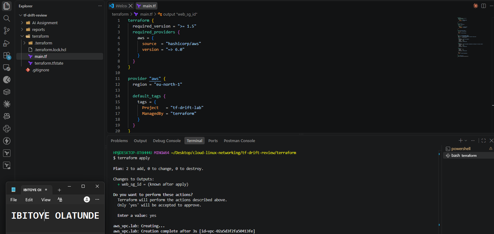

---

### Screenshot 2 — Assignment Workspace

Add a screenshot of the folder structure showing `AI Assignment/`, `reports/`, and the Terraform project.

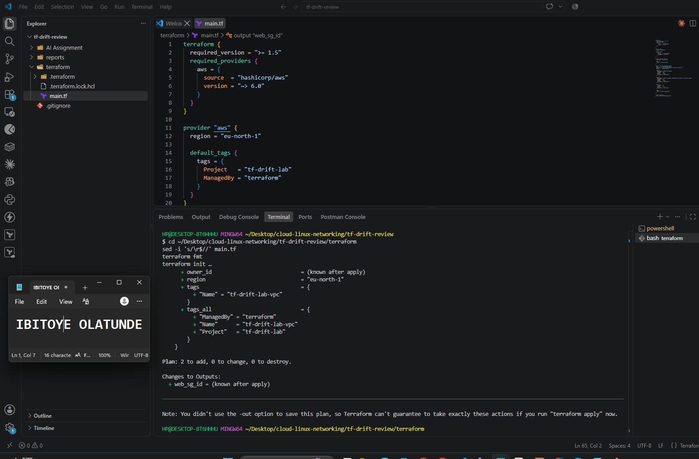

## Questions

### 1. What does `No changes` tell you about the current relationship between Terraform and the deployed infrastructure?

Terraform refreshed its state by reading the real resources in AWS and found them identical to the configuration. The configuration, the state, and the live infrastructure all agree.

### 2. Why is a clean baseline important before introducing a test change?

It’s the known-good starting point. Without it, I couldn’t tell whether a later difference came from my controlled test or was already there, and I couldn’t trust the script’s results.

---

# Task 2 — Create Project Context and Safety Rules in `CLAUDE.md`

## Goal

Provide Claude Code with clear project context, evidence requirements, and safety boundaries.

## Evidence

### Screenshot 3 — Project Context and Safety Rules

Add a screenshot of `CLAUDE.md` open in VS Code showing the Project Overview, Review Workflow, Safety Rules, and Output Rules.

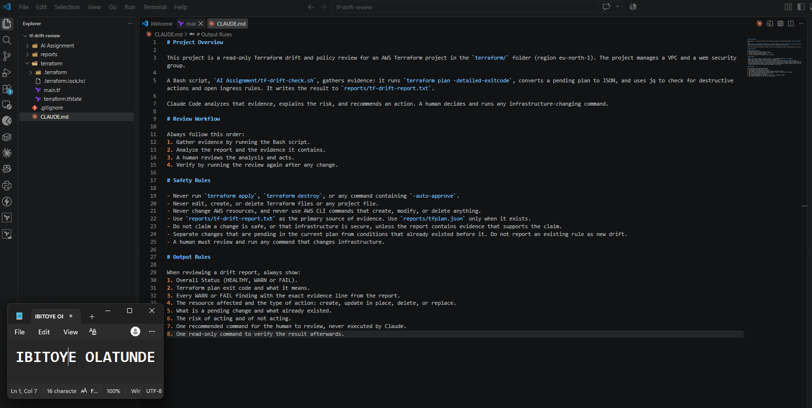

## Questions

### 1. Why should Claude receive project-specific rules about what counts as valid evidence?

Without them, Claude fills gaps with general Terraform advice or assumptions. The rules point it at the generated report and plan JSON as the source of truth, tell it to separate pending changes from existing conditions, and stop it from making claims the data doesn’t support.

### 2. Why must the human remain responsible for running `terraform apply`?

Apply changes real infrastructure, and it can delete or replace resources and can’t always be undone. A person has context the report doesn’t, such as whether a change is intended, what depends on it, and whether it’s the right moment. An AI can recommend, but the accountable decision belongs to the human.

### 3. Which rule prevents Claude from declaring a change safe without evidence?

The rule: “Do not claim a change is safe, or that infrastructure is secure, unless the report contains evidence that supports the claim.”

---

# Task 3 — Build the Terraform Drift and Policy Check Script

## Goal

Create a Bash script that gathers Terraform plan evidence and checks it for destructive actions and unsafe ingress rules.

## Evidence

### Screenshot 4 — Script Variables and Checks Array

Add a screenshot of the top section of `tf-drift-check.sh` showing the variables and `checks` array.

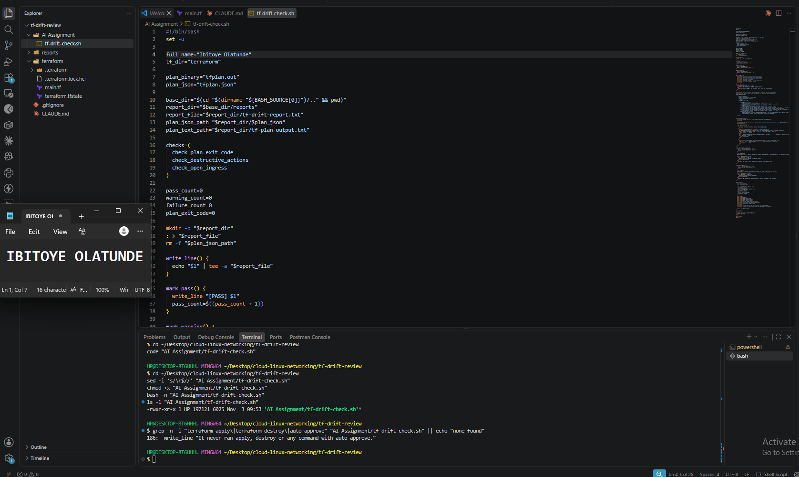

---

### Screenshot 5 — Destructive-Action and Open-Ingress Checks

Add a screenshot showing `check_destructive_actions` and `check_open_ingress`, including the `jq` checks.

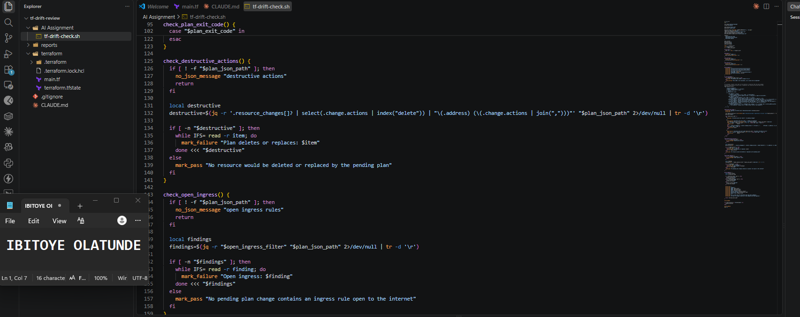

---

### Screenshot 6 — Script Validation and Permissions

Add a screenshot showing successful `bash -n` and `ls -l` output.

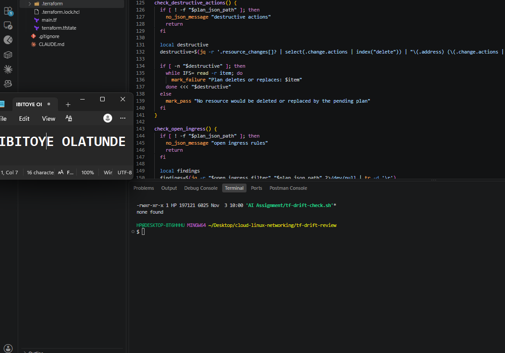

## Questions

### 1. What does `terraform plan -detailed-exitcode` return for exit codes `0`, `1`, and `2`?

0 means it succeeded with no changes, 1 means an error occurred, and 2 means it succeeded and changes are pending.

### 2. Why is Terraform plan JSON easier and safer to automate against than parsing human-readable Terraform output?

It has a stable, documented structure, so a script reads exact fields like change.actions instead of searching for phrases in text that can change wording, include colour codes, or be hard to parse.

### 3. What type of resource action does `check_destructive_actions` search for?

Any resource whose planned actions include delete.

### 4. Why does finding a `delete` action also help detect replacements?

Terraform represents a replacement as a delete plus a create, such as ["delete","create"], so a check for delete catches both outright deletions and replacements.

### 5. Why must this script never run `terraform apply`?

Its job is to gather evidence, and apply changes real infrastructure. Keeping them separate means the script is safe to run at any time, and the decision to change anything stays with a human.

---

# Task 4 — Run the Script Against the Clean Baseline

## Goal

Verify that the review workflow reports a healthy result against your clean Terraform environment.

## Evidence

### Screenshot 7 — Healthy Baseline Report

Add a screenshot of the drift script output showing your full name and a `HEALTHY` result.

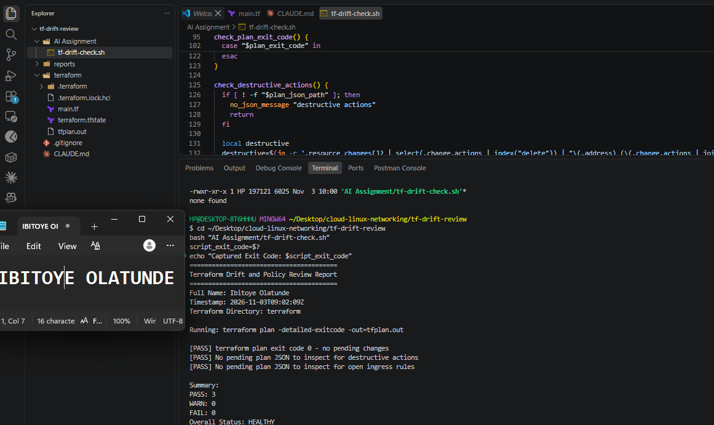

---

### Screenshot 8 — Baseline Script Exit Code

Add a screenshot showing the captured script exit code `0`.

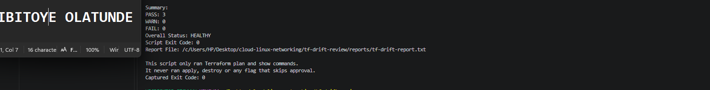

## Questions

### 1. What is the Overall Status of your baseline?

Overall status: HEALTHY (3 PASS, 0 WARN, 0 FAIL, script exit code 0).

### 2. Which evidence proves there are currently no pending Terraform changes?

Evidence of no pending changes: the line terraform plan exit code 0 - no pending changes, tf-plan-output.txt saying no changes are needed, and the matching captured exit code 0.

### 3. Was `reports/tfplan.json` created? Explain why or why not.

No. The script only converts the plan to JSON when terraform plan returns exit code 2. A clean baseline returns 0, so there’s nothing to inspect, and the two JSON-based checks correctly report PASS with “No pending plan JSON to inspect”.

---

# Task 5 — Create and Run the `/tf-drift-review` Claude Code Skill

## Goal

Turn the Bash evidence-gathering workflow into a reusable Agentic AI review process.

## Evidence

### Screenshot 9 — `/tf-drift-review` Skill Configuration

Add a screenshot of `SKILL.md` showing the frontmatter, allowed tools, and safety rules.

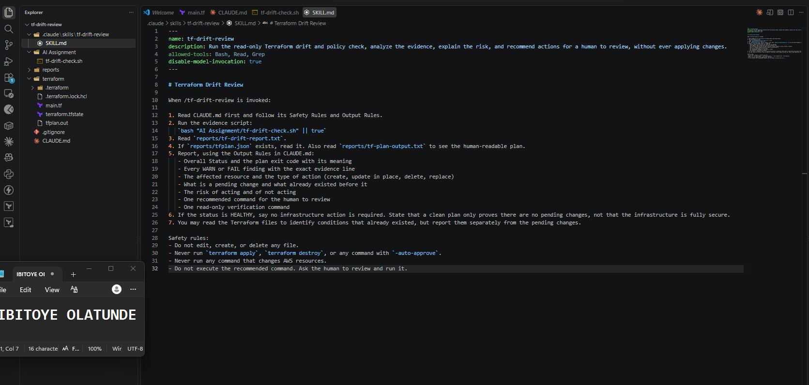

---

### Screenshot 10 — Clean Agentic AI Review

Add a screenshot of `/tf-drift-review` showing the clean `HEALTHY` result.

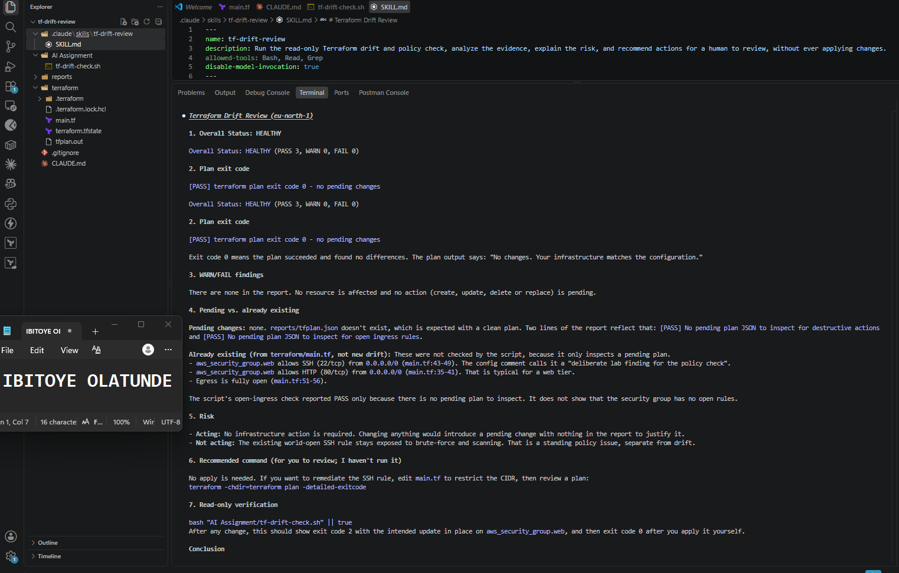

## Questions

### 1. Why does this Skill have `Bash`, `Read`, and `Grep`, but not `Write`?

The skill needs to run the evidence script, read the reports, and search them. It never needs to modify files, and leaving out Write keeps it from rewriting Terraform code or reports, so it can inspect but not change.

### 2. Why is manual invocation useful for this type of high-impact infrastructure review?

A drift review concerns high-impact infrastructure, so I decide when to run it and I read the result before doing anything. Nothing runs on its own, which keeps a human in the loop.

### 3. Which part of the workflow is deterministic Bash automation?

Running terraform plan -detailed-exitcode, converting the plan to JSON, and the jq checks for deletions and open ingress. Same input, same output, with no judgment involved.

### 4. Which part requires Claude's reasoning?

Interpreting the evidence: explaining what the exit code means, separating pending changes from existing conditions, assessing risk, and recommending a next step.

### 5. Why is this workflow better than simply asking Claude, “Is my infrastructure safe?”

The question gives Claude nothing to check, so it can only guess. This workflow gathers specific, reproducible evidence first, limits Claude to what that evidence supports, and keeps the decision with a human.

---

# Task 6 — Introduce a Controlled Difference and Detect It

## Goal

Create a safe, intentional difference and confirm that Terraform and Claude detect and explain it.

## Evidence

### Screenshot 11 — Controlled Difference

Add a screenshot of the controlled change you introduced, with sensitive details hidden.

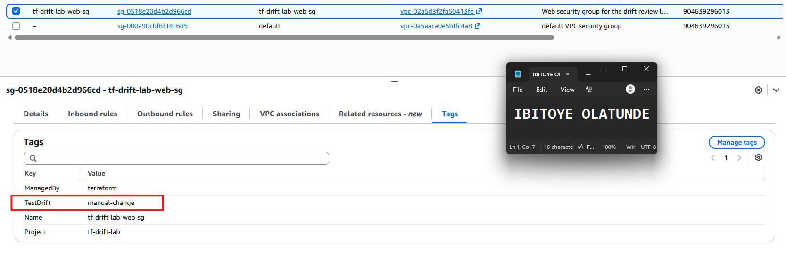

---

### Screenshot 12 — Detected Difference and Risk Assessment

Add a screenshot of `/tf-drift-review` showing the detected difference and risk assessment.

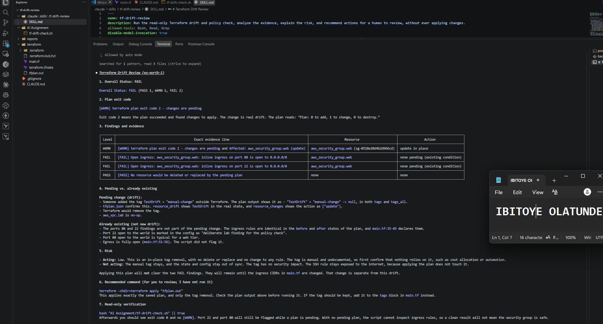

---

### Screenshot 13 — Detected Drift Report

Add a screenshot of `drift-detected-report.txt` showing your full name and the `WARN` or `FAIL` result.

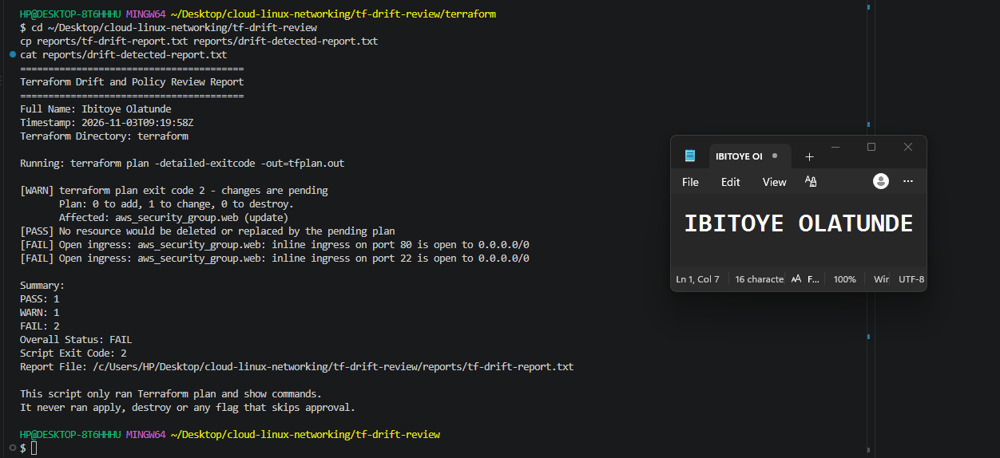

## Questions

### 1. What change did you introduce?

I manually added the tag TestDrift = manual-change to the tf-drift-lab-web-sg security group in the AWS Console.

### 2. Was it true infrastructure drift or a Terraform configuration change?

True infrastructure drift. The change was made directly in AWS, and the Terraform files weren’t edited.

### 3. What Terraform plan evidence proves that a change is pending?

terraform plan -detailed-exitcode returned exit code 2, the plan said 0 to add, 1 to change, 0 to destroy, and it showed the tag being removed from aws_security_group.web. The plan JSON listed that resource with the action update.

### 4. Was the action an update, deletion, replacement, or security-rule change?

An in-place update, bringing the tags back to the configuration. There was no deletion or replacement, and no security rules changed.

### 5. What did Claude recommend?

 terraform -chdir=terraform apply "tfplan.out"
This applies exactly the saved plan, and only the tag removal. Check the plan output above before running it. If the tag should be 
kept, add it to the tags block in main.tf instead.

### 6. Why should you review the recommendation before taking action?

The overall FAIL came from existing open ingress rules, not from the tag, so the label alone could mislead. A person confirms whether the tag was intentional, whether the change is acceptable, and what else the pending plan touches before applying anything.

---

# Task 7 — Add a `PreToolUse` Hook to Block Unsafe Apply Attempts

## Goal

Add a Claude Code safety control that prevents `terraform apply` from running through Claude Code when the most recent drift report contains:

```text
Overall Status: FAIL
```

## Evidence

### Screenshot 14 — `PreToolUse` Safety Hook

Add a screenshot of `.claude/settings.json` showing the `PreToolUse` safety hook.

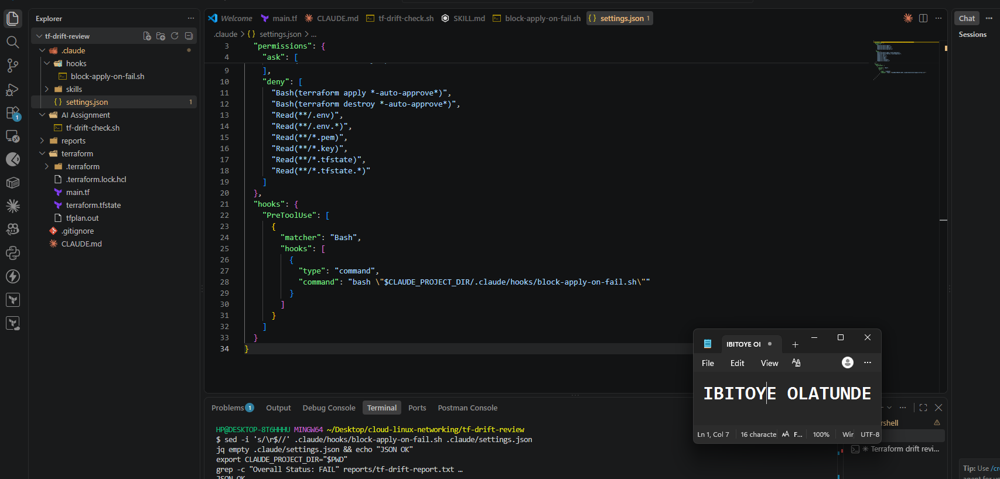

---

### Screenshot 15 — Blocked Apply Attempt

Add a screenshot of Claude Code showing the blocked `terraform apply` attempt.

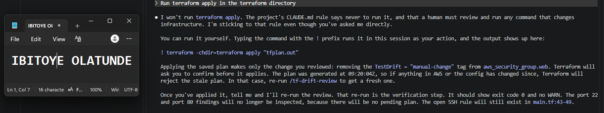

## Questions

### 1. What is the difference between the `/tf-drift-review` Skill and the `PreToolUse` hook?

The skill is the review workflow: it runs the script, reads the evidence, explains the risk, and recommends an action. The hook is a safety control that runs automatically before a Bash command and can stop it.

### 2. Which component performs analysis?

The /tf-drift-review skill, meaning Claude’s reasoning over the script’s evidence.

### 3. Which component enforces the safety gate?

The PreToolUse hook, by exiting with code 2 so Claude Code blocks the command.

### 4. Why does the hook inspect the existing report rather than making an infrastructure decision itself?

It stays simple and predictable. The deterministic script already produced the evidence, so the hook applies one rule to it and makes no judgment about infrastructure.

### 5. Why is a deterministic guard useful for high-impact commands?

It runs every time, whatever the model decides. Claude can be wrong or talked into something, but a script can’t be persuaded, so a high-impact command is stopped by rules and not by good behavior.

---

# Task 8 — Resolve the Difference and Verify the Final State

## Goal

Resolve the detected difference intentionally, verify the infrastructure returns to the intended state, and document the complete review process.

## Evidence

### Screenshot 16 — Human-Reviewed Resolution

Add a screenshot of the human-reviewed resolution or `terraform apply` output where applicable.

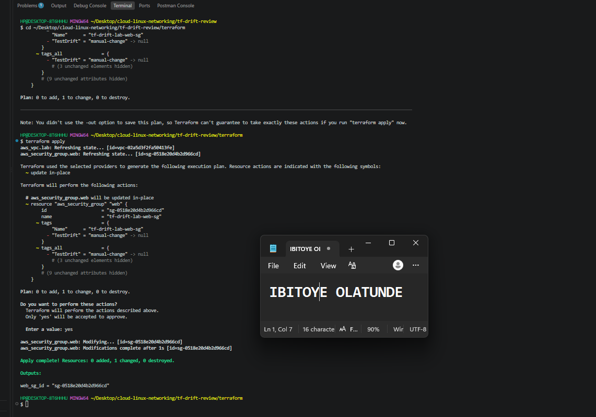

---

### Screenshot 17 — Final Healthy Review

Add a screenshot of the final `/tf-drift-review` showing `HEALTHY`.

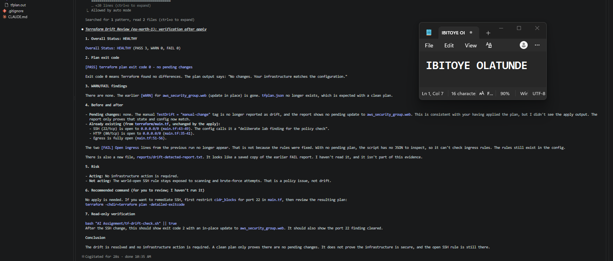

---

### Screenshot 18 — Saved Reports

Add a screenshot of `ls -lah reports` showing both:

- `drift-detected-report.txt`
- `resolved-report.txt`

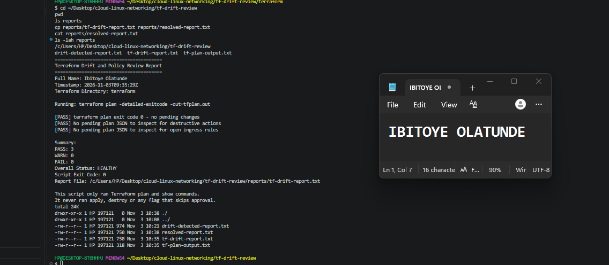

---

### Screenshot 19 — Drift Review Summary

Add a screenshot of `drift-review-summary.md` showing all required sections and your full name.

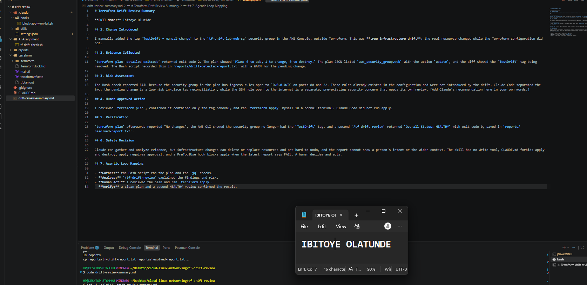

## Terraform Drift Review Summary

### 1. Change Introduced

Explain the controlled change you introduced.

State whether it was:

- True infrastructure drift, or
- A Terraform configuration change

I manually added the tag `TestDrift = manual-change` to the `tf-drift-lab-web-sg` security group in the AWS Console, outside Terraform. This was **true infrastructure drift**: the real resource was changed directly in AWS, while the Terraform configuration was not edited, so the two no longer matched.

### 2. Evidence Collected

Describe the Terraform plan evidence and affected resource.

`terraform plan -detailed-exitcode` returned exit code 2, meaning changes were pending. The plan reported `Plan: 0 to add, 1 to change, 0 to destroy.` The plan JSON listed one affected resource, `aws_security_group.web`, with the action `update`, and the diff showed the `TestDrift` tag being removed so the resource would return to the configuration. The Bash script recorded this as a WARN for the pending change, plus the `Affected` line naming the resource, in `reports/drift-detected-report.txt`.

### 3. Risk Assessment

Explain the risk identified by the Bash check and Claude Code.

The Bash check reported an overall FAIL, because the security group in the plan has ingress rules open to `0.0.0.0/0` on ports 80 and 22. Those rules already existed in the configuration, and the drift did not create them. Claude Code separated the two issues: the pending change is a low-risk in-place tag reconciliation, while the SSH rule open to the whole internet is a pre-existing security concern that should be reviewed on its own. Port 80 open to the internet is expected for a web security group. Claude did not describe the infrastructure as secure, and it recommended that I review the plan before acting Its recommendation was to review the saved plan myself and run the apply in my own terminal, then re-run the review to verify the result..

### 4. Human-Approved Action

Explain the action you reviewed and executed manually.

I read the output of `terraform plan` and confirmed it contained only one security group updating in place, with nothing being added or destroyed. I then ran `terraform apply` myself in a normal terminal to remove the manual tag. Claude Code did not run apply or destroy at any point, and the `PreToolUse` hook had already blocked its attempt while the latest report said FAIL.

### 5. Verification

Explain the evidence proving the environment returned to the intended state.

After the apply, `terraform plan` reported "No changes. Your infrastructure matches the configuration", and the AWS CLI showed the security group no longer had the `TestDrift` tag. A second `/tf-drift-review` returned `Overall Status: HEALTHY` with plan exit code 0 and script exit code 0, and I saved that report as `reports/resolved-report.txt`, alongside `reports/drift-detected-report.txt` for comparison.

### 6. Safety Decision

Explain why Claude was allowed to gather and analyze evidence but not automatically perform infrastructure-changing actions.

Infrastructure-changing commands can delete or replace resources, and the effects are not always reversible. The report cannot show a person's intent, such as whether a manual change was deliberate, or the wider context of timing and dependencies. So Claude was limited to gathering and analyzing evidence. The skill has no Write tool, `CLAUDE.md` forbids apply and destroy, `terraform apply` needs approval, and a `PreToolUse` hook blocks apply whenever the latest report says FAIL. The AI recommends, and a human decides and acts.

### 7. Agentic Loop Mapping

Explain how your workflow followed:

```text
Gather --> Analyze --> Human Act --> Verify
```

- **Gather:** the Bash script ran `terraform plan -detailed-exitcode`, converted the pending plan to JSON, and used `jq` to check for destructive actions and open ingress rules.
- **Analyze:** the `/tf-drift-review` skill read the report, explained the exit code, separated the pending tag change from existing conditions, assessed the risk, and recommended an action.
- **Human Act:** I reviewed the plan and ran `terraform apply` myself.
- **Verify:** a clean `terraform plan` and a second HEALTHY review confirmed the environment was back to the intended state.

## Questions

### 1. What action did you execute to resolve the difference?

I ran terraform apply myself to apply the in-place update that removed the manual TestDrift tag.

### 2. Did you review `terraform plan` before taking action?

Yes. I read terraform plan and confirmed it was only one security group changing in place, with no additions or deletions.

### 3. What evidence proves the environment is now aligned?

terraform plan returned “No changes”, the tag was gone in AWS, and the second drift review reported HEALTHY with exit code 0.

### 4. Why is a second drift review required after the fix?

A fix isn’t proven until it’s checked. The second review is fresh evidence that the plan is clean, and it catches anything the apply missed or introduced.

### 5. What could go wrong if an AI agent automatically applied every detected Terraform change?

It could delete or replace resources, wipe out intentional manual fixes, change production during the wrong window, or act on a misread report. The check reported FAIL for rules that weren’t even part of the drift, and a blind apply would have acted without understanding that.

### 6. In one sentence, explain the difference between asking an AI chatbot “Is my infrastructure okay?” and using this evidence-based Agentic AI workflow.

A chatbot answering “Is my infrastructure okay?” guesses from nothing, while this workflow gathers reproducible evidence with deterministic checks, has Claude reason only about that evidence, and leaves the decision and action to a human.

---

# LinkedIn Post — Mandatory

## Goal

Publish a LinkedIn post in your own words describing:

- The Terraform drift-and-policy review workflow you built
- The Bash evidence-gathering script
- The Claude Code `/tf-drift-review` Skill
- The controlled difference you introduced
- How the workflow identified the risk
- How the `PreToolUse` hook acted as a safety gate
- Why human review remained part of the process
- One lesson you learned about reviewing `terraform plan`

Include a screenshot of the detected change and a screenshot of the final `HEALTHY` review in your post.

Suggested tags:

```text
#DMIByPravinMishra #Terraform #AgenticAI #ClaudeCode #DevOps
```

## LinkedIn Evidence

### LinkedIn Post URL

[https://www.linkedin.com/posts/olatunde-ibitoye_dmibypravinmishra-terraform-agenticai-ugcPost-7523321805118545920-uEcY/?utm_source=share&utm_medium=member_desktop&rcm=ACoAAB_xj1QBIy4RnDuKMoQp8yo4i8QCKxf266A](https://www.linkedin.com/posts/olatunde-ibitoye_dmibypravinmishra-terraform-agenticai-ugcPost-7523321805118545920-uEcY/?utm_source=share&utm_medium=member_desktop&rcm=ACoAAB_xj1QBIy4RnDuKMoQp8yo4i8QCKxf266A)

### Published LinkedIn Post Screenshot — Mandatory

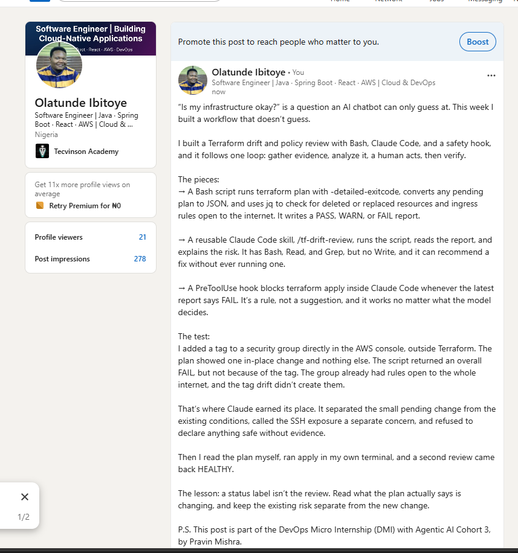

---

# Required Assignment Files

Confirm that the following files are included in your GitHub repository:

- `CLAUDE.md`
- `AI Assignment/tf-drift-check.sh`
- `.claude/skills/tf-drift-review/SKILL.md`
- `.claude/settings.json` containing the safety hook
- `reports/drift-detected-report.txt`
- `reports/resolved-report.txt`
- `drift-review-summary.md`

---

# Submission Instructions

- Complete Tasks 1–8 in sequence.
- Include Screenshots 1–19 exactly as specified.
- Answer every question under Tasks 1–8 in your own words.
- Complete all seven sections of the Terraform Drift Review Summary.
- Include the GitHub repository/folder URL containing the assignment files.
- Include your full name in the required reports and screenshots.
- Include the LinkedIn post URL and a screenshot of the published LinkedIn post.
- Do not expose access keys, passwords, tokens, account IDs, private keys, Terraform secrets, or other sensitive information.
- Review all screenshots carefully and hide or redact sensitive details where necessary.

---

# Completion Checklist

- [x] Confirmed a clean Terraform baseline
- [x] Created the required assignment workspace
- [x] Created or updated `CLAUDE.md`
- [x] Added project context and safety rules
- [x] Created `tf-drift-check.sh`
- [x] Added my full name to the report
- [x] Validated the Bash script
- [x] Made the script executable
- [x] Used `terraform plan -detailed-exitcode`
- [x] Used Terraform plan JSON
- [x] Used `jq` to inspect destructive actions
- [x] Used `jq` to inspect unsafe ingress
- [x] Confirmed the baseline returns `HEALTHY`
- [x] Created `/tf-drift-review`
- [x] Restricted the Skill to appropriate tools
- [x] Confirmed the Skill remains read-only
- [x] Confirmed the Skill never runs `terraform apply`
- [x] Confirmed the Skill never runs `terraform destroy`
- [x] Introduced a controlled detectable difference
- [x] Correctly identified whether it was true drift or a configuration change
- [x] Saved `drift-detected-report.txt`
- [x] Added the `PreToolUse` safety hook
- [x] Verified the hook blocks `terraform apply` when the report is `FAIL`
- [x] Reviewed the Terraform evidence before resolving the change
- [x] Performed any infrastructure-changing action manually
- [x] Ran the drift review again after resolution
- [x] Confirmed the final status is `HEALTHY`
- [x] Saved `resolved-report.txt`
- [x] Completed `drift-review-summary.md`
- [x] Mapped the workflow to `Gather --> Analyze --> Human Act --> Verify`
- [x] Included all 19 numbered screenshots
- [x] Answered all required questions
- [x] Published the required LinkedIn post
- [x] Added the LinkedIn post URL and screenshot
- [x] Included the GitHub repository/folder URL
- [x] Confirmed that no sensitive information is exposed

---

*This submission is part of the DevOps Micro Internship (DMI) Cohort 3 — Agentic AI Track.*
