# Assignment 02 — Provision Linux VMs with Terraform and Run Ansible Ad-Hoc Commands

Part of the DevOps Micro Internship (DMI) with Agentic AI

---

## Purpose

In this assignment, you will use Terraform to provision three or four Ubuntu Linux Virtual Machines on either Microsoft Azure or Amazon Web Services.

You will configure SSH key-based authentication, organize the servers using a custom Ansible inventory, and run Ansible ad-hoc commands across individual hosts and inventory groups.

---

# Task 1 — Create the Multi-Host Lab Structure

## Goal

Create a separate project directory for the multi-host lab and prepare the Terraform, Ansible, and documentation files.

This project will use the Git repository and Ansible controller prepared in Assignment 01.

### Evidence

#### Screenshot 1 — Terminal showing the complete `ansible-adhoc-lab` project structure

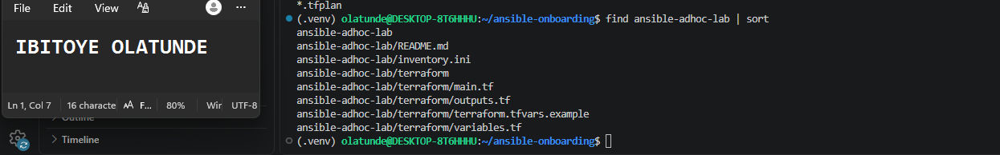

---

#### Screenshot 2 — Terminal showing `git status --short` with the new project files and updated `.gitignore`

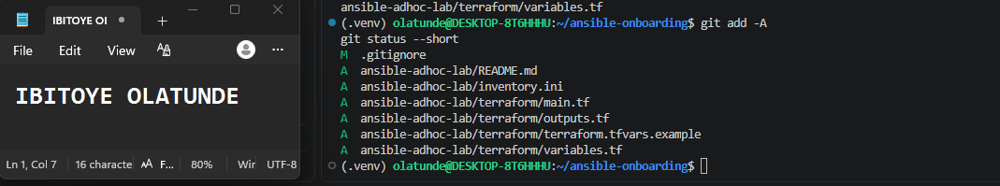

---

### Notes

I created a separate project folder, `ansible-adhoc-lab/`, inside the Git repository from Assignment 01, so the lab reuses the same repository history, virtual environment and Ansible controller. The folder separates the infrastructure code from the Ansible files: Terraform files (`main.tf`, `variables.tf`, `outputs.tf` and a `terraform.tfvars.example`) live in `terraform/`, and the inventory and README sit beside it.

Before adding any files, I updated `.gitignore` to exclude Terraform's local files: the `.terraform/` folder, state files, plan files, and any real `.tfvars` file. State files and variable files can contain IP addresses and other sensitive values, so they must never be committed. Only `terraform.tfvars.example`, which holds placeholder values, is tracked.

I staged the new files without committing them so that `git status --short` shows exactly what the lab adds: the updated `.gitignore` and the five new project files.

---

# Task 2 — Create the Terraform Configuration

## Goal

Create the Terraform configuration required to provision three or four Ubuntu Linux VMs on your selected cloud platform.

Complete only one option:

- Option A — Microsoft Azure
- Option B — Amazon Web Services

Do not configure both providers for this assignment.

### Evidence

#### Screenshot 3 — Terraform configuration showing the three or four server roles and the `for_each` or `count` implementation

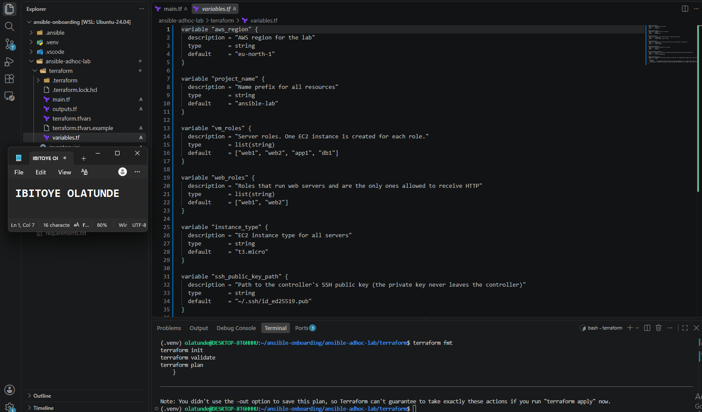

---

#### Screenshot 4 — Terraform configuration showing SSH restricted to the controller IP and HTTP allowed only for web hosts

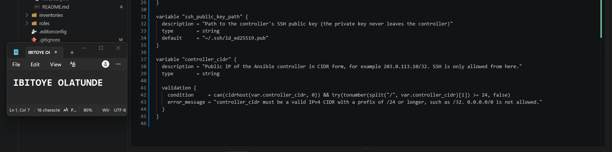

---

#### Screenshot 5 — Terraform output configuration showing how public IP addresses are associated with the server roles

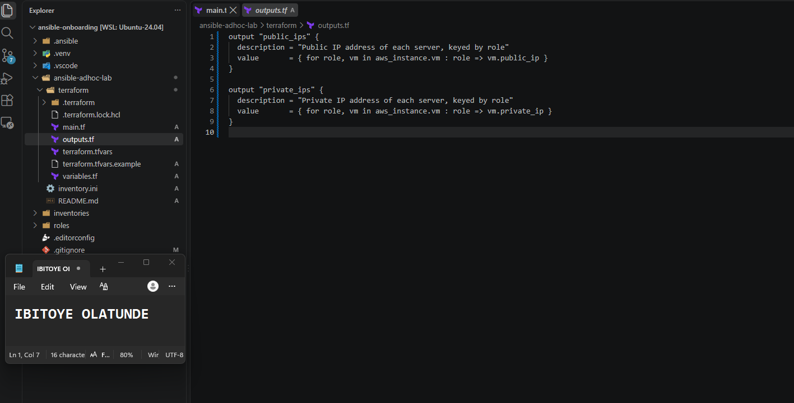

---

### Notes

I chose AWS (Option B) and used for_each over a vm_roles list to create four servers (web1, web2, app1, db1), so one resource block produces four instances, each named and tagged by role. The network is created once and shared. SSH is allowed only from my controller’s public IP, set in a git-ignored terraform.tfvars and validated so it can’t be opened to the whole internet. HTTP is allowed only through the web security group, which Terraform attaches only to roles listed in web_roles. The controller_cidr validation rejects 0.0.0.0/0. The instances use IMDSv2 and encrypted root volumes. The outputs return the public and private IP of each server, keyed by role, ready to build the Ansible inventory.

---

# Task 3 — Provision the Infrastructure with Terraform

## Goal

Initialize and validate the Terraform configuration, review the execution plan, provision the selected three or four VMs, and retrieve their public IP addresses.

### Evidence

#### Screenshot 6 — Final `terraform apply` output showing `Apply complete`

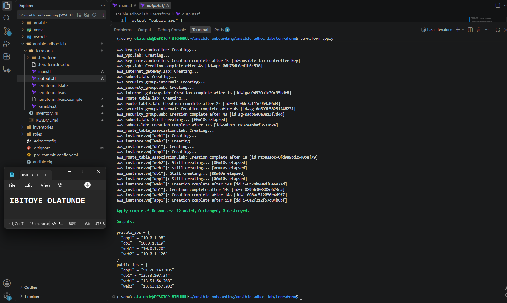

---

#### Screenshot 7 — `terraform output public_ips` showing the role-to-IP mapping for all three or four VMs

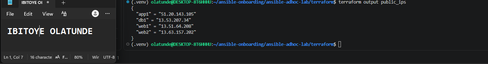

---

#### Screenshot 8 — Azure Portal or AWS Management Console showing all three or four VMs in the `Running` state, with their role-based names visible

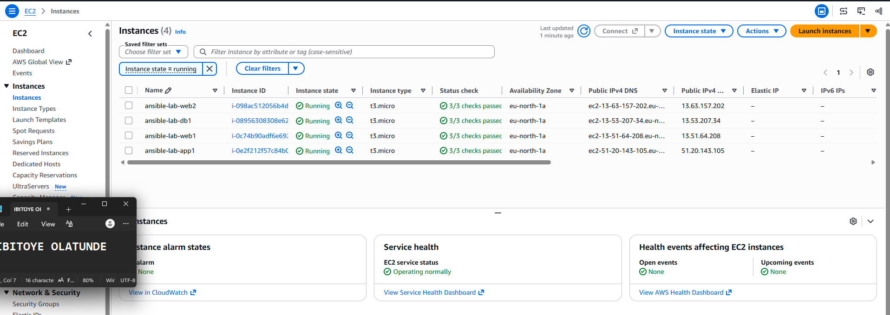

---

### Notes

I initialized the working directory, validated the configuration, and reviewed a plan of 12 resources before applying. I confirmed the plan matched the design: two security groups, with SSH limited to my controller’s public IP and HTTP only on the web group, and four instances created from one for_each. After terraform apply, all four servers were running, and terraform output public_ips returned a role-to-IP map for web1, web2, app1 and db1. I confirmed the same four servers, named by role, in the EC2 console.

---

# Task 4 — Verify SSH Key-Based Access

## Goal

Verify that each managed VM can be accessed from the Ansible controller using SSH key-based authentication.

### Evidence

#### Screenshot 9 — Terminal showing successful SSH hostname output from all VMs

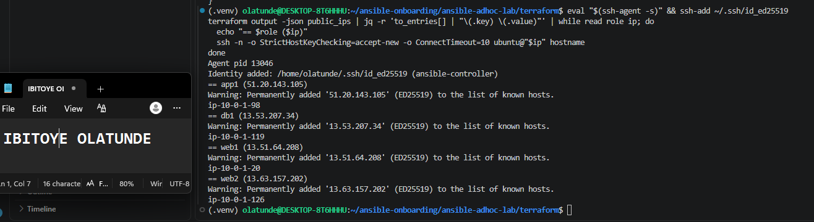

---

### Notes

SSH timed out to all four servers on my first attempt, even though the instances were running and passing status checks. I compared my current public IP with the controller_cidr I had applied, and found my IP had changed since the apply, so the security groups were correctly dropping my traffic. I updated terraform.tfvars, and terraform plan showed only the two security groups changing in place, with nothing replaced. After applying, all four hosts returned their hostnames over key authentication with no password prompt. The lesson is that restricting SSH to a single controller IP is secure but brittle when the controller’s public address changes, so the IP has to be rechecked.

---

# Task 5 — Create the Custom Ansible Inventory

## Goal

Create an Ansible inventory file that groups the managed VMs by role.

The inventory allows Ansible to run commands against all servers, or only specific groups such as `web`, `app`, or `db`.

### Evidence

#### Screenshot 10 — `inventory.ini` showing the `web`, `app`, and `db` groups

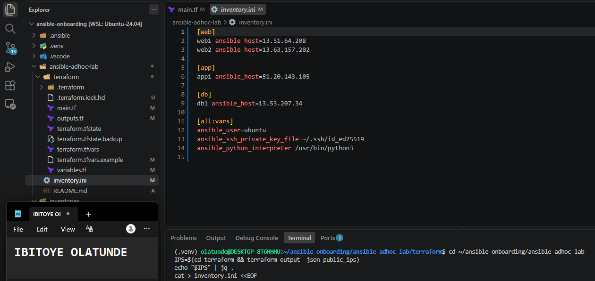

---

#### Screenshot 11 — Output of `ansible-inventory -i inventory.ini --graph`

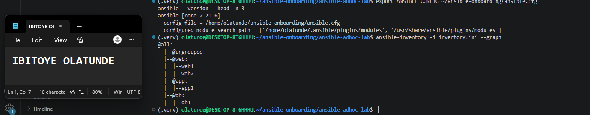

---

### Notes

I generated inventory.ini from Terraform’s public_ips output with jq, so no IP address was typed by hand. The file defines three groups matching the server roles: web (web1, web2), app (app1) and db (db1). Each host is named by its role, with the real address in ansible_host, so Ansible’s output identifies servers by role. Shared connection settings (the ubuntu user, the controller’s private key and the Python path) are defined once under [all:vars]. Grouping means a command can target one role, such as ansible web ..., or every server with ansible all .... Because Ansible only reads ansible.cfg from the current folder, I pointed ANSIBLE_CONFIG at the Assignment 01 configuration so this lab reuses the same controller settings.

---

# Task 6 — Run Ansible Ad-Hoc Commands

## Goal

Run Ansible ad-hoc commands from the controller to verify connectivity, check server information, and manage packages and services across inventory groups.

This task proves that the inventory is working and that Ansible can control multiple managed VMs without writing a playbook.

### Evidence

#### Screenshot 12 — Output of `ansible all -i inventory.ini -m ping`

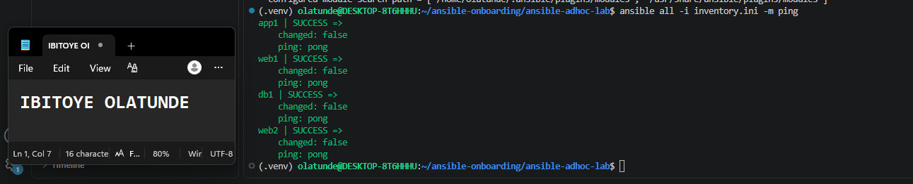

---

#### Screenshot 13 — Output of `ansible all -i inventory.ini -m command -a "uptime"`

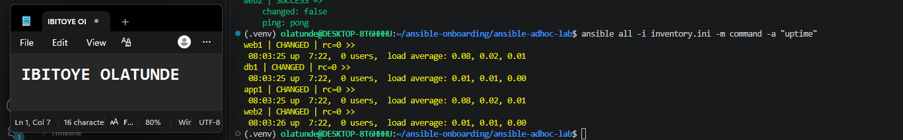

---

#### Screenshot 14 — Output of `ansible web -i inventory.ini -m apt -a "name=nginx state=present update_cache=yes" --become`

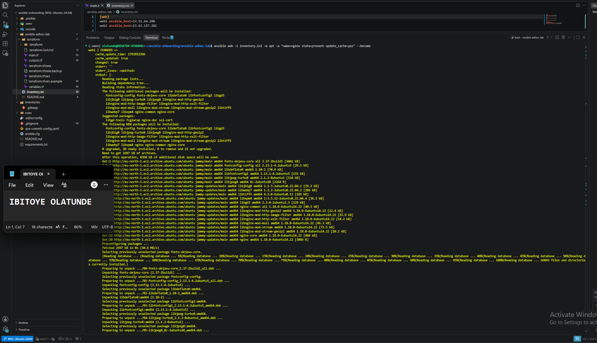

---

#### Screenshot 15 — Output of `ansible web -i inventory.ini -m service -a "name=nginx state=started enabled=yes" --become`

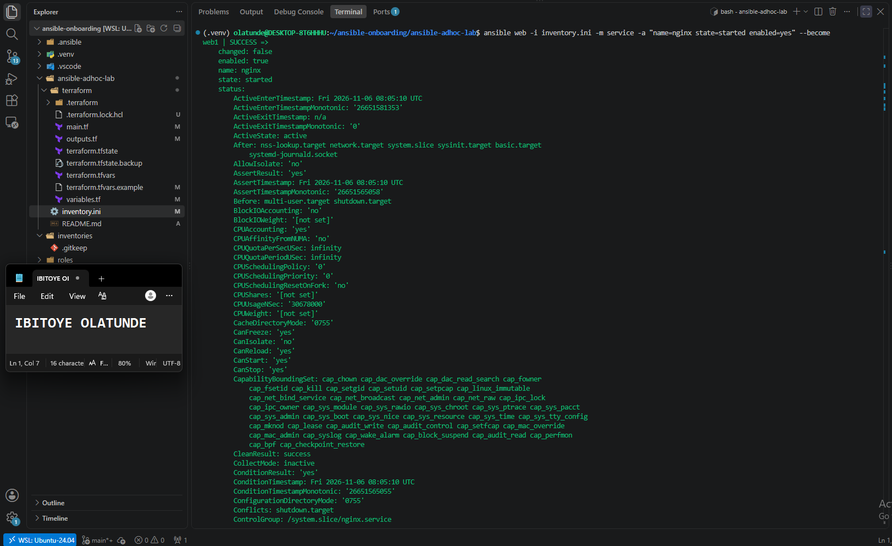

---

#### Screenshot 16 — Output of `ansible all -i inventory.ini -m apt -a "name=htop state=present update_cache=yes" --become`

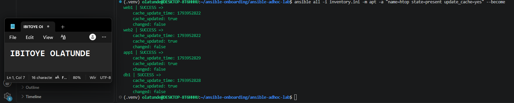

---

#### Screenshot 17 — Output of `ansible web -i inventory.ini -m command -a "systemctl is-active nginx"`

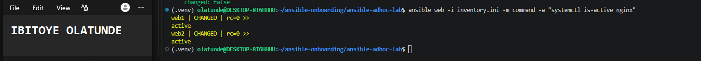

---

### Notes

I ran six ad-hoc commands from the controller against the inventory. ping returned pong from all four servers, proving that SSH, the key and Python all work. uptime ran on every host through the command module. I installed Nginx only on the web group, which showed that Ansible targets groups independently, then confirmed with systemctl is-active nginx that both web servers reported active. I installed htop across all hosts. The apt and service modules are idempotent: running them again reports changed: false because the desired state already exists, whereas the command module always reports a change because Ansible can’t know what the command did.

---

# LinkedIn Post Required

## Evidence

#### LinkedIn Post URL

Paste your LinkedIn post URL here:

`https://www.linkedin.com/posts/olatunde-ibitoye_dmibypravinmishra-ansible-terraform-share-7524389442556653568-S0MU/?utm_source=share&utm_medium=member_desktop&rcm=ACoAAB_xj1QBIy4RnDuKMoQp8yo4i8QCKxf266A`

---

#### Screenshot — Published LinkedIn post

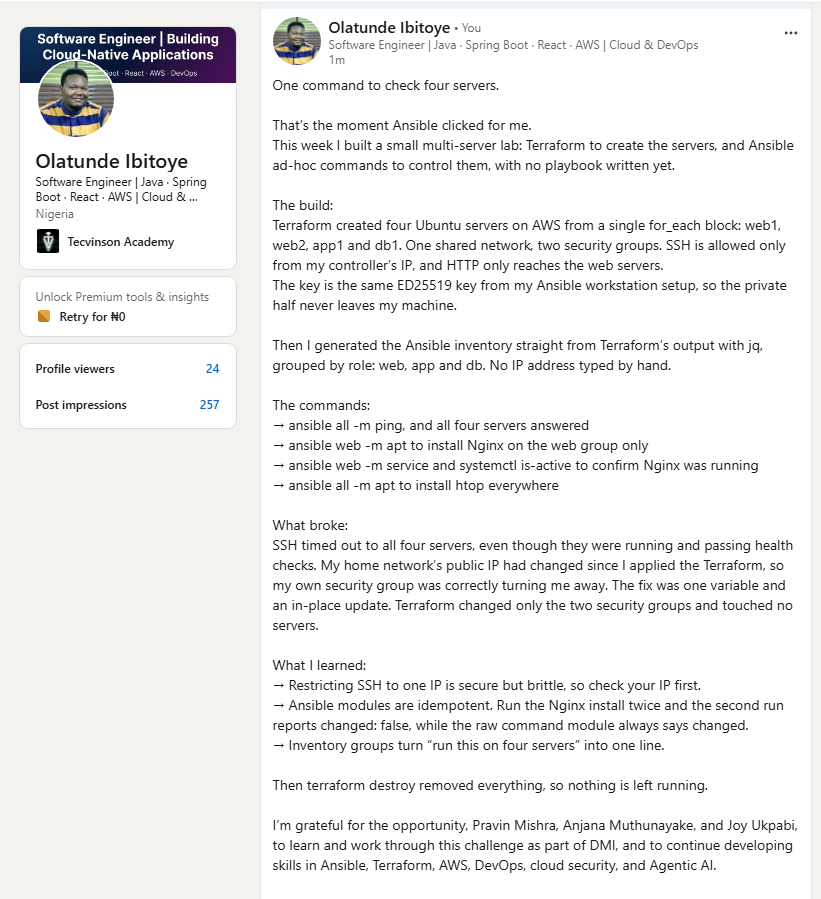

---

# Assignment Questions

Answer the following in your own words:

**1. What is the purpose of an Ansible inventory file?**

An inventory tells Ansible which servers it manages and how to reach them. It lists the hosts, organizes them into groups, and holds connection settings such as the login user and the private key. Without it, Ansible would have no idea where to run a command. In my lab, `inventory.ini` listed my four AWS servers by name and address, and let me target them in different ways: a single command can address one group or every server.

---

**2. What is the difference between the `web`, `app`, and `db` groups in your inventory?**

Each group represents a server role. The `web` group holds `web1` and `web2`, the servers that serve web traffic, and they are the only ones whose security group allows HTTP. The `app` group holds `app1`, the application server, and the `db` group holds `db1`, the database server. Both of those only accept SSH from my controller. The groups let me run a command on just one role, for example installing Nginx with `ansible web ...` so it only lands on the web servers, or run something on everything with `ansible all ...`.

---

**3. What does the Ansible `ping` module verify?**

It's not an ICMP network ping. The `ping` module checks that Ansible can connect to the server over SSH, authenticate with its key, and run Python on the target, which is what most modules need. When a host replies `pong`, it proves the inventory entry, the network path, the SSH credentials and Python on the server are all working, so it's the first check to run before anything else.

---

**4. Why do package installation commands require `--become`?**

Installing software changes the whole system, so it needs administrator privileges. I connect as the normal `ubuntu` user, who can't write to the system package directories. `--become` tells Ansible to run the task with elevated privileges, like using `sudo`. Without it, `apt` would fail with a permission error, because a normal user isn't allowed to install packages or manage system services.

---

**5. When would you use an ad-hoc command instead of a playbook?**

I'd use an ad-hoc command for quick, one-off tasks that don't need to be repeated or kept: checking whether servers are reachable, looking at uptime, restarting a service, or installing one package on a group. A playbook is better for anything that should be repeatable, reviewed, versioned in Git, or made of several steps, such as configuring a server from scratch. Ad-hoc commands are fast but leave no record, while a playbook is a documented, reusable process.

---

**6. What is one challenge you faced while setting up SSH or inventory, and how did you fix it?**

My first SSH test timed out to all four servers, even though they were running and passing their status checks. The cause was my own security group: I had restricted SSH to my controller's public IP, but my IP had changed after I applied the Terraform. I compared my current IP against the one in `terraform.tfvars` and the security groups, updated the variable, and ran `terraform apply`. The plan showed only the two security groups changing in place, with no servers touched. After that, all four servers returned their hostnames over key authentication. It taught me that locking SSH to one IP is secure but brittle, so the IP has to be rechecked before each session.

---

# Required Files

Confirm that the following files are included in your assignment workspace:

- [ ] `ansible-adhoc-lab/README.md`
- [ ] `ansible-adhoc-lab/terraform/providers.tf`
- [ ] `ansible-adhoc-lab/terraform/main.tf`
- [ ] `ansible-adhoc-lab/terraform/variables.tf`
- [ ] `ansible-adhoc-lab/terraform/outputs.tf`
- [ ] `ansible-adhoc-lab/ansible/inventory.ini`
- [ ] Updated `.gitignore`

---

# Submission Instructions

- Add all required screenshots from the tasks.
- Full Name must be visible in required screenshots.
- Mention whether you used Azure or AWS.
- Mention whether you used the three-VM option or four-VM option.
- Add the public IP addresses of the VMs, redacted if preferred.
- Add your `inventory.ini` proof.
- Add a short explanation of what you learned.
- Answer all assignment questions clearly in your own words.
- Add your LinkedIn post URL.
- Do not expose SSH private keys, Terraform state files, cloud credentials, passwords, access keys, secret keys, account IDs, or subscription IDs.

---

# Completion Checklist

- [ ] Task 1: `ansible-adhoc-lab` project structure created
- [ ] Task 1: `.gitignore` updated for Terraform files
- [ ] Task 2: Terraform configuration created
- [ ] Task 2: Server roles defined for either three or four VMs
- [ ] Task 2: `count` or `for_each` used
- [ ] Task 2: SSH restricted to the controller public IP
- [ ] Task 2: HTTP allowed only for web hosts
- [ ] Task 2: Terraform output maps roles to public IPs
- [ ] Task 3: Terraform initialized successfully
- [ ] Task 3: Terraform configuration validated
- [ ] Task 3: Terraform apply completed successfully
- [ ] Task 3: All selected VMs are running
- [ ] Task 4: SSH key-based access works for every VM
- [ ] Task 5: `inventory.ini` contains `web`, `app`, and `db` groups
- [ ] Task 5: `ansible-inventory -i inventory.ini --graph` shows the correct groups
- [ ] Task 6: `ansible all -i inventory.ini -m ping` returns `SUCCESS`
- [ ] Task 6: Ad-hoc commands run successfully
- [ ] Task 6: `--become` was used for package and service tasks
- [ ] Task 6: Nginx is active on the `web` group
- [ ] Screenshots 1–17 are included
- [ ] Assignment questions are answered
- [ ] LinkedIn post published
- [ ] LinkedIn post URL added
- [ ] No sensitive information is exposed

---

## About DMI & CloudAdvisory

DevOps Micro Internship (DMI) is a project-based DevOps program run by Pravin Mishra and The CloudAdvisory, focused on real-world execution, systems thinking, and career readiness.

It helps learners build strong DevOps foundations with hands-on experience.

---

## Resources

- DMI Official Website: [https://dmi.pravinmishra.com?utm_source=github&utm_medium=readme](https://dmi.pravinmishra.com?utm_source=github&utm_medium=readme)
- University: [https://university.pravinmishra.com?utm_source=github&utm_medium=readme](https://university.pravinmishra.com?utm_source=github&utm_medium=readme)
- Discord Community: [https://discord.pravinmishra.com?utm_source=github&utm_medium=readme](https://discord.pravinmishra.com?utm_source=github&utm_medium=readme)
- Blog: [https://dmi.pravinmishra.com/blog?utm_source=github&utm_medium=readme](https://dmi.pravinmishra.com/blog?utm_source=github&utm_medium=readme)
- YouTube Playlist: [https://www.youtube.com/playlist?list=PLFeSNDtI4Cho](https://www.youtube.com/playlist?list=PLFeSNDtI4Cho)
- Pravin Mishra LinkedIn: [https://www.linkedin.com/in/pravin-mishra-aws-trainer/](https://www.linkedin.com/in/pravin-mishra-aws-trainer/)
- CloudAdvisory LinkedIn: [https://www.linkedin.com/company/thecloudadvisory/](https://www.linkedin.com/company/thecloudadvisory/)

---

*This submission is part of DevOps Micro Internship (DMI) — Agentic AI Track.*