# Assignment 03 — Deploy a Static Website to Multiple Servers Using a Multi-Play Ansible Playbook

Part of the DevOps Micro Internship (DMI) with Agentic AI

---

## Student Details

**Full Name:** Ibitoye Olatunde

**Cloud Platform Used:** AWS

**Server 1 URL:** `http://16.171.241.115`

**Server 2 URL:** `http://51.20.80.215`

---

## Purpose

In this assignment, you will create a multi-play Ansible playbook to install Nginx, deploy a static website to two Ubuntu servers, and verify that the website is accessible from both servers.

You may use either AWS EC2 instances or Azure Virtual Machines as your managed servers.

---

# Task 1 — Create the Project Structure

## Goal

Create the required folders and files for the Ansible project.

## Evidence

### Screenshot 1 — Terminal or VS Code showing the complete `static-web` project structure

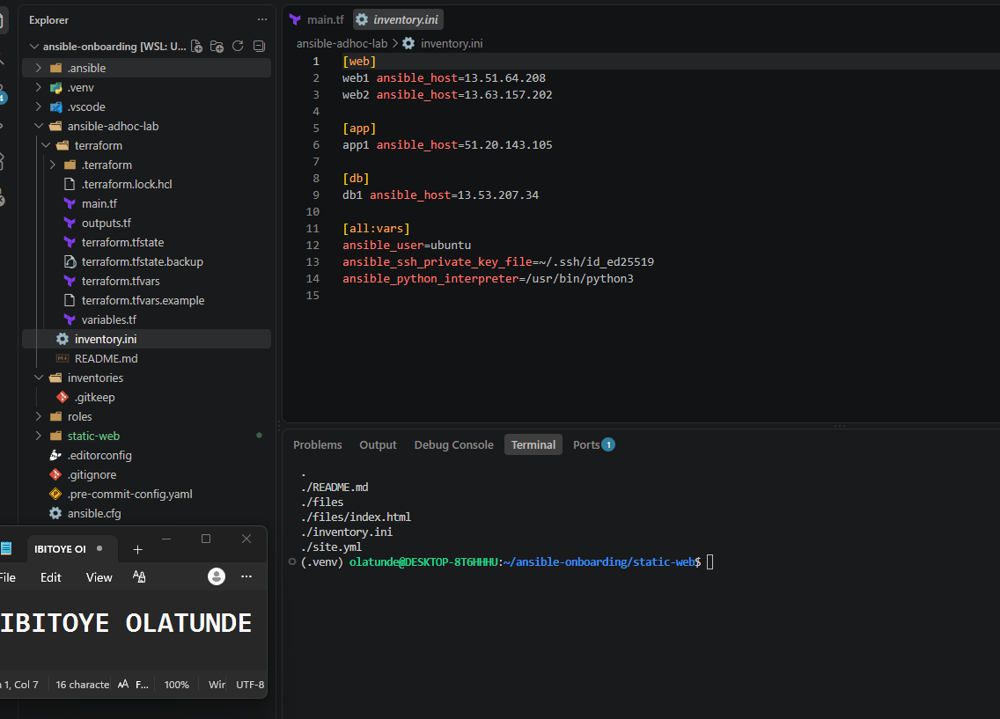

---

# Task 2 — Configure the Ansible Inventory

## Goal

Add both Ubuntu servers to the Ansible inventory.

## Evidence

### Screenshot 2 — Output of `ansible-inventory -i inventory.ini --graph` showing `web1` and `web2`

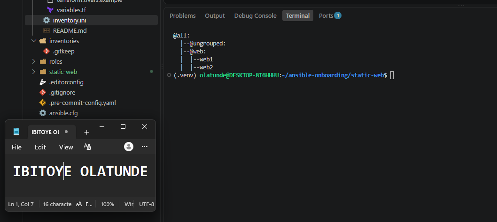

---

## Configuration File

Copy and paste the complete contents of your `inventory.ini` file below:

```ini
Add your inventory.ini content here.
```

---

# Task 3 — Verify Ansible Connectivity

## Goal

Confirm that the Ansible controller can connect to both servers.

## Evidence

### Screenshot 3 — Ansible ping output showing `SUCCESS` and `pong` for both servers

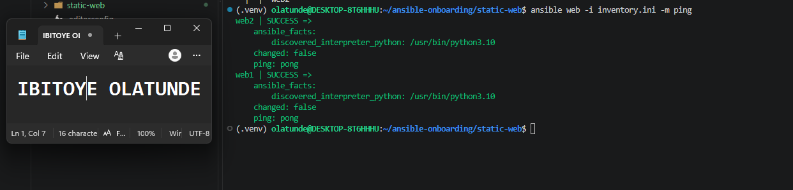

---

# Task 4 — Download and Personalize the Static Website

## Goal

Download `index.html` to the Ansible controller and personalize the website with your full name.

## Evidence

### Screenshot 4 — Edited `files/index.html` showing the footer line with your full name

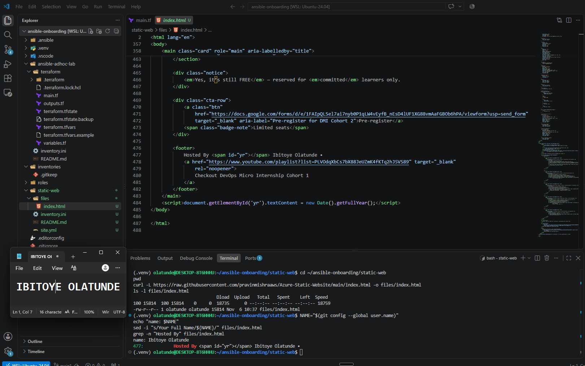

---

# Task 5 — Create the Multi-Play Ansible Playbook

## Goal

Create a single Ansible playbook containing separate plays for installation, deployment, and verification.

## Configuration File

Copy and paste the complete contents of your `site.yml` file below:

```yaml
---
- name: Install and configure Nginx
  hosts: web
  become: true
  tasks:
    - name: Update the APT package cache
      ansible.builtin.apt:
        update_cache: true
        cache_valid_time: 3600

    - name: Install Nginx
      ansible.builtin.apt:
        name: nginx
        state: present

    - name: Start and enable Nginx
      ansible.builtin.service:
        name: nginx
        state: started
        enabled: true

- name: Deploy the static website
  hosts: web
  become: true
  tasks:
    - name: Copy index.html to the web root
      ansible.builtin.copy:
        src: files/index.html
        dest: /var/www/html/index.html
        owner: www-data
        group: www-data
        mode: "0644"
      notify: Reload nginx

  handlers:
    - name: Reload nginx
      ansible.builtin.service:
        name: nginx
        state: reloaded

- name: Verify both websites from the controller
  hosts: localhost
  connection: local
  gather_facts: false
  become: false
  tasks:
    - name: Send an HTTP GET request to each web server
      ansible.builtin.uri:
        url: "http://{{ hostvars[item].ansible_host }}"
        status_code: 200
      loop: "{{ groups['web'] }}"
      register: website_checks

    - name: Confirm each server returned HTTP 200
      ansible.builtin.assert:
        that:
          - item.status == 200
        success_msg: "{{ item.item }} returned HTTP {{ item.status }}"
      loop: "{{ website_checks.results }}"
```

---

# Task 6 — Validate the Playbook Syntax

## Goal

Check the playbook for YAML or Ansible syntax errors before running it.

## Evidence

### Screenshot 5 — Successful syntax-check output showing `playbook: site.yml`

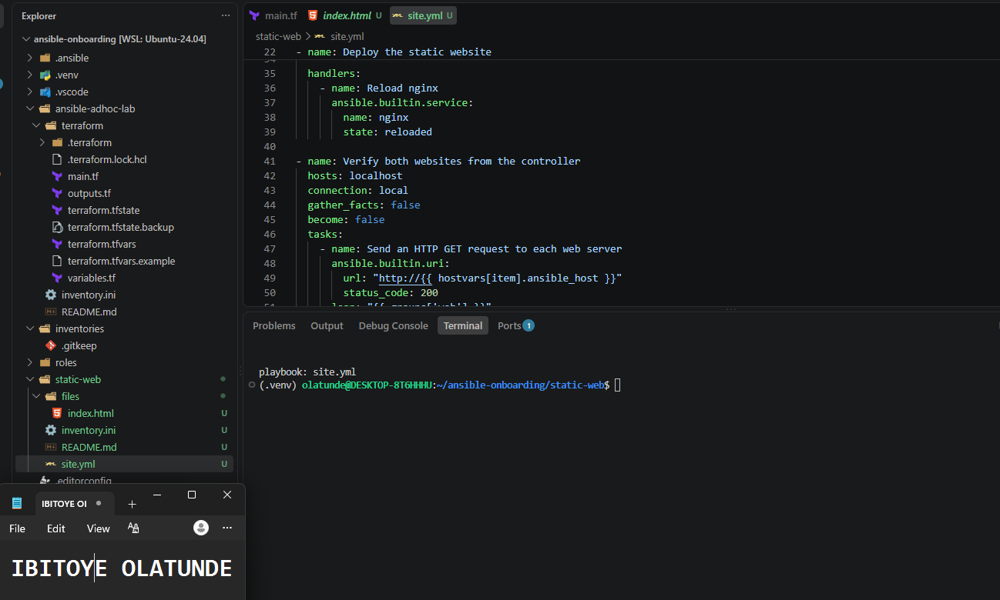

---

# Task 7 — Run the Multi-Play Playbook

## Goal

Install Nginx, deploy the website, and verify both servers in one playbook run.

## Evidence

### Screenshot 6 — Play 3 verification showing HTTP `200` for both servers

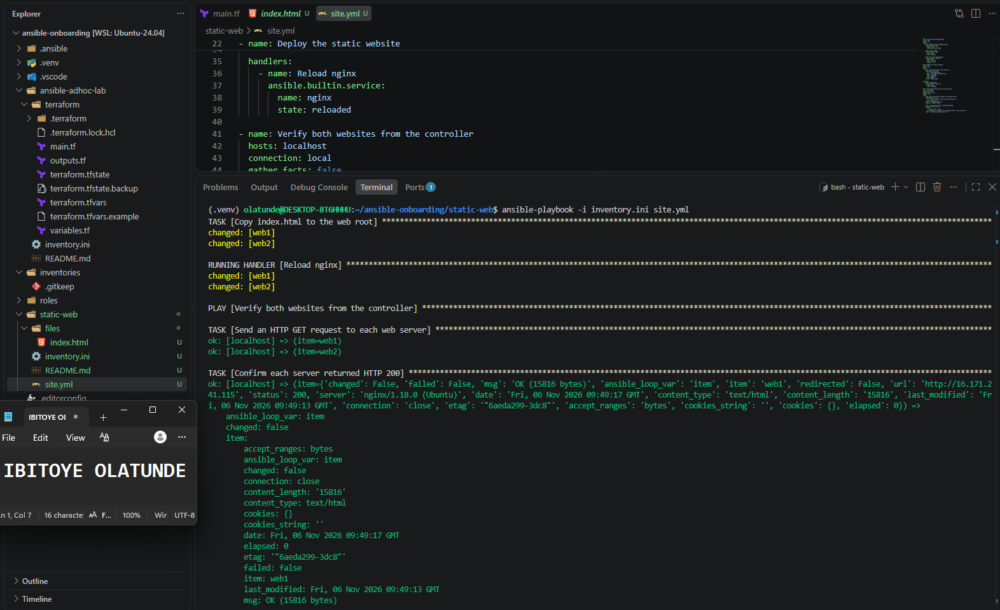

---

### Screenshot 7 — Final play recap showing `unreachable=0` and `failed=0` for `web1`, `web2`, and `localhost`

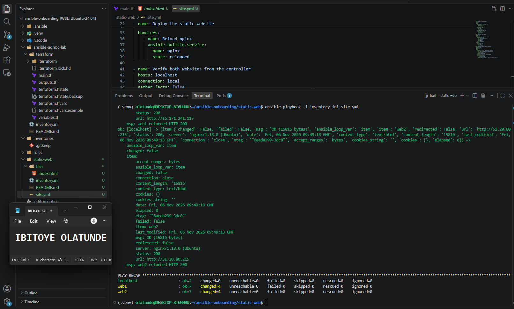

---

# Task 8 — Verify Idempotency

## Goal

Run the playbook again and confirm that it does not make unnecessary changes.

## Evidence

### Screenshot 8 — Second playbook run showing the play recap with `changed=0`, `unreachable=0`, and `failed=0` for both web servers

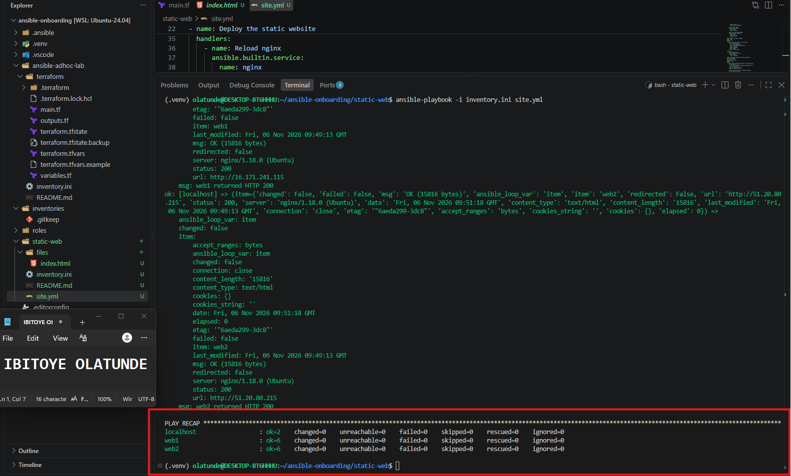

---

# Task 9 — Test Both Websites Manually

## Goal

Confirm that the static website is accessible from both public IP addresses.

## Evidence

### Screenshot 9 — `curl -I` output showing HTTP `200 OK` from both servers

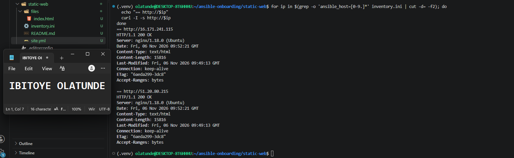

---

### Screenshot 10 — Browser showing the website from Server 1 with the public IP and your full name visible

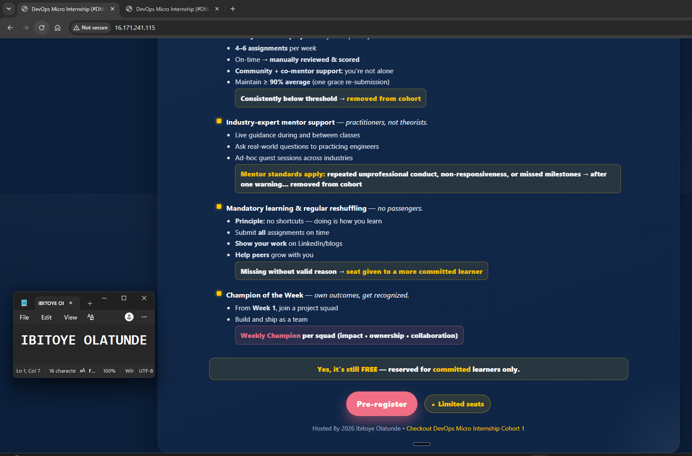

---

### Screenshot 11 — Browser showing the website from Server 2 with the public IP and your full name visible

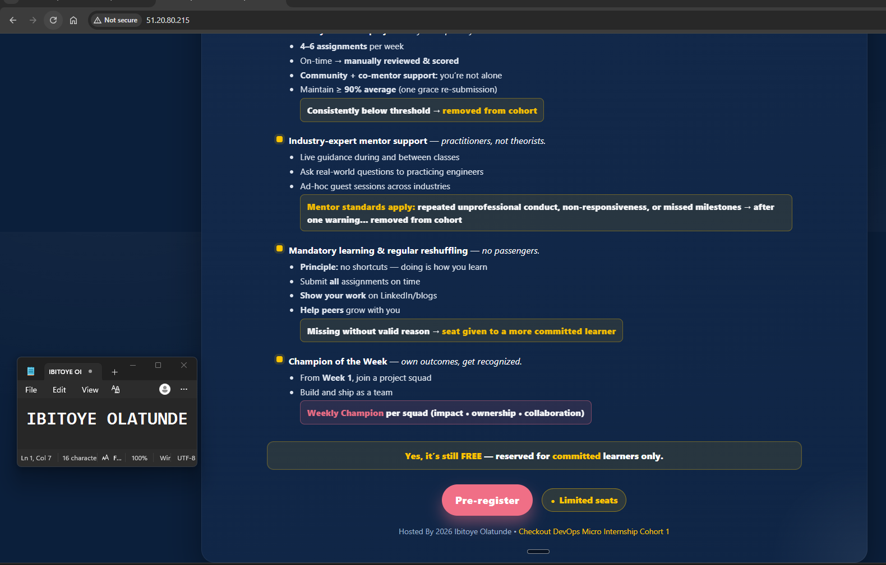

---

## Website URLs

Add both deployed website URLs below:

```text
Server 1: http://16.171.241.115
Server 2: http://51.20.80.215
```

---

# Task 10 — Complete the Project README

## Goal

Document how the project works and record what you learned.

## README Content

Copy and paste the complete contents of your `README.md` file below:

````markdown
# Static Website Deployment with a Multi-Play Ansible Playbook

**Author:** Ibitoye Olatunde

## Overview

This project deploys a static website to two Ubuntu web servers on AWS using one Ansible playbook with three plays: install Nginx, deploy the site, and verify that both servers respond. The servers were created with Terraform in an earlier lab, and the Ansible controller is the workstation built in Assignment 01.

## Project Structure

```text
static-web/
├── README.md
├── inventory.ini      # web1 and web2 in the [web] group
├── site.yml           # the three-play playbook
└── files/
    └── index.html     # the website, personalized with my name
```

## How It Works

| Play | Hosts | What it does |
|---|---|---|
| 1. Install and configure Nginx | `web` | Refreshes the apt cache, installs Nginx, and starts and enables the service |
| 2. Deploy the static website | `web` | Copies `files/index.html` from the controller to `/var/www/html/` and reloads Nginx only if the file changed (a handler) |
| 3. Verify both websites | `localhost` | Sends an HTTP GET to each web server with the `uri` module and asserts every response is 200 |

Each play has one responsibility, so a failure shows which stage broke. For example, a failure in Play 3 means the servers are running but the site is unreachable.

## Run It

From the controller, with the virtual environment active:

```bash
source ~/ansible-onboarding/.venv/bin/activate
export ANSIBLE_CONFIG=~/ansible-onboarding/ansible.cfg
cd ~/ansible-onboarding/static-web

ansible web -i inventory.ini -m ping
ansible-playbook -i inventory.ini site.yml --syntax-check
ansible-playbook -i inventory.ini site.yml
```

Running the playbook a second time should report `changed=0` for both servers.

## Idempotency

Every task describes a desired state instead of a command to run: the package is present, the service is started, and the file matches the one on the controller. Ansible checks the current state first and only acts when it differs, so repeating the playbook is safe. The apt task uses `cache_valid_time: 3600`, so the package cache is only refreshed when it is more than an hour old. Without that setting, the refresh would report a change on every run.

## Verification

- `ansible-playbook` finishes with `unreachable=0 failed=0` on every host.
- Play 3 confirms HTTP 200 from each server.
- `curl -I http://<server-ip>` returns `HTTP/1.1 200 OK`.
- Each site shows my name in the footer when opened in a browser.

## Design Decisions

- **`copy` instead of `git clone` on each server:** the controller holds one version of the file and pushes the same bytes everywhere. The servers don't need Git, outbound access to GitHub, or credentials.
- **A handler to reload Nginx:** it runs only when the site file really changed, so a re-run doesn't reload a live service for nothing.
- **Host key checking stays on:** `host_key_checking = True` in `ansible.cfg`, so Ansible refuses to connect to a server whose fingerprint doesn't match.

## Cleanup

The servers cost money while they run. Destroy them with `terraform destroy` in `ansible-adhoc-lab/terraform` when finished.

## What I Learned

- A playbook describes desired state, so running it again is safe.
- Splitting install, deploy and verify into separate plays makes failures easy to locate.
- Plays run in order, and each play gathers facts separately unless `gather_facts: false` is set, as in the controller-side verification play.
- A small setting like `cache_valid_time` decides whether a re-run is truly clean.
````

---

# LinkedIn Post Required

## Evidence

### LinkedIn Post URL

Paste your LinkedIn post URL here:

`https://www.linkedin.com/posts/olatunde-ibitoye_dmibypravinmishra-ansible-aws-ugcPost-7524412981271646208-nJhJ/?utm_source=share&utm_medium=member_desktop&rcm=ACoAAB_xj1QBIy4RnDuKMoQp8yo4i8QCKxf266A`

---

### Screenshot — Published LinkedIn post

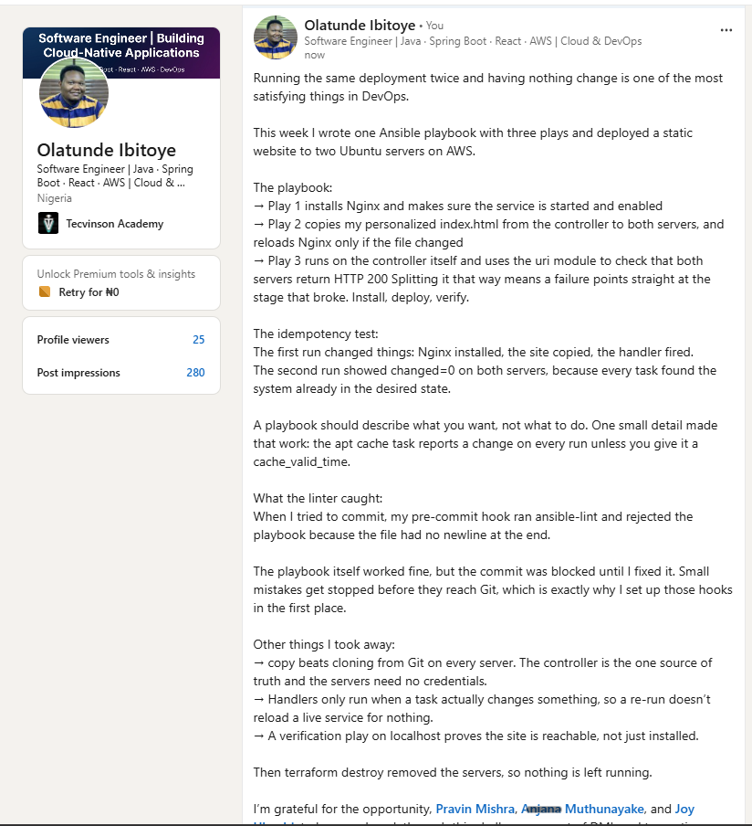

---

# Assignment Questions

Answer the following in your own words:

**1. What issue did you face while completing this assignment, and how did you fix it?**

When I first tried to commit the project, the pre-commit hook ran ansible-lint and rejected `site.yml` with `yaml[new-line-at-end-of-file]`, because the file did not end with a newline. The playbook itself worked and passed the syntax check, but the linter enforces formatting before anything reaches Git, so the commit was blocked. I added the missing newline, ran the hooks again until both yamllint and ansible-lint passed, and then committed. It showed me why linting belongs in the commit workflow: small mistakes are caught before they are saved.

---

**2. What did you learn from this assignment?**

I learned how a playbook describes a desired state instead of a list of commands, so it can be run safely more than once. I learned that one playbook can contain several plays that run in order against different hosts, that a handler only runs when a task actually changes something, and that a play can run on the controller itself to verify a result. I also saw that small settings matter for idempotency, such as `cache_valid_time` on the apt cache task.

---

**3. Why is it useful to split installation, deployment, and verification into separate plays?**

Each play has one clear responsibility, so when something fails I immediately know which stage broke: the install, the content deployment, or the final check. The plays can also target different hosts, which is why verification runs from `localhost` against the servers' addresses. Separating them makes the playbook easier to read and maintain, lets each play control its own settings, such as skipping fact gathering where it isn't needed, and makes it simpler to change one stage without touching the others.

---

**4. What is one benefit of using the Ansible `copy` module instead of cloning the website directly from Git on every managed server?**

With `copy`, the controller is the single source of truth, and it pushes the exact same file to every server. The servers do not need Git installed, outbound access to GitHub, or any credentials. That makes the deployment simpler and more secure, and it avoids differences caused by servers pulling at different times or from a changed repository. The module also compares the file with what is already on the server, so it only reports a change, and triggers the reload handler, when the content actually differs.

---

**5. What does idempotency mean in this assignment?**

It means running the playbook again does not change anything that is already correct. On the first run, Ansible installed Nginx, copied the website and reloaded the service. On the second run, every task found the system already in the desired state, so the recap showed `changed=0` and the reload handler never fired. That makes the playbook safe to repeat at any time.

---

**6. What does the Ansible `uri` module verify in Play 3?**

It sends an HTTP request from the controller to each web server's address and checks that the server responds with the expected status code, 200. That proves the web server is actually serving the site over the network, not just that Nginx is installed and running. If any server returned a different status or did not respond, the task would fail, and the assert task then confirms each result explicitly.

---

# Required Files

Confirm that the following files are included in your assignment folder:

- [ ] `inventory.ini`
- [ ] `site.yml`
- [ ] `files/index.html`
- [ ] `README.md`

---

# Submission Instructions

- Add all required screenshots in the correct order.
- Full Name must be visible in required screenshots.
- Include both deployed website URLs.
- Paste `inventory.ini`, `site.yml`, and `README.md` as editable text.
- Answer all assignment questions clearly in your own words.
- Add your LinkedIn post URL.
- Do not expose SSH private keys, passwords, cloud account IDs, or other sensitive information.

---

# Completion Checklist

- [ ] Task 1: `static-web` folder structure is complete
- [ ] Task 2: Both servers are listed under the `[web]` group in `inventory.ini`
- [ ] Task 2: Inventory graph shows `web1` and `web2`
- [ ] Task 3: Ansible ping returns `SUCCESS` and `pong` for both servers
- [ ] Task 4: `files/index.html` contains your full name
- [ ] Task 5: `site.yml` contains three separate plays
- [ ] Task 5: Play 1 installs, starts, and enables Nginx
- [ ] Task 5: Play 2 deploys `index.html` using the `copy` module
- [ ] Task 5: Nginx reload handler is included
- [ ] Task 5: Play 3 verifies both web servers from the controller
- [ ] Task 6: Playbook syntax check passes
- [ ] Task 7: First playbook run completes with `unreachable=0` and `failed=0`
- [ ] Task 7: URI verification returns HTTP `200` for both servers
- [ ] Task 8: Second playbook run demonstrates idempotency
- [ ] Task 8: Second run shows `changed=0` for both web servers
- [ ] Task 9: Both `curl -I` commands return HTTP `200 OK`
- [ ] Task 9: Website loads from Server 1
- [ ] Task 9: Website loads from Server 2
- [ ] Task 9: Full name is visible on both deployed websites
- [ ] Task 10: `README.md` contains all required explanations
- [ ] Screenshots 1–11 are included
- [ ] `inventory.ini`, `site.yml`, and `README.md` are pasted as editable text
- [ ] Both website URLs are included
- [ ] Assignment questions are answered
- [ ] LinkedIn post published
- [ ] LinkedIn post URL added
- [ ] No sensitive information is exposed

---

## About DMI & CloudAdvisory

DevOps Micro Internship (DMI) is a project-based DevOps program run by Pravin Mishra and The CloudAdvisory, focused on real-world execution, systems thinking, and career readiness.

It helps learners build strong DevOps foundations with hands-on experience.

---

## Resources

- DMI Official Website: [https://dmi.pravinmishra.com?utm_source=github&utm_medium=readme](https://dmi.pravinmishra.com?utm_source=github&utm_medium=readme)
- University: [https://university.pravinmishra.com?utm_source=github&utm_medium=readme](https://university.pravinmishra.com?utm_source=github&utm_medium=readme)
- Discord Community: [https://discord.pravinmishra.com?utm_source=github&utm_medium=readme](https://discord.pravinmishra.com?utm_source=github&utm_medium=readme)
- Blog: [https://dmi.pravinmishra.com/blog?utm_source=github&utm_medium=readme](https://dmi.pravinmishra.com/blog?utm_source=github&utm_medium=readme)
- YouTube Playlist: [https://www.youtube.com/playlist?list=PLFeSNDtI4Cho](https://www.youtube.com/playlist?list=PLFeSNDtI4Cho)
- Pravin Mishra LinkedIn: [https://www.linkedin.com/in/pravin-mishra-aws-trainer/](https://www.linkedin.com/in/pravin-mishra-aws-trainer/)
- CloudAdvisory LinkedIn: [https://www.linkedin.com/company/thecloudadvisory/](https://www.linkedin.com/company/thecloudadvisory/)

---

*This submission is part of DevOps Micro Internship (DMI) — Agentic AI Track.*