# Assignment 04 — Deploy Mini Finance on Azure Using Terraform and Ansible

Part of the DevOps Micro Internship (DMI) with Agentic AI

---

## Purpose

In this assignment, you will provision Azure infrastructure using Terraform and deploy the Mini Finance website using an Ansible multi-play playbook.

Terraform will create the Azure Virtual Machine and networking resources. Ansible will install Nginx, clone the Mini Finance repository, deploy the website, and verify the deployment.

---

# Task 1 — Create the Project Structure

## Goal

Create separate directories and files for the Terraform infrastructure and Ansible configuration.

### Evidence

#### Screenshot 1 — Terminal or VS Code showing the complete `mini-finance` project structure

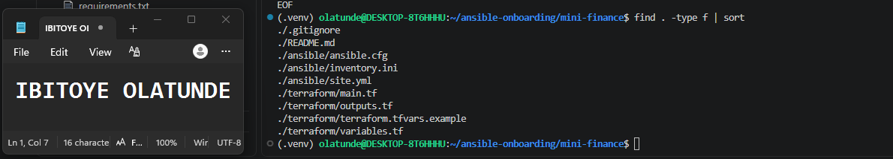

---

### Notes

I created a `mini-finance` project inside the Assignment 01 repository, so it shares the same Git history, virtual environment and Ansible controller. Terraform and Ansible are kept in separate folders (`terraform/` and `ansible/`), so the infrastructure code and the configuration code stay independent. The `ansible/` folder also holds its own copy of `ansible.cfg`, because Ansible only reads a config file from the folder it runs in. A project `.gitignore` excludes Terraform state files, plan files, real `.tfvars` files and key files, so only `terraform.tfvars.example` is tracked.

---

# Task 2 — Create the Azure Infrastructure Using Terraform

## Goal

Use Terraform to provision an Ubuntu Virtual Machine with the required Azure networking and security resources.

### Evidence

#### Screenshot 2 — Terraform code showing the `Allow-SSH` rule for port `22` and the `Allow-HTTP` rule for port `80`

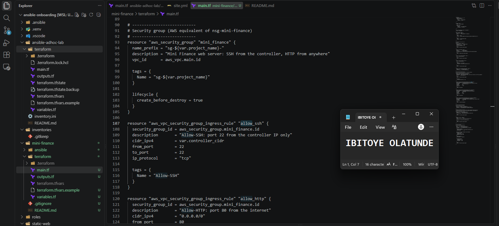

---

#### Screenshot 3 — Terraform code showing the association between `nsg-mini-finance` and `nic-mini-finance`

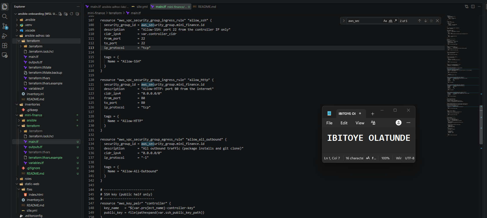

---

### Notes

I wrote the Terraform configuration for one Ubuntu 22.04 server on AWS. It is split into `variables.tf` (region, instance type, key path and my controller's public IP), `main.tf` and `outputs.tf`, so no environment-specific value is hardcoded in the resources. The security group allows SSH on port 22 only from my controller's `/32` address, which a validation rule enforces so it can never be opened to the whole internet, and allows HTTP on port 80 from anywhere because the website must be public. In the sheet's Azure terms, the security group plays the role of `nsg-mini-finance`: it is attached to an explicit network interface, `nic-mini-finance`, which is the AWS equivalent of the NSG-to-NIC association. An Elastic IP gives the server a stable public address, and a cloud-init setting names the host `mini-finance`. AWS reserves the `sg-` prefix for group names, so the group itself is named `mini-finance-sg-...` and `sg-mini-finance` is its `Name` tag.

---

# Task 3 — Initialize and Apply the Terraform Configuration

## Goal

Format and validate the Terraform configuration, review the execution plan, and provision the Azure infrastructure.

### Evidence

#### Screenshot 4 — End of the `terraform apply` output showing `Apply complete!` with no errors

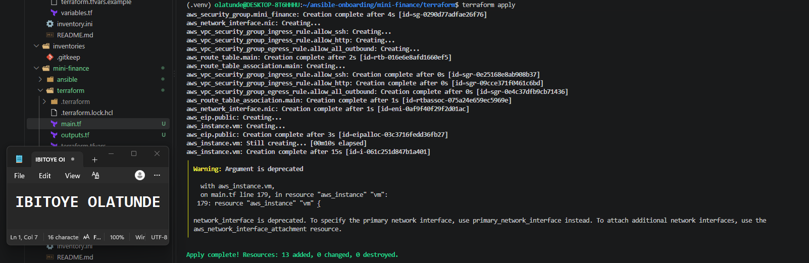

---

#### Screenshot 5 — Output of `terraform output public_ip` showing the VM’s public IP address

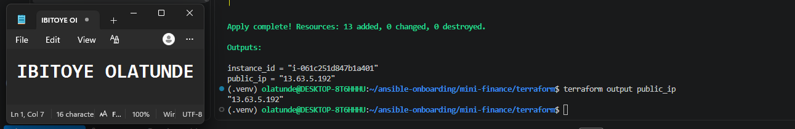

---

### Notes

I ran `terraform fmt`, `init` and `validate`, then reviewed the plan before applying. My first plan failed with a real AWS rule: a security group name cannot start with `sg-`. I renamed the group and kept `sg-mini-finance` as its `Name` tag, and the plan then showed 13 new resources with nothing changed or destroyed. `terraform apply` finished with `Apply complete! Resources: 13 added, 0 changed, 0 destroyed.` It also printed a deprecation warning that `network_interface` is replaced by `primary_network_interface` in newer provider versions, which does not affect the result. `terraform output public_ip` returned the server's public address.

---

# Task 4 — Verify Passwordless SSH Access

## Goal

Confirm that the Ansible controller can connect to the Terraform-provisioned Azure VM using SSH key authentication.

### Evidence

#### Screenshot 6 — Passwordless SSH command and the returned `mini-finance` hostname

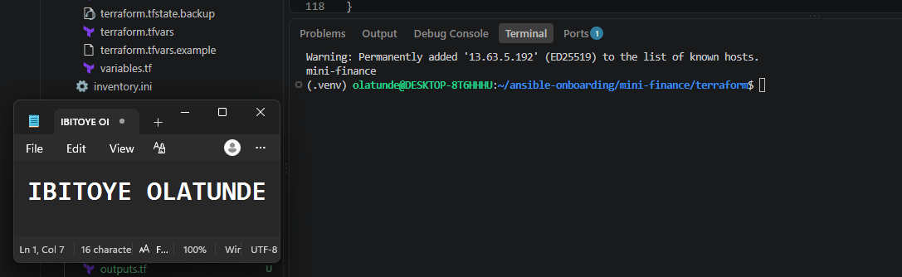

---

### Notes

I tested passwordless SSH from the Ansible controller using the ED25519 key from Assignment 01, connecting as the `ubuntu` user (the default on AWS Ubuntu images, where the sheet's Azure example uses `azureuser`). The command `ssh -i ~/.ssh/id_ed25519 ubuntu@<public-ip> "hostname"` returned `mini-finance` with no password prompt. That proves the public key Terraform registered matches my private key, the security group's SSH rule accepts my controller's IP, the server booted with SSH running, and the cloud-init hostname setting worked.

---

# Task 5 — Create the Ansible Inventory and Verify Connectivity

## Goal

Add the Terraform-provisioned Azure VM to the Ansible inventory and confirm that Ansible can connect to it.

### Evidence

#### Screenshot 7 — Ansible ping output showing `SUCCESS` and `pong` from the Azure VM

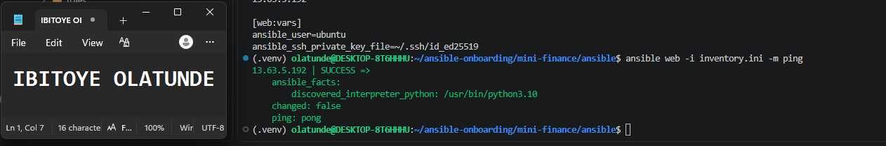

---

### Configuration File

Copy and paste the complete contents of your `ansible/inventory.ini` file below:

```ini
[web]
13.63.5.192

[web:vars]
ansible_user=ubuntu
ansible_ssh_private_key_file=~/.ssh/id_ed25519
```

---

# Task 6 — Create the Multi-Play Ansible Playbook

## Goal

Create one Ansible playbook containing separate plays to install Nginx, deploy the Mini Finance website, and verify the deployment.

### Evidence

#### Screenshot 8 — `site.yml` showing Play 1 and the beginning of Play 2

Screenshot must show:

- Play 1 targeting the `web` group
- Installation of `nginx`, `git`, and `rsync`
- Nginx service configured as started and enabled
- Beginning of Play 2 with the Git repository URL and synchronization task

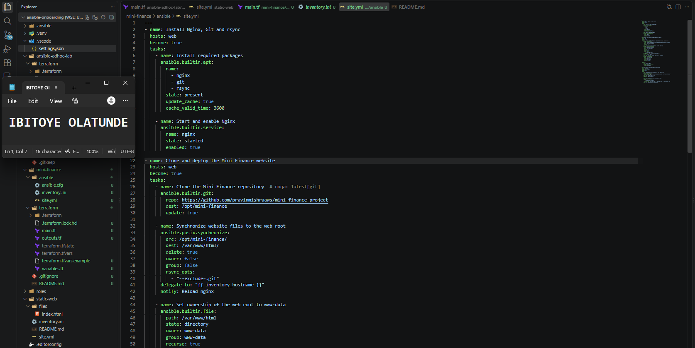

---

#### Screenshot 9 — `site.yml` showing the deployment destination, handler, and Play 3 verification

Screenshot must show:

- Website destination `/var/www/html/`
- Ownership set to `www-data:www-data`
- Nginx reload handler
- Play 3 targeting `localhost`
- The `uri` verification and `assert` condition

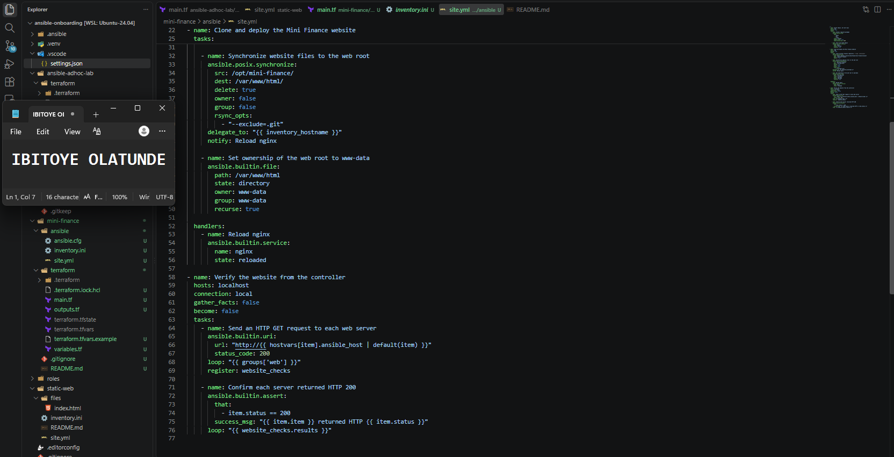

---

### Configuration File

Copy and paste the complete contents of your `ansible/site.yml` file below:

```yaml
---
- name: Install Nginx, Git and rsync
  hosts: web
  become: true
  tasks:
    - name: Install required packages
      ansible.builtin.apt:
        name:
          - nginx
          - git
          - rsync
        state: present
        update_cache: true
        cache_valid_time: 3600

    - name: Start and enable Nginx
      ansible.builtin.service:
        name: nginx
        state: started
        enabled: true

- name: Clone and deploy the Mini Finance website
  hosts: web
  become: true
  tasks:
    - name: Clone the Mini Finance repository  # noqa: latest[git]
      ansible.builtin.git:
        repo: https://github.com/pravinmishraaws/mini-finance-project
        dest: /opt/mini-finance
        update: true

    - name: Synchronize website files to the web root
      ansible.posix.synchronize:
        src: /opt/mini-finance/
        dest: /var/www/html/
        delete: true
        owner: false
        group: false
        rsync_opts:
          - "--exclude=.git"
      delegate_to: "{{ inventory_hostname }}"
      notify: Reload nginx

    - name: Set ownership of the web root to www-data
      ansible.builtin.file:
        path: /var/www/html
        state: directory
        owner: www-data
        group: www-data
        recurse: true

  handlers:
    - name: Reload nginx
      ansible.builtin.service:
        name: nginx
        state: reloaded

- name: Verify the website from the controller
  hosts: localhost
  connection: local
  gather_facts: false
  become: false
  tasks:
    - name: Send an HTTP GET request to each web server
      ansible.builtin.uri:
        url: "http://{{ hostvars[item].ansible_host | default(item) }}"
        status_code: 200
      loop: "{{ groups['web'] }}"
      register: website_checks

    - name: Confirm each server returned HTTP 200
      ansible.builtin.assert:
        that:
          - item.status == 200
        success_msg: "{{ item.item }} returned HTTP {{ item.status }}"
      loop: "{{ website_checks.results }}"
```

---

# Task 7 — Validate and Run the Ansible Playbook

## Goal

Validate the syntax of the multi-play Ansible playbook and run it to install Nginx, deploy the Mini Finance website, and verify the deployment.

### Evidence

#### Screenshot 10 — Successful playbook syntax check showing `playbook: site.yml`

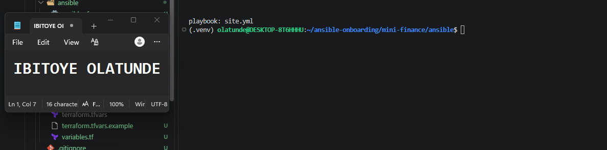

---

#### Screenshot 11 — Play 3 output showing the successful HTTP verification and assertion

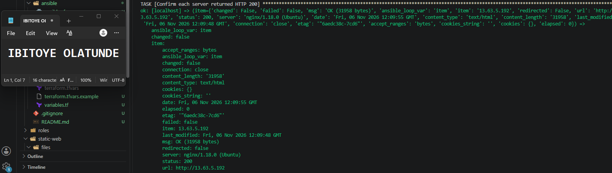

---

#### Screenshot 12 — Final `PLAY RECAP` showing `failed=0` and `unreachable=0`

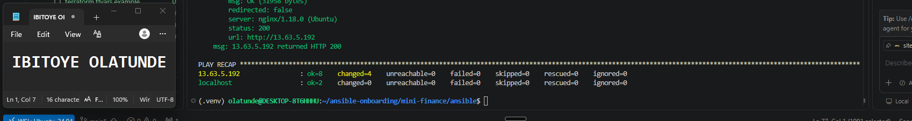

---

### Notes

I validated the playbook with `ansible-playbook --syntax-check`, which printed `playbook: site.yml`, and with `ansible-lint`, which passed at the strictest profile after I added a missing newline at the end of the file. My first real run failed at the clone task: Git reported `could not read Username for 'https://github.com'`, which is how it reports a repository that is not found or not public. Play 1 had already succeeded, so SSH, `become` and the package installs were working. I found that the correct repository is `mini_finance` (with an underscore), updated the `repo:` line, and reran. This time Play 1 installed Nginx, Git and rsync, Play 2 cloned the repository, synchronized the files into `/var/www/html/` with `www-data` ownership and reloaded Nginx through the handler, and Play 3 returned HTTP 200 and passed the assertion. The recap showed `failed=0` and `unreachable=0` on both the server and `localhost`.

---

# Task 8 — Test the Mini Finance Website in a Browser

## Goal

Confirm that the Mini Finance website is publicly accessible through the Azure VM’s public IP address.

### Evidence

#### Screenshot 13 — Mini Finance website successfully loading in the browser, with the Azure VM’s public IP address visible in the address bar

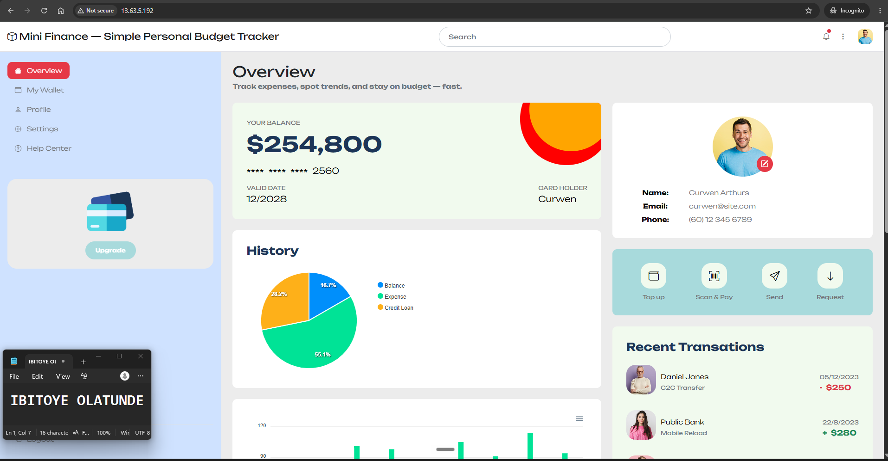

---

### Website URL

Add your deployed website URL below:

```text
http://13.63.5.192
```

---

# Task 9 — Create the Project README

## Goal

Create a `README.md` file to document the Mini Finance infrastructure and deployment project.

### Evidence

#### Screenshot 14 — Completed `README.md` displayed in the VS Code Markdown preview or terminal

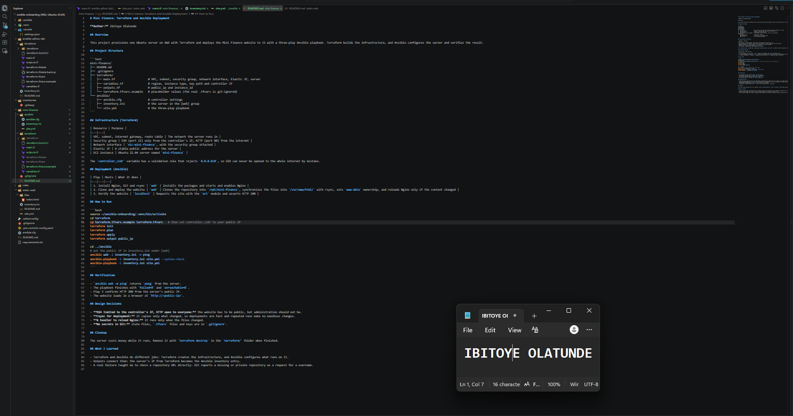

---

### README Content

Copy and paste the complete contents of your `README.md` file below:

````markdown
# Mini Finance: Terraform and Ansible Deployment

**Author:** Ibitoye Olatunde

## Overview

This project provisions one Ubuntu server on AWS with Terraform and deploys the Mini Finance website to it with a three-play Ansible playbook. Terraform builds the infrastructure, and Ansible configures the server and verifies the result.

## Project Structure

```text
mini-finance/
├── README.md
├── .gitignore
├── terraform/
│   ├── main.tf                    # VPC, subnet, security group, network interface, Elastic IP, server
│   ├── variables.tf               # region, instance type, key path and controller IP
│   ├── outputs.tf                 # public_ip and instance_id
│   └── terraform.tfvars.example   # placeholder values (the real .tfvars is git-ignored)
└── ansible/
    ├── ansible.cfg                # controller settings
    ├── inventory.ini              # the server in the [web] group
    └── site.yml                   # the three-play playbook
```

## Infrastructure (Terraform)

| Resource | Purpose |
|---|---|
| VPC, subnet, internet gateway, route table | The network the server runs in |
| Security group | SSH (port 22) only from the controller's IP, HTTP (port 80) from the internet |
| Network interface | `nic-mini-finance`, with the security group attached |
| Elastic IP | A stable public address for the server |
| EC2 instance | Ubuntu 22.04 server named `mini-finance` |

The `controller_cidr` variable has a validation rule that rejects `0.0.0.0/0`, so SSH can never be opened to the whole internet by mistake.

## Deployment (Ansible)

| Play | Hosts | What it does |
|---|---|---|
| 1. Install Nginx, Git and rsync | `web` | Installs the packages and starts and enables Nginx |
| 2. Clone and deploy the website | `web` | Clones the repository into `/opt/mini-finance`, synchronizes the files into `/var/www/html/` with rsync, sets `www-data` ownership, and reloads Nginx only if the content changed |
| 3. Verify the website | `localhost` | Requests the site with the `uri` module and asserts HTTP 200 |

## How to Run

```bash
source ~/ansible-onboarding/.venv/bin/activate
cd terraform
cp terraform.tfvars.example terraform.tfvars   # then set controller_cidr to your public IP
terraform init
terraform plan
terraform apply
terraform output public_ip

cd ../ansible
# put the public IP in inventory.ini under [web]
ansible web -i inventory.ini -m ping
ansible-playbook -i inventory.ini site.yml --syntax-check
ansible-playbook -i inventory.ini site.yml
```

## Verification

- `ansible web -m ping` returns `pong` from the server.
- The playbook finishes with `failed=0` and `unreachable=0`.
- Play 3 confirms HTTP 200 from the server's public IP.
- The website loads in a browser at `http://<public-ip>`.

## Design Decisions

- **SSH limited to the controller's IP, HTTP open to everyone:** the website has to be public, but administration should not be.
- **rsync for deployment:** it copies only what changed, so deployments are fast and repeated runs make no needless changes.
- **A handler to reload Nginx:** it runs only when the files changed.
- **No secrets in Git:** state files, `.tfvars` files and keys are in `.gitignore`.

## Cleanup

The server costs money while it runs. Remove it with `terraform destroy` in the `terraform/` folder when finished.

## What I Learned

- Terraform and Ansible do different jobs: Terraform creates the infrastructure, and Ansible configures what runs on it.
- Outputs connect them: the server's IP from Terraform becomes the Ansible inventory entry.
- A real failure taught me to check a repository URL directly: Git reports a missing or private repository as a request for a username.
````

---

# LinkedIn Post Required

## Evidence

#### Screenshot 15 — Published LinkedIn post showing the text and at least one deployment screenshot

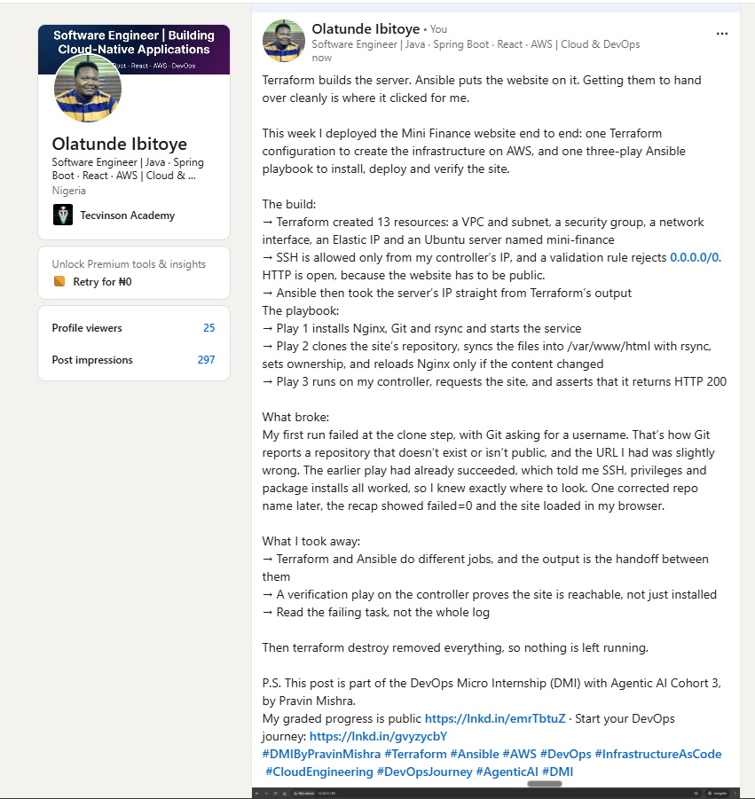

---

#### LinkedIn Post URL

Paste your LinkedIn post URL here:

`https://www.linkedin.com/posts/olatunde-ibitoye_dmibypravinmishra-terraform-ansible-share-7524448162670100480-QfMZ/?utm_source=share&utm_medium=member_desktop&rcm=ACoAAB_xj1QBIy4RnDuKMoQp8yo4i8QCKxf266A`

---

### LinkedIn Submission Notes

**One challenge you faced and how you fixed it:**

My first playbook run failed at the clone task with `could not read Username for 'https://github.com'`. Git reports a repository that is not found or not public that way, because it tries to ask for credentials and can't in an unattended run. Play 1 had already succeeded, so I knew SSH, privilege escalation and the package installs were working, and the problem was only the repository address. I found the correct repository name, `mini_finance` with an underscore, updated the `repo:` line, and reran the playbook. Play 3 then returned HTTP 200 and the recap showed `failed=0`.

---

**One real-world example where you can use this learning:**

A team could use the same pattern to create a staging or demo environment for a company website. Terraform would build a server with locked-down SSH, and an Ansible playbook would install the web server, deploy the latest site files and check automatically that the site responds, so a new environment is created, tested and tore down in minutes, with the same result every time. The same approach would work for client demos, training labs, or recovering a web server after a failure.

---

# Assignment Questions

Answer the following in your own words:

**1. What did you provision using Terraform in this assignment?**

I provisioned one Ubuntu 22.04 server on AWS and the network around it: a VPC, a subnet, an internet gateway and route table, a security group, a network interface with the security group attached, an Elastic IP for a stable public address, and the SSH key pair. In total Terraform created 13 resources. It also named the server `mini-finance` with a cloud-init setting and returned the public IP as an output, which I used for SSH, the Ansible inventory and the browser test.

---

**2. What did Ansible configure and deploy in this assignment?**

Ansible configured the server and deployed the website. Play 1 installed Nginx, Git and rsync and started and enabled Nginx. Play 2 cloned the Mini Finance repository into `/opt/mini-finance`, synchronized its files into `/var/www/html/` with rsync, set `www-data` ownership, and reloaded Nginx through a handler. Play 3 ran from the controller and verified that the site responds with HTTP 200.

---

**3. Why is SSH access on port `22` restricted to your public IP address?**

SSH gives full administrative access to the server, so it is the main target for automated attacks and password or key guessing from anywhere on the internet. Allowing port 22 only from my controller's public IP means nobody else can even reach the SSH service. I also added a validation rule to the Terraform variable, so the address cannot accidentally be set to `0.0.0.0/0`. The downside is that if my own IP changes, I lose access until I update the rule.

---

**4. Why is HTTP port `80` open to the internet?**

The server hosts a public website, and visitors can come from any address, so port 80 has to accept traffic from everywhere. Opening it only exposes the web server, which is meant to be public, and everything else stays closed. Administration is a different matter and stays restricted to my IP.

---

**5. What is the purpose of the Ansible inventory file?**

The inventory tells Ansible which servers to manage and how to connect to them. Mine lists the server's public IP in a `[web]` group, and sets the login user (`ubuntu`) and the private key once for the whole group. Without it, Ansible would not know where to run anything. The groups also let a playbook target a role, which is what `hosts: web` does in the first two plays.

---

**6. Why does the playbook use separate plays for install, deploy, and verify?**

Each play has one job, so when something fails I immediately know which stage broke. My first run failed during the clone in Play 2, and Play 1 had already succeeded, which told me SSH and the package installs were fine. Separate plays also let each one target different hosts, such as running verification from `localhost`, and use different settings, such as skipping fact gathering in Play 3. The playbook is easier to read, change and reuse.

---

**7. Why is `rsync` useful when deploying website files?**

rsync copies only the files that are new or changed, instead of recopying everything, so deployments are fast, and a repeated run changes nothing when the content is the same. It can copy a whole folder tree in one task, preserve permissions and timestamps, and delete files that no longer exist in the source, so `/var/www/html/` mirrors the repository exactly. That also makes the playbook idempotent, so the Nginx reload handler only runs when the content really changed.

---

**8. What does the Ansible `uri` module verify in this assignment?**

In Play 3 it sends an HTTP request from the controller to the server's public IP and checks that the response status is 200. That proves the website is really being served over the network, not just that Nginx is installed and running. The `assert` task then confirms each result explicitly and prints a clear message, such as `13.63.5.192 returned HTTP 200`. If the server returned an error or did not respond, the playbook would fail.

---

**9. What issue did you face during this assignment, and how did you fix it?**

My first playbook run failed at the clone task with `could not read Username for 'https://github.com'`. Git reports a repository that is not found or not public that way, because it tries to ask for credentials and cannot in an unattended run. Play 1 had already succeeded, so I knew SSH, `become` and the package installs worked, and the problem was only the repository address. I found the correct repository name, `mini_finance` with an underscore, updated the `repo:` line in `site.yml`, and reran the playbook. Play 3 returned HTTP 200 and the recap showed `failed=0`. I also hit a smaller issue: `ansible-lint` rejected `site.yml` because it had no newline at the end, which I fixed before running.

---

**10. What did you learn from using Terraform and Ansible together?**

I learned that they do different jobs. Terraform creates the infrastructure, and Ansible configures what runs on it. The Terraform output is the handoff between the two, since the server's public IP became the Ansible inventory entry. I also saw why it's worth keeping them separate: I could fix the playbook and rerun it many times without touching the server that Terraform built. Each tool is idempotent in its own way, so repeating either one is safe.

---

# Required Files

Confirm that the following files are included in your assignment folder:

- [ ] `.gitignore`
- [ ] `README.md`
- [ ] `terraform/providers.tf`
- [ ] `terraform/main.tf`
- [ ] `terraform/variables.tf`
- [ ] `terraform/outputs.tf`
- [ ] `ansible/inventory.ini`
- [ ] `ansible/site.yml`

---

# Submission Instructions

- Add all required screenshots in the correct order.
- Full Name must be visible in required screenshots.
- Add the Azure VM public IP address.
- Add the final Mini Finance website URL.
- Paste `inventory.ini`, `site.yml`, and `README.md` as editable text.
- Answer all assignment questions clearly in your own words.
- Add your LinkedIn post URL.
- Do not expose SSH private keys, passwords, Azure credentials, subscription IDs, Terraform state contents, or other sensitive information.

---

# Completion Checklist

- [ ] Task 1: `mini-finance` project structure created
- [ ] Task 1: `.gitignore` created
- [ ] Task 2: Terraform Azure infrastructure code created
- [ ] Task 2: `Allow-SSH` rule configured for port `22`
- [ ] Task 2: `Allow-HTTP` rule configured for port `80`
- [ ] Task 2: NSG associated with the Network Interface
- [ ] Task 3: `terraform fmt` completed
- [ ] Task 3: `terraform init` completed
- [ ] Task 3: `terraform validate` completed successfully
- [ ] Task 3: `terraform apply` completed successfully
- [ ] Task 3: `terraform output public_ip` displayed the VM public IP
- [ ] Task 4: Passwordless SSH works from the Ansible controller
- [ ] Task 5: `inventory.ini` created
- [ ] Task 5: Ansible ping returns `SUCCESS` and `pong`
- [ ] Task 6: `site.yml` contains three separate plays
- [ ] Task 6: Play 1 installs Nginx, Git, and rsync
- [ ] Task 6: Play 2 clones and deploys the Mini Finance website
- [ ] Task 6: Play 3 verifies HTTP status code `200`
- [ ] Task 7: Playbook syntax check passes
- [ ] Task 7: Ansible playbook completes successfully
- [ ] Task 7: Final recap shows `failed=0` and `unreachable=0`
- [ ] Task 8: Mini Finance website loads in the browser
- [ ] Task 8: Azure VM public IP is visible in the browser screenshot
- [ ] Task 9: `README.md` completed
- [ ] Screenshots 1–15 are included
- [ ] `inventory.ini`, `site.yml`, and `README.md` are pasted as editable text
- [ ] Assignment questions are answered
- [ ] LinkedIn post published with Anyone visibility
- [ ] LinkedIn post URL added
- [ ] No sensitive information is exposed

---

## About DMI & CloudAdvisory

DevOps Micro Internship (DMI) is a project-based DevOps program run by Pravin Mishra and The CloudAdvisory, focused on real-world execution, systems thinking, and career readiness.

It helps learners build strong DevOps foundations with hands-on experience.

---

## Resources

- DMI Official Website: [https://dmi.pravinmishra.com?utm_source=github&utm_medium=readme](https://dmi.pravinmishra.com?utm_source=github&utm_medium=readme)
- University: [https://university.pravinmishra.com?utm_source=github&utm_medium=readme](https://university.pravinmishra.com?utm_source=github&utm_medium=readme)
- Discord Community: [https://discord.pravinmishra.com?utm_source=github&utm_medium=readme](https://discord.pravinmishra.com?utm_source=github&utm_medium=readme)
- Blog: [https://dmi.pravinmishra.com/blog?utm_source=github&utm_medium=readme](https://dmi.pravinmishra.com/blog?utm_source=github&utm_medium=readme)
- YouTube Playlist: [https://www.youtube.com/playlist?list=PLFeSNDtI4Cho](https://www.youtube.com/playlist?list=PLFeSNDtI4Cho)
- Pravin Mishra LinkedIn: [https://www.linkedin.com/in/pravin-mishra-aws-trainer/](https://www.linkedin.com/in/pravin-mishra-aws-trainer/)
- CloudAdvisory LinkedIn: [https://www.linkedin.com/company/thecloudadvisory/](https://www.linkedin.com/company/thecloudadvisory/)

---

*This submission is part of DevOps Micro Internship (DMI) — Agentic AI Track.*