# Assignment — Deploy EpicBook with Terraform and Ansible Roles

Part of the DevOps Micro Internship (DMI) with Agentic AI

---

## Purpose

In this assignment, you will deploy the EpicBook web application using Terraform and Ansible roles.

Terraform provisions the cloud infrastructure, including one Ubuntu VM and one managed MySQL database. Ansible roles configure the VM, install required software, deploy the EpicBook application, configure Nginx, connect the app to the managed MySQL database, and verify the deployment.

---

# Task 1 — Set Up the Project Folder Layout

## Goal

Create the project folder structure for Terraform and Ansible roles.

Terraform will be used to provision the cloud infrastructure. Ansible roles will be used to configure the VM and deploy the EpicBook application.

### Evidence

#### Screenshot 1 — Terminal showing the completed `epicbook-prod` project structure

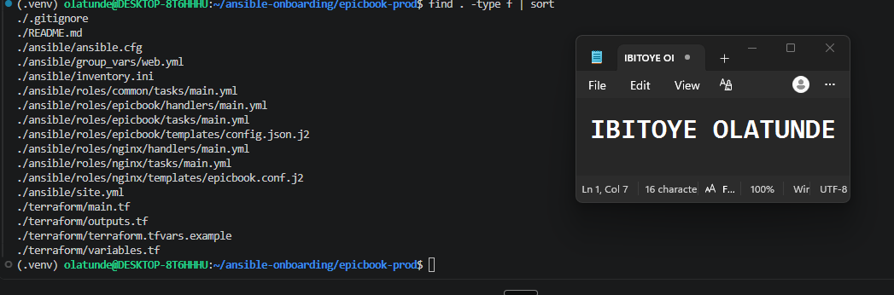

---

### Notes

Answer the following in your own words:

**1. Which cloud provider did you choose for this assignment?**

I chose AWS. Terraform creates an EC2 Ubuntu server for the application and an Amazon RDS for MySQL instance as the managed database. I had already built and tested AWS infrastructure with Terraform in earlier assignments, so I could reuse the same account, region and tooling.

---

**2. Why is it useful to keep Terraform files and Ansible files in separate folders?**

They do different jobs and change at different times. Terraform creates and tracks the infrastructure and keeps its own state and lock files, while Ansible configures what runs on the servers. Separate folders keep Terraform's state and provider files out of the Ansible project, make it clear which tool owns what, let me re-run or fix one without touching the other, and keep Git ignore rules simple.

---

**3. What is the purpose of the `roles` directory in Ansible?**

It holds reusable, self-contained units of automation. Each role, such as `common`, `nginx` and `epicbook`, has its own tasks, templates and handlers in a standard layout, so the playbook only has to list the roles it needs and the order to run them. That keeps `site.yml` short and readable, and each role can be tested, changed or reused in another project on its own.

---

# Task 2 — Provision the Infrastructure with Terraform

## Goal

Run Terraform to provision the cloud infrastructure for the EpicBook deployment.

Terraform will create the VM, managed MySQL database, networking, security rules, and required outputs.

### Evidence

#### Screenshot 2 — `terraform apply` completed successfully

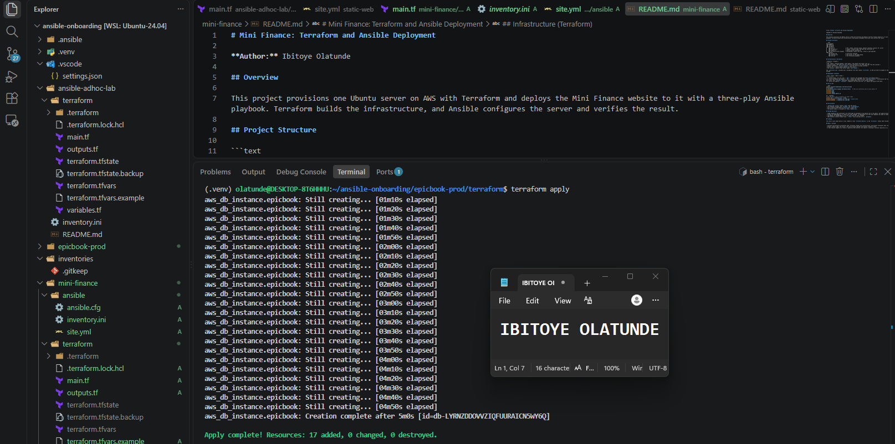

---

#### Screenshot 3 — Output of `terraform output`

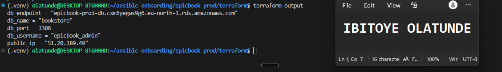

---

#### Screenshot 4 — Azure Portal or AWS Console showing the VM running

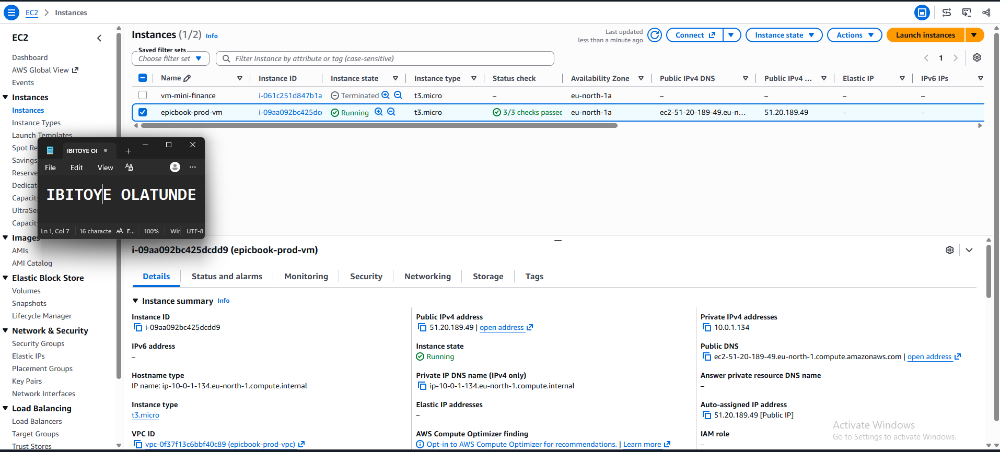

---

#### Screenshot 5 — Azure Portal or AWS Console showing the managed MySQL database created

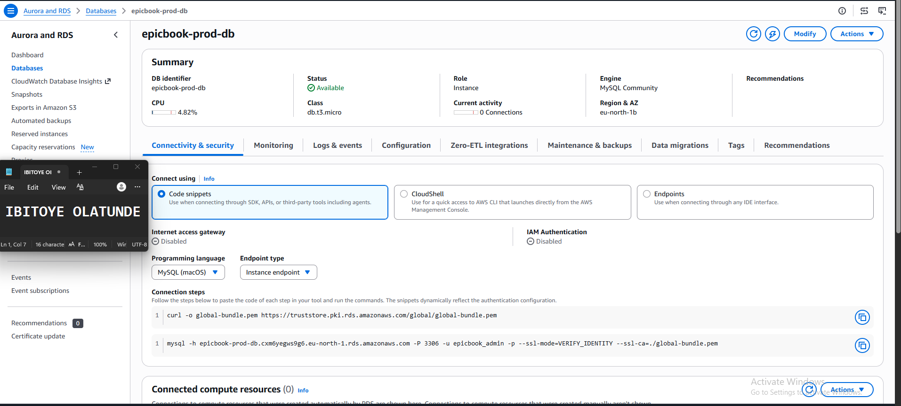

---

### Notes

Answer the following in your own words:

**1. What resources did Terraform create for this assignment?**

Terraform created a VPC with one public subnet and two private subnets, an internet gateway and a public route table, two security groups, an SSH key pair, one Ubuntu EC2 server for the application, a DB subnet group, and a managed Amazon RDS MySQL instance. The server's security group allows SSH only from my controller's IP and HTTP from the internet. The database's security group allows MySQL only from the server's security group. Terraform returned the server's public IP and the database endpoint as outputs.

---

**2. Why should you review `terraform plan` before running `terraform apply`?**

The plan shows exactly what Terraform will create, change or destroy before anything happens. Reviewing it catches mistakes such as a wrong CIDR, a rule that is too open, an unexpected replacement or a missing resource, when fixing them is free. Applying without reading it means finding out about those mistakes on live infrastructure, and for something like a database that can be slow, costly or destructive.

---

**3. Why should database passwords not be shown in Terraform output?**

Outputs are printed to the terminal, saved in the state file, and often ends up in logs, screenshots and shared files. A password shown there is exposed to anyone who can see them, and the database can be reached with it. I supplied the password through an environment variable, used a write-only argument so it is not stored in state, and exposed only the endpoint, port, name and username.

---

# Task 3 — Verify SSH Key-Based Access

## Goal

Verify that the cloud VM can be accessed from the Ansible controller using SSH key-based authentication.

### Evidence

#### Screenshot 6 — Successful SSH hostname check from the Ansible controller

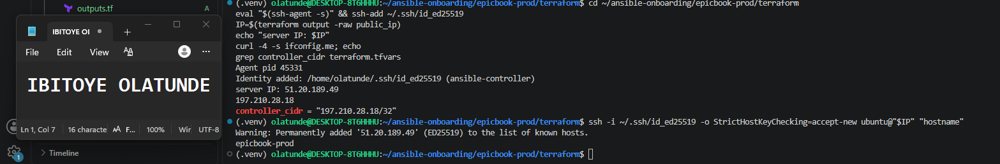

---

### Notes

Answer the following in your own words:

**1. What command did you use to verify SSH access?**

`ssh -i ~/.ssh/id_ed25519 ubuntu@<public_ip> "hostname"`, where the public IP comes from `terraform output -raw public_ip`.

---

**2. What proves that SSH key-based access worked successfully?**

The command returned the server's hostname, `epicbook-prod`, with no password prompt and no error. That shows the public key Terraform registered matches my private key, the security group's SSH rule allows my controller's IP, and the server booted with SSH running.

---

**3. What would you check if SSH returned `Permission denied (publickey)`?**

I would check that the private key is loaded in the SSH agent or given with `-i`, that it is the key matching the public key Terraform registered, that the private key file has strict permissions (`600`), and that I am using the right username (`ubuntu` on AWS Ubuntu images). I would also confirm the server has finished booting, and run `ssh -v` to see which keys are offered and why they are rejected

---

# Task 4 — Create the Ansible Inventory and Configuration

## Goal

Create the Ansible inventory file and local Ansible configuration for the EpicBook VM.

The inventory tells Ansible which VM to manage and which SSH user to use.

### Evidence

#### Screenshot 7 — `inventory.ini` showing the VM under the `web` group

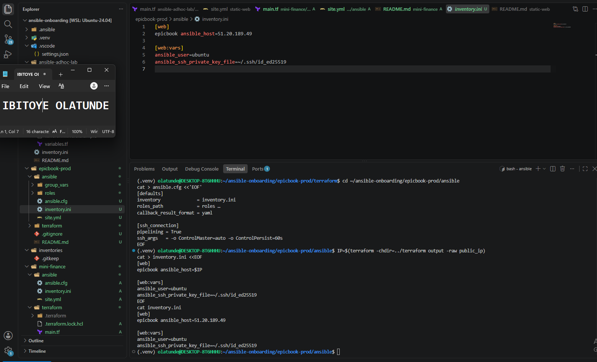

---

#### Screenshot 8 — Output of `ansible-inventory -i inventory.ini --graph`

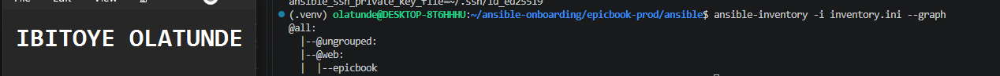

---

#### Screenshot 9 — Output of `ansible web -i inventory.ini -m ping`

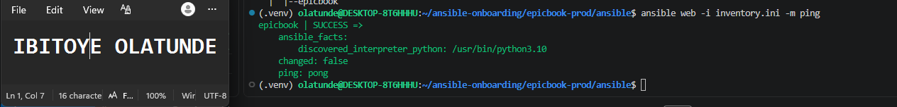

---

### Notes

Answer the following in your own words:

**1. What is the purpose of `inventory.ini`?**

It tells Ansible which servers to manage and how to connect to them. Mine puts the EpicBook server in a `web` group and sets the login user and private key for that group. The playbook then targets `hosts: web` without knowing any addresses.

---

**2. What does `ansible_host` store?**

The real address Ansible connects to, here the server's public IP. The name in front of it, `epicbook`, is just a friendly alias that appears in Ansible's output, so the address can change without renaming the host.

---

**3. What does `ansible_ssh_private_key_file` tell Ansible?**

Which private key to use to authenticate over SSH. It must match the public key installed on the server, which is the ED25519 key registered through Terraform.

---

**4. Why is `host_key_checking = False` used only for this temporary lab?**

It stops Ansible from stopping to verify the server's fingerprint, which is convenient for a brand-new server that will be destroyed after the assignment. But it also removes protection against connecting to an impostor or a man-in-the-middle. In production I would keep it enabled and manage trusted fingerprints in `known_hosts`.

---

# Task 5 — Create the Main Ansible Playbook

## Goal

Create the main Ansible playbook that runs the required roles in the correct order.

The `site.yml` file will call the `common`, `nginx`, and `epicbook` roles.

### Evidence

#### Screenshot 10 — `site.yml` showing the roles in the correct order

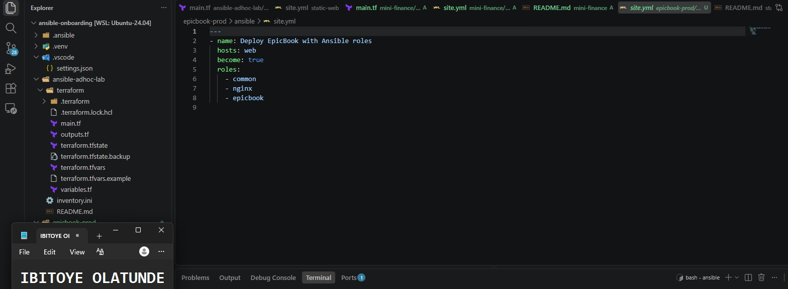

---

#### Screenshot 11 — Output of `ansible-playbook -i inventory.ini site.yml --syntax-check`

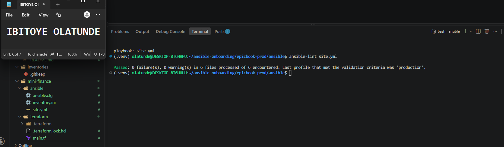

---

### Notes

Answer the following in your own words:

**1. What is the purpose of `site.yml`?**

It is the main playbook, the single entry point that decides which roles run, on which hosts, and in what order. Mine targets the `web` group with elevated privileges and calls the `common`, `nginx` and `epicbook` roles. Because the actual work lives in the roles, `site.yml` stays short and readable, and running the whole deployment is one command.

---

**2. Why should the roles run in the order `common`, `nginx`, and `epicbook`?**

Each role depends on the one before it. `common` installs the base packages and tools, such as Git, curl and the MySQL client, that later roles need. `nginx` then installs and configures the web server that will sit in front of the application. `epicbook` deploys the application last, connects it to the database and starts it, so by then everything it needs exists, and Nginx is ready to forward traffic to it. Running them in the wrong order would fail, for example by trying to clone the application before Git is installed.

---

**3. What does `become: true` allow Ansible to do?**

It lets Ansible run tasks with elevated (root) privileges, like using `sudo`. Installing packages, writing configuration under `/etc` and managing system services all need administrator rights, but I connect as the normal `ubuntu` user. Without `become: true`, those tasks would fail with permission errors.

---

# Task 6 — Create the `common` Role

## Goal

Create the `common` role to prepare the Ubuntu VM with the basic packages required for the EpicBook deployment.

This role handles the common server setup before Nginx and the application are configured.

### Evidence

#### Screenshot 12 — `roles/common/tasks/main.yml` showing the common setup tasks

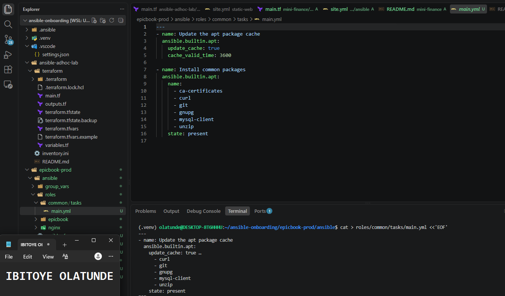

---

### Notes

Answer the following in your own words:

**1. What is the responsibility of the `common` role?**

It prepares the Ubuntu server with the basic packages that the rest of the deployment depends on: Git to download the application, curl for downloads, the MySQL client to work with the database, and a few supporting tools. It also refreshes the package cache. Doing this first means the later roles can assume the base tools already exist.

---

**2. Why should Nginx installation not be placed inside the `common` role?**

`common` should hold things every server needs, while Nginx is specific to web servers. Keeping it in its own role makes each role do one clear job, so the Nginx setup can be reused, changed or tested on its own, and a database or worker server that uses `common` would not get a web server it doesn't need.

---

**3. Why is `mysql-client` useful in this deployment?**

The database is a separate managed service, so the server needs a client to talk to it. I use it to check that the database is reachable, to import the schema and sample data, and to inspect the tables afterwards. It lets me test and troubleshoot the connection from the application server itself.

---

# Task 7 — Create the `nginx` Role

## Goal

Create the `nginx` role to install Nginx and configure it as a reverse proxy for the EpicBook application.

Nginx will receive browser traffic on port `80` and forward it to the EpicBook Node.js application running on the VM.

### Evidence

#### Screenshot 13 — `roles/nginx/tasks/main.yml` showing Nginx installation and site configuration tasks

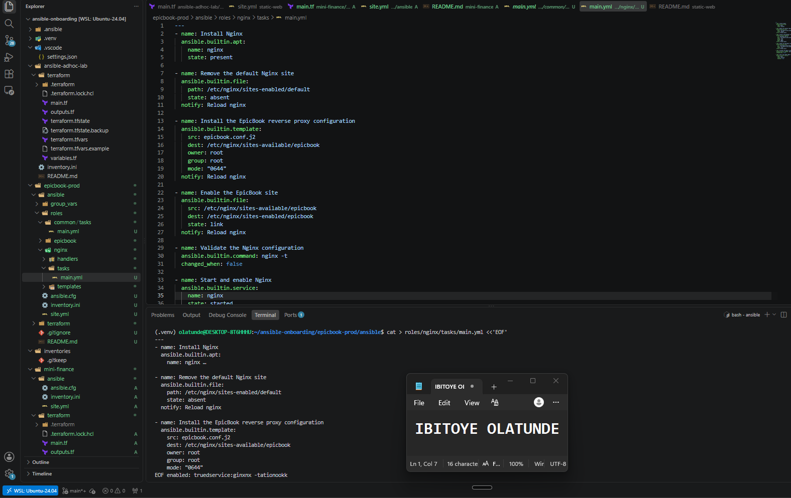

---

#### Screenshot 14 — `roles/nginx/templates/epicbook.conf.j2` showing the reverse proxy configuration

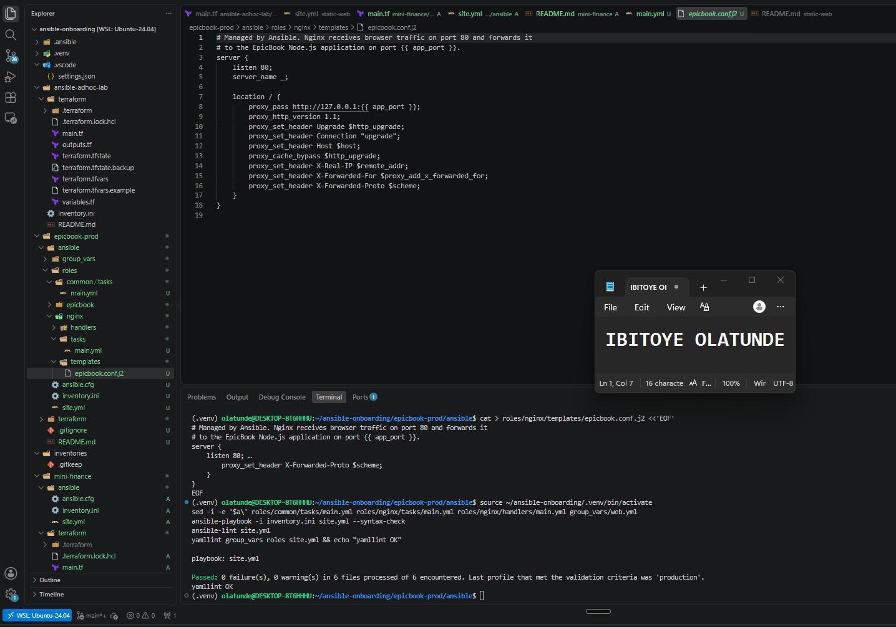

---

### Notes

Answer the following in your own words:

**1. What is the responsibility of the `nginx` role?**

It installs Nginx, replaces the default site with the EpicBook configuration, validates the configuration with `nginx -t`, enables the site, and makes sure the service is started and enabled. A handler reloads Nginx only when the configuration actually changed.

---

**2. Why is Nginx configured as a reverse proxy in this deployment?**

Browsers connect to port 80, but the EpicBook Node.js application listens on port 8080. Nginx sits in front and forwards requests to the application, so users never need to know about the internal port. It also keeps the application off the public port, can add headers and later handle HTTPS, and it is a robust, standard web server, so the Node.js process doesn't have to run as a privileged service on port 80.

---

**3. Why should the application port come from `group_vars/web.yml` instead of being hard-coded?**

The port is used in more than one place, in the Nginx template and in the application's start command. Storing it once in `group_vars/web.yml` means changing it takes one edit, and the roles can't drift out of sync. It also makes the roles reusable, since another project can set a different port without touching the role files.

---

# Task 8 — Create the `epicbook` Role

## Goal

Create the `epicbook` role to deploy the EpicBook application, connect it to the managed MySQL database, and run the application on port `8080` using PM2.

### Evidence

#### Screenshot 15 — `roles/epicbook/tasks/main.yml` showing application deployment tasks

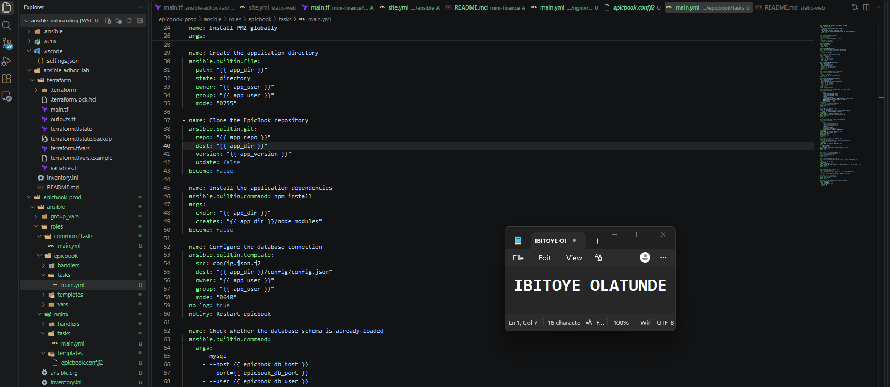

---

#### Screenshot 16 — Task or file showing how the database connection is configured, with secrets hidden

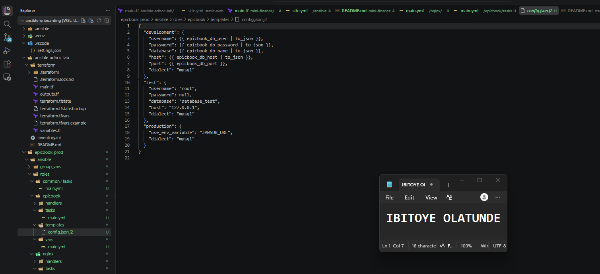

---

#### Screenshot 17 — Task or output showing the EpicBook application managed by PM2

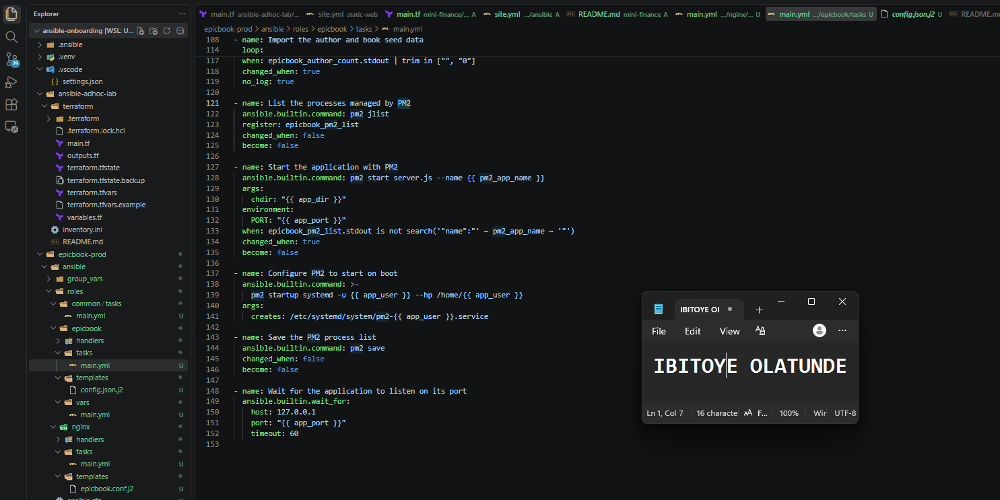

---

### Notes

Answer the following in your own words:

**1. What is the responsibility of the `epicbook` role?**

It deploys the application. It installs Node.js and PM2, clones the EpicBook repository at a pinned commit, installs the dependencies, writes the database connection settings, loads the schema and sample data into the managed MySQL database, and starts the application under PM2 on port 8080. It also registers PM2 with systemd so the app comes back after a reboot, and waits until the application is listening.

---

**2. Why is PM2 used for the EpicBook Node.js application?**

Running `node server.js` directly ties the app to a terminal session and stops if it crashes or I disconnect. PM2 is a process manager: it runs the app in the background, restarts it if it crashes, keeps a list of managed processes (`pm2 status`), collects logs, and, with `pm2 startup` and `pm2 save`, starts the app again automatically after a server reboot.

---

**3. Why should database passwords not be hard-coded in public files?**

Anyone who can read the file can use the password, and once a password is in Git it stays in the history even if it is later deleted. Public repositories are scanned by bots for exactly this. I kept the password out of every file in the project: I type it into my terminal, Terraform and Ansible both read it from the environment, Terraform stores it as a write-only value, and Ansible hides it with `no_log`. The only place it exists on disk is the application's own config file on the server, which is readable only by its owner.

---

**4. What does it mean for the application to run on port `8080` while Nginx listens on port `80`?**

Browsers connect to the standard web port, 80, where Nginx answers. Nginx then forwards each request to the Node.js application listening privately on port 8080. Users never use port 8080, and the app itself doesn't need to run as a privileged process to bind to a low port. The security group only opens port 80 to the internet, so the application port is not exposed directly.

---

# Task 9 — Create Group Variables

## Goal

Create reusable variables for the EpicBook deployment.

The `group_vars/web.yml` file stores values that can be reused across the Ansible roles.

### Evidence

#### Screenshot 18 — `group_vars/web.yml` showing the application, PM2, and database variables, with passwords hidden or masked

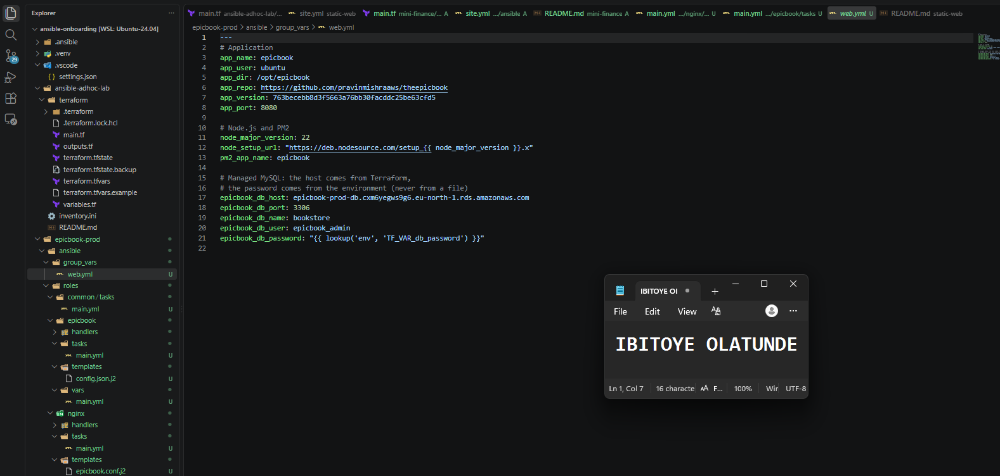

---

### Notes

Answer the following in your own words:

**1. What is the purpose of `group_vars/web.yml`?**

It stores the values shared by every host in the `web` group, in one place that all the roles can read. The roles use variables such as `app_port`, `app_dir` and the database settings instead of hard-coded values, so changing a port or a path is a one-line edit. It also keeps configuration separate from the logic in the roles, so the roles stay reusable.

---

**2. Which values did you store in `group_vars/web.yml`?**

The application settings (name, user, directory, repository, pinned version and port 8080), the Node.js and PM2 settings (the Node major version, its setup URL and the PM2 process name), and the database connection details (host, port, database name, username and the password lookup). The database host, port, name and username come from Terraform's outputs, so nothing was typed by hand.

---

**3. How did you handle the database password securely?**

The password is never written to a file. I type it into my terminal once, and Terraform and Ansible both read it from the `TF_VAR_db_password` environment variable. Terraform sends it to AWS as a write-only value, so it isn't stored in state or printed in outputs, and `group_vars/web.yml` contains only a lookup of that variable. The tasks that use it are marked `no_log`, so it doesn't appear in Ansible's output, and the database tasks pass it through an environment variable and not the command line. The only copy on disk is the application's config file on the server, readable only by its owner.

---

# Task 10 — Run the Ansible Playbook

## Goal

Run the Ansible playbook to configure the VM and deploy the EpicBook application.

The playbook should run the roles in this order:

1. `common`
2. `nginx`
3. `epicbook`

### Evidence

#### Screenshot 19 — Ansible playbook output showing the roles running

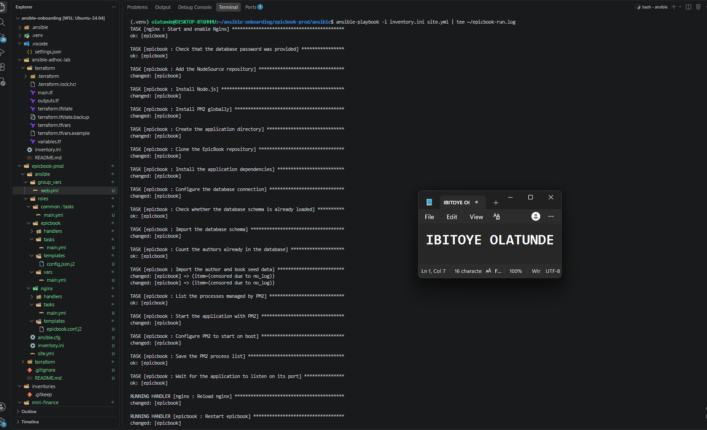

---

#### Screenshot 20 — Final Ansible recap showing `failed=0`

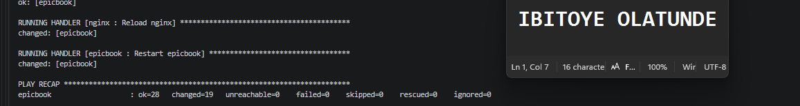

---

#### Screenshot 21 — Output of `ansible web -i inventory.ini -m command -a "systemctl is-active nginx" --become`

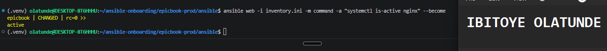

---

#### Screenshot 22 — Output of `ansible web -i inventory.ini -m command -a "pm2 status"`

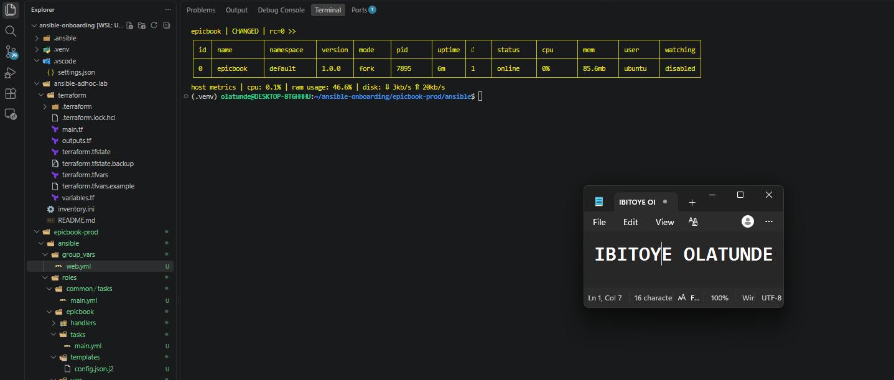

---

#### Screenshot 23 — Output of `ansible web -i inventory.ini -m command -a "curl -I http://localhost:8080"`

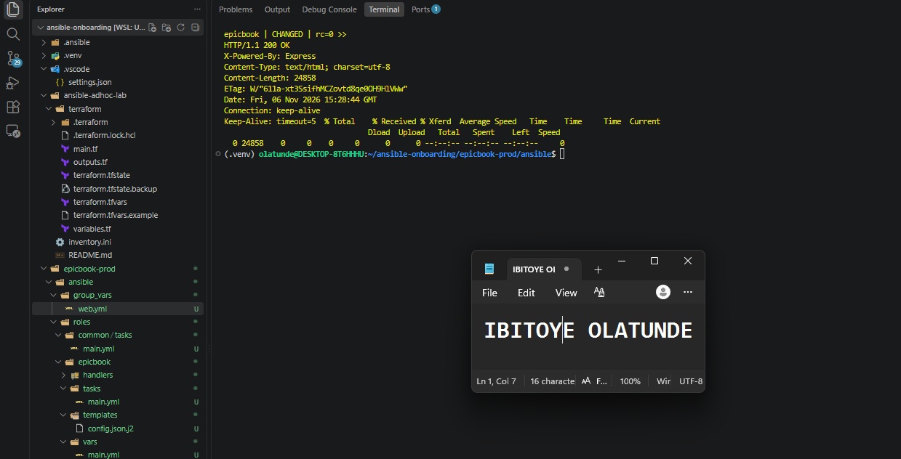

---

### Notes

Answer the following in your own words:

**1. What command did you run to execute the Ansible playbook?**

`ansible-playbook -i inventory.ini site.yml`, from the `ansible/` folder, with the database password available in the `TF_VAR_db_password` environment variable.

---

**2. How do you know all roles completed successfully?**

The output showed tasks from `common`, `nginx` and `epicbook` in that order, and the final recap showed `failed=0` and `unreachable=0` for the server. I also confirmed the results with separate checks on Nginx, PM2 and the application port, and a second run reported `changed=0`.

---

**3. What proves that Nginx is active?**

`systemctl is-active nginx`, run through Ansible with `--become`, returned `active`. The playbook also validated the configuration with `nginx -t` before starting the service.

---

**4. What proves that PM2 is managing the EpicBook application?**

`pm2 status` listed the `epicbook` process with status `online`, running as the `ubuntu` user. PM2 was also registered with systemd and its process list saved, so it restarts after a reboot.

---

**5. What proves that the EpicBook application responds on port `8080`?**

`curl -I http://localhost:8080`, run on the server, returned `HTTP/1.1 200 OK` with the `X-Powered-By: Express` header, which shows the Node.js application itself is answering on its own port, independent of Nginx.

---

# Task 11 — Verify the EpicBook Deployment

## Goal

Verify that the EpicBook application is running, accessible in the browser, and connected to the managed MySQL database.

### Evidence

#### Screenshot 24 — Output of `curl -I http://<public_ip>`

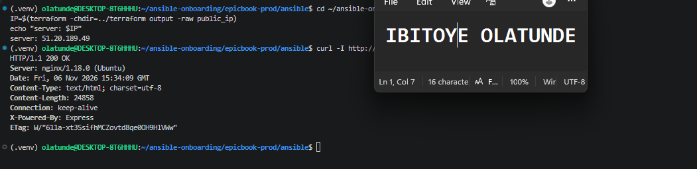

---

#### Screenshot 25 — Output of the cart API test command

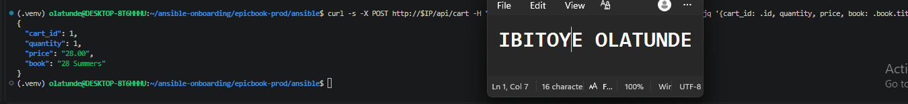

---

#### Screenshot 26 — Output of the `/cart` HTTP status check

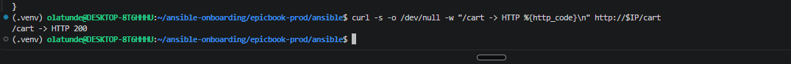

---

#### Screenshot 27 — Browser showing the EpicBook application loaded from `http://<public_ip>`

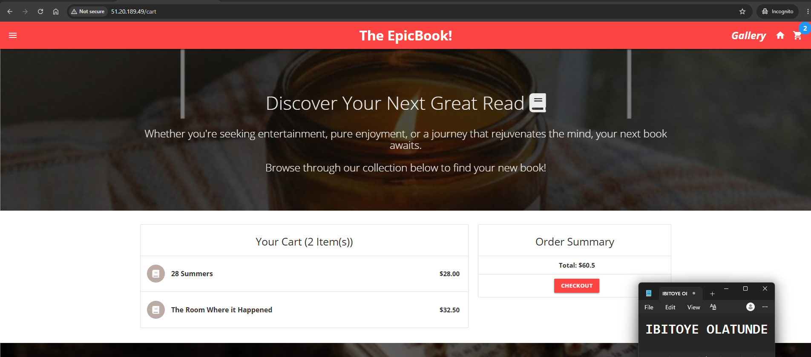

---

### Notes

Answer the following in your own words:

**1. What HTTP response did you receive from the public application URL?**

`HTTP/1.1 200 OK`, with the headers `Server: nginx/1.18.0 (Ubuntu)` and `X-Powered-By: Express`. That shows Nginx received the request on port 80 and forwarded it to the Express application, which answered.

---

**2. What did the cart API test prove?**

I sent a POST request to `/api/cart` with a book ID, and it returned a new cart record with a price and the book's title. Creating that record is a write to the managed MySQL database, and looking up the book is a read, so it proves the application is really connected to the database and can read and write data through the full path.

---

**3. What did the `/cart` status check return?**

HTTP 200. The page is built from the cart rows stored in the database, so a successful response means the application could query MySQL and render the page.

---

**4. What issue did you face during verification, and how did you fix it?**

did not face any issue

---

# LinkedIn Post Required

## Evidence

#### LinkedIn Post URL

Paste your LinkedIn post URL here:

`https://www.linkedin.com/posts/olatunde-ibitoye_dmibypravinmishra-terraform-ansible-share-7524497519125516288-w6yv/?utm_source=share&utm_medium=member_desktop&rcm=ACoAAB_xj1QBIy4RnDuKMoQp8yo4i8QCKxf266A`

---

#### Screenshot — Published LinkedIn post

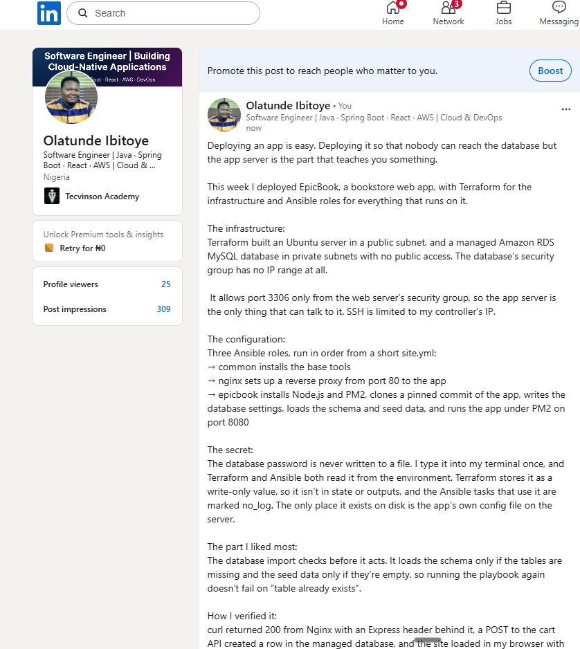

---

# Assignment Questions

Answer the following in your own words:

**1. Why is Terraform used for infrastructure provisioning?**

Terraform describes infrastructure as code, so the whole environment (network, security groups, server and database) is created from files, not by clicking through a console. That makes it repeatable and reviewable: `terraform plan` shows exactly what will change before anything happens, the code can be versioned in Git, and the same configuration builds the same result every time. It also tracks what it created, so `terraform destroy` removes everything cleanly, which is how I avoided leaving a billable server and database running.

---

**2. Why are Ansible roles useful for production-style deployments?**

A role packages one responsibility, such as base packages, the web server or the application, with its own tasks, templates and handlers in a standard layout. The main playbook then only lists which roles to run and in what order, so it stays short and readable. Roles can be reused across projects, tested on their own, and changed without touching the others, and the clear structure makes it easier for a team to understand and maintain the deployment.

---

**3. What is the purpose of `group_vars/web.yml`?**

It holds the values shared by all hosts in the `web` group, such as the application directory, repository, port, Node.js version and the database connection details. The roles read these variables instead of hard-coded values, so a change like a different port is a one-line edit in one place, and the roles stay generic and reusable. It also keeps configuration separate from logic, and lets the password be a lookup instead of a stored value.

---

**4. Why should database passwords not be committed to GitHub?**

Anyone who can see the repository can use the password to reach the database, and Git keeps history, so even a deleted password stays retrievable. Public repositories are scanned automatically by bots looking for exactly this. I kept the password out of every file: I type it into my terminal, Terraform and Ansible read it from the environment, and `.gitignore` excludes state files and `.tfvars` files that could contain secrets.

---

**5. What is the purpose of Nginx in this deployment?**

Nginx is the web server and reverse proxy in front of the application. Browsers connect to port 80, and Nginx forwards each request to the Node.js application listening privately on port 8080. That means users never see the application port, the app doesn't need privileges to bind to a low port, the security group only has to open port 80, and Nginx can later handle things like HTTPS, caching and headers.

---

**6. Why should the managed MySQL database not be publicly accessible?**

A database holds the application's data, and a public endpoint can be found and attacked from anywhere with password guessing, vulnerabilities and denial of service. Mine sits in private subnets with `publicly_accessible` set to false, and its security group allows port 3306 only from the application server's security group, so nothing else, including the internet and my own computer, can connect directly. Only the application server can reach it, which sharply reduces the attack surface.

---

**7. Why is PM2 used for the EpicBook Node.js application?**

Running `node server.js` directly stops when I disconnect or when the process crashes. PM2 is a process manager that runs the app in the background, restarts it automatically if it fails, shows its status with `pm2 status`, and keeps logs. With `pm2 startup` and `pm2 save` it is also registered with systemd, so the application starts again after a server reboot without anyone logging in.

---

**8. What does idempotency mean in Ansible?**

It means running the same playbook again leaves the system in the same state, without making unnecessary changes or failing. Tasks describe a desired state, such as "the package is installed" or "the file has this content", and Ansible only acts when the current state differs. In my deployment, the database tasks check whether the schema and data already exist before importing, Node.js and PM2 are only installed if they are missing, and a second run reports `changed=0`. That makes it safe to repeat a deployment.

---

**9. What issue did you face during the deployment, and how did you fix it?**

[Write your real issue here, in three or four sentences. Say what failed, how you found the cause, and what you changed. Candidates, if one of these actually happened to you:
- AWS rejected a security group or RDS setting, and you changed the name or value.
- Your public IP changed and SSH timed out, so you updated the controller IP in Terraform and applied.
- The playbook's database tasks failed because the password in your terminal differed from the one the database was created with.
- `ansible-lint` or `yamllint` rejected a file in the pre-commit hook, for example a missing newline or a line over 80 characters, and you fixed it before committing.]

---

**10. What security improvement would you make before using this setup in production?**

Several. I would add HTTPS with a certificate, since the site currently serves plain HTTP. I would store the database password in a secrets manager and fetch it at runtime, instead of writing it into the application's config file on the server, and give the database its own least-privilege user, not the master account. I would turn on Multi-AZ and automated backups for the database, enable SSH host-key checking in Ansible (it was turned off for this temporary lab), and put the application server behind a load balancer in a private subnet, with a bastion host or session manager for administration, and add monitoring and alerts.

---

# Required Files

Confirm that the following files are included in your GitHub repository or assignment folder:

- [ ] `README.md`
- [ ] Terraform files under either `terraform/azure/` or `terraform/aws/`
- [ ] `ansible/ansible.cfg`
- [ ] `ansible/inventory.ini`
- [ ] `ansible/site.yml`
- [ ] `ansible/group_vars/web.yml`
- [ ] `ansible/roles/common/tasks/main.yml`
- [ ] `ansible/roles/nginx/tasks/main.yml`
- [ ] `ansible/roles/nginx/templates/epicbook.conf.j2`
- [ ] `ansible/roles/epicbook/tasks/main.yml`

---

# Submission Instructions

- Add all required screenshots in your submission.
- Full Name must be visible in required screenshots.
- Mention the cloud provider used: Azure or AWS.
- Add the VM public IP address.
- Add the final application URL.
- Add Terraform output proof.
- Add Ansible role tree proof.
- Add all required notes and assignment question answers.
- Add your LinkedIn post URL.
- Do not expose SSH private keys, passwords, cloud credentials, database credentials, Terraform state files, subscription IDs, or account IDs.

---

# Completion Checklist

- [ ] Task 1: Project folder layout created
- [ ] Task 2: Terraform infrastructure provisioned
- [ ] Task 3: SSH key-based access verified
- [ ] Task 4: Ansible inventory and configuration created
- [ ] Task 5: Main Ansible playbook created
- [ ] Task 6: `common` role created
- [ ] Task 7: `nginx` role created
- [ ] Task 8: `epicbook` role created
- [ ] Task 9: Group variables created
- [ ] Task 10: Ansible playbook run completed
- [ ] Task 11: EpicBook deployment verified
- [ ] Terraform files created under only one cloud provider folder
- [ ] One Ubuntu VM was created
- [ ] One managed MySQL database was created
- [ ] SSH port `22` is restricted to the controller public IP
- [ ] HTTP port `80` is accessible
- [ ] MySQL port `3306` is not publicly open
- [ ] `ansible web -i inventory.ini -m ping` returns `SUCCESS`
- [ ] `site.yml` calls the roles in the correct order
- [ ] Database secrets are hidden or handled securely
- [ ] Nginx is active
- [ ] PM2 shows the EpicBook application running
- [ ] EpicBook responds on port `8080`
- [ ] Public URL loads in the browser
- [ ] Cart API verification works
- [ ] Playbook completes with `failed=0`
- [ ] Screenshots 1–27 are included
- [ ] Assignment questions are answered
- [ ] LinkedIn post published
- [ ] LinkedIn post URL added
- [ ] No sensitive information is exposed

---

## About DMI & CloudAdvisory

DevOps Micro Internship (DMI) is a project-based DevOps program run by Pravin Mishra and The CloudAdvisory, focused on real-world execution, systems thinking, and career readiness.

It helps learners build strong DevOps foundations with hands-on experience.

---

## Resources

- DMI Official Website: [https://dmi.pravinmishra.com?utm_source=github&utm_medium=readme](https://dmi.pravinmishra.com?utm_source=github&utm_medium=readme)
- University: [https://university.pravinmishra.com?utm_source=github&utm_medium=readme](https://university.pravinmishra.com?utm_source=github&utm_medium=readme)
- Discord Community: [https://discord.pravinmishra.com?utm_source=github&utm_medium=readme](https://discord.pravinmishra.com?utm_source=github&utm_medium=readme)
- Blog: [https://dmi.pravinmishra.com/blog?utm_source=github&utm_medium=readme](https://dmi.pravinmishra.com/blog?utm_source=github&utm_medium=readme)
- YouTube Playlist: [https://www.youtube.com/playlist?list=PLFeSNDtI4Cho](https://www.youtube.com/playlist?list=PLFeSNDtI4Cho)
- Pravin Mishra LinkedIn: [https://www.linkedin.com/in/pravin-mishra-aws-trainer/](https://www.linkedin.com/in/pravin-mishra-aws-trainer/)
- CloudAdvisory LinkedIn: [https://www.linkedin.com/company/thecloudadvisory/](https://www.linkedin.com/company/thecloudadvisory/)

---

*This submission is part of DevOps Micro Internship (DMI) — Agentic AI Track.*