# Assignment 6 — AI-Assisted Ansible Change Risk Review

Part of the DevOps Micro Internship (DMI) with Agentic AI

---

## Purpose

In this assignment, you will build an AI-assisted Ansible risk-review workflow using `ansible-playbook --check --diff`, Bash scripting, and Claude Code.

You will review possible server changes before applying them, classify risky tasks, and keep the final apply decision under human control.

---

# Task 1 — Confirm EpicBook Connectivity and Create the Workspace

## Goal

Confirm that your previous EpicBook Ansible project is working before creating the risk-review automation.

### Evidence

#### Screenshot 1 — Output of `ansible web -i inventory.ini -m ping`

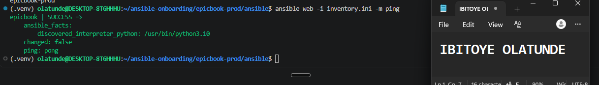

---

#### Screenshot 2 — Output of `ansible-playbook -i inventory.ini site.yml --syntax-check`

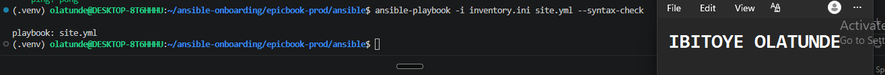

---

#### Screenshot 3 — Output of `pwd` and `find . -maxdepth 4 -type d | sort`

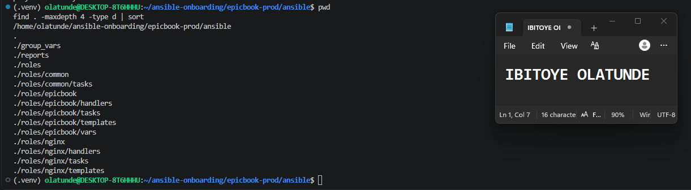

---

### Notes

Answer the following in your own words:

**1. What proves that Ansible can reach your EpicBook VM?**

`ansible web -i inventory.ini -m ping` returned `SUCCESS` with `"ping": "pong"` for the EpicBook host. The `ping` module is not a network ping: it logs in over SSH with my key and runs Python on the server, so a `pong` proves the inventory entry, the network path, the SSH credentials and Python on the VM all work. My first attempt failed with `Host key verification failed`, because the server was new and my SSH configuration asks before trusting an unknown host. I connected once by hand, checked the server's hostname, and accepted its fingerprint, and the ping then succeeded with host-key checking still switched on.

---

**2. Why should you confirm playbook syntax before building a risk-review script?**

The risk-review script depends on Ansible running the playbook in dry-run mode. If the playbook has a syntax error, the dry run would fail for a reason that has nothing to do with risk, and I could mistake a broken playbook for a failed review. Running `ansible-playbook --syntax-check` first proves the playbook parses correctly, so any later problem comes from the script or from the changes themselves.

---

# Task 2 — Create Project Context and Safety Rules in CLAUDE.md

## Goal

Create a `CLAUDE.md` file that tells Claude Code how this project must behave.

### Evidence

#### Screenshot 4 — `CLAUDE.md` open in VS Code or terminal showing the safety rules

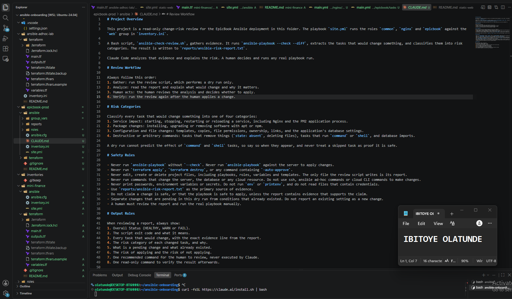

---

### Notes

Answer the following in your own words:

**1. Why should Claude Code have project-specific safety rules?**

Without rules, Claude Code treats a request like "check this playbook" as a general question and may take helpful-looking actions, such as running the playbook, editing a task or restarting a service. `CLAUDE.md` is loaded at the start of every session, so it tells Claude exactly what this project is, what counts as valid evidence, which actions are forbidden, and what a good report contains. That keeps its behaviour predictable and limits it to analysis, which matters most for commands that can change a live server.

---

**2. Why should the human run the real Ansible playbook manually?**

A real run changes the server: it can install or remove packages, rewrite configuration, restart services and import data into the database, and some of that cannot easily be undone. A report can't show a person's intent or the wider context, such as whether the change is wanted, who is using the site right now, or whether it is the right moment. The accountable decision should belong to a person who has reviewed the evidence, so the human runs the playbook, and Claude only recommends.

---

**3. Which rule prevents Claude Code from applying changes automatically?**

The rule: "Never run `ansible-playbook` without `--check`. Never run `ansible-playbook` against the server to apply changes." Together with "A human must review the report and run the real playbook manually", it limits Claude to dry runs and analysis.

---

# Task 3 — Ask Claude Code to Plan the Risk Review

## Goal

Use Claude Code to produce a read-only plan before writing the Bash script.

### Evidence

#### Screenshot 5 — Claude Code showing the four-category risk-classification plan

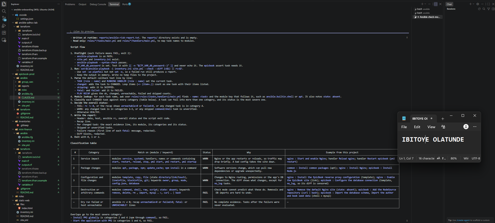

---

### Notes

Answer the following in your own words:

**1. Which part of this task represents the Gather phase?**

Claude Code reading the project: `CLAUDE.md`, `site.yml`, `inventory.ini` and the role files. It collected facts about what the playbook does without changing anything, so its plan was based on the real tasks in my roles and not on a generic guess.

---

**2. Which part represents the Analyze phase?**

Claude Code's reasoning about those facts: deciding which tasks belong in each of the four risk categories, which keywords and modules should identify them, which status each should produce, and how check mode treats `command` and `shell` tasks. That interpretation and the resulting plan is the analysis.

---

**3. How did you verify Claude Code did not create or edit files?**

I listed every file in the folder with its modification time before starting Claude Code and again afterwards, and compared the two lists with `diff`. They were identical, so no project file was created, edited or deleted. I also ran Claude Code in plan mode, which is read-only, and the rules in `CLAUDE.md` forbid edits.

---

# Task 4 — Build the Ansible Risk Review Script

## Goal

Create a Bash script that runs an Ansible dry run and classifies risky changes.

### Evidence

#### Screenshot 6 — Top section of `ansible-check-review.sh` showing `full_name`, `playbook_path`, `inventory_path`, and the `checks` array

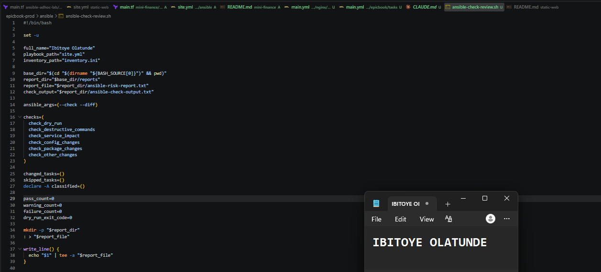

---

#### Screenshot 7 — Middle section showing `extract_changed_tasks` and `check_tasks_matching_pattern`

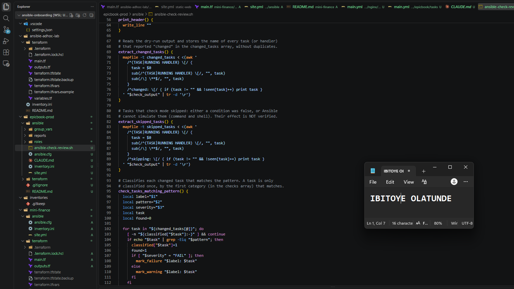

---

#### Screenshot 8 — Bottom section showing the loop, summary, and exit behavior

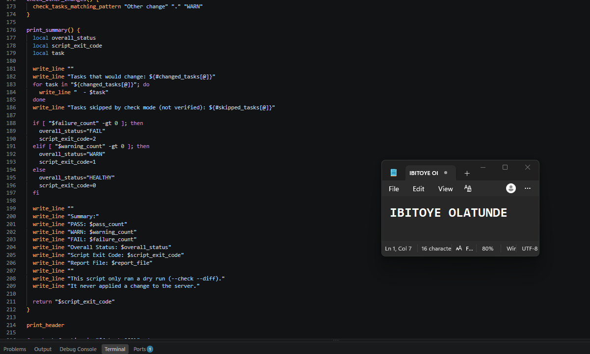

---

#### Screenshot 9 — Output of `bash -n ansible-check-review.sh` and `ls -l ansible-check-review.sh`

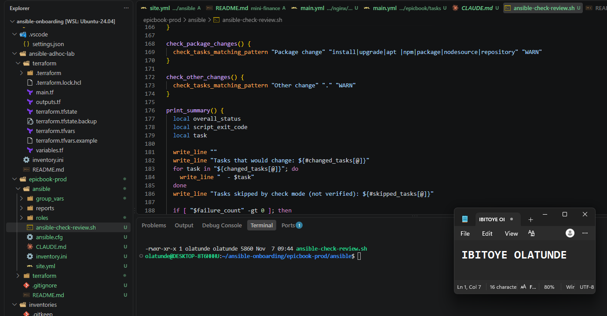

---

### Notes

Answer the following in your own words:

**1. What is stored in the `changed_tasks` array?**

The names of the tasks and handlers that reported `changed` in the dry-run output, without duplicates, for example "Install Nginx" or "Reload nginx". The risk checks loop over this array and compare each name with a pattern for one risk category.

---

**2. Which function finds changed tasks from the Ansible output?**

`extract_changed_tasks`. It reads the saved dry-run output with `awk`, remembers the current `TASK [...]` or `RUNNING HANDLER [...]` header, and whenever it sees a `changed:` line, it adds that task's name to the array.
---

**3. Why does the script use `--check --diff`?**

`--check` runs the playbook in dry-run mode, so Ansible reports what it would change without changing anything, which makes it safe to run before a real deployment. `--diff` adds the before-and-after content for changes inside files, such as a template, so a reviewer can see what would actually be different.

---

**4. Why does the script use different exit codes for healthy, warning, and failed results?**

So the outcome can be understood by a person or another tool without reading the whole report: 0 means nothing would change, 1 means changes were found that need a human look, and 2 means a destructive or arbitrary-command change, or a dry run that failed. Different codes let a pipeline treat the three cases differently, for example continuing on 0, pausing for approval on 1 and stopping on 2.

---

# Task 5 — Run the Baseline Dry-Run Review

## Goal

Run the script against your current EpicBook playbook and confirm the baseline risk status.

### Evidence

#### Screenshot 10 — Output of `./ansible-check-review.sh`

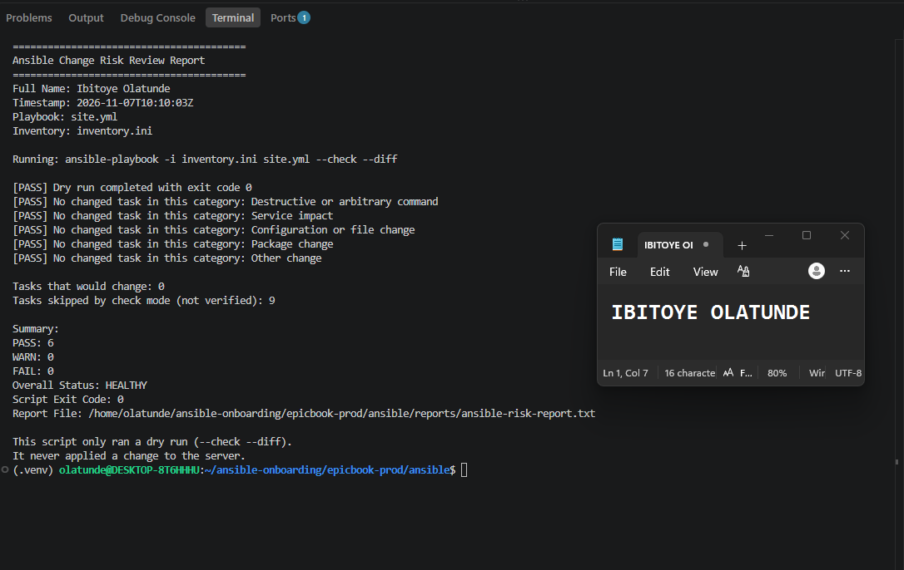

---

#### Screenshot 11 — Output of `echo "Captured Exit Code: $script_exit_code"` and `cat reports/ansible-risk-report.txt`

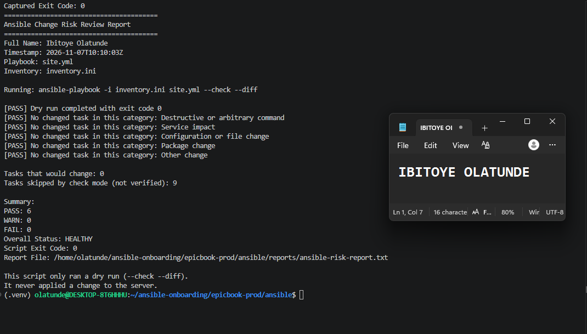

---

### Notes

Answer the following in your own words:

**1. What was the overall status of your baseline run?**

WARN. The dry run completed with exit code 0 and nothing destructive would change, but one task reported `changed`, so the script finished with exit code 1.

---

**2. Did any tasks report `changed`?**

Yes, one: `common : Update the apt package cache`. That task refreshes the package index when it is more than an hour old (`cache_valid_time: 3600`), so it shows as changed whenever the server has been idle for longer than that. Every other task that could be simulated reported `ok`.

---

**3. Were any changed tasks flagged as risky?**

It was flagged in the Package change category as a warning, but it is low risk: it only refreshes the list of available packages and does not install, upgrade or remove anything. The report also listed nine tasks that check mode skipped, which are `command` and `shell` tasks whose effect a dry run cannot predict, so they are not verified.

---

**4. What does the script exit code mean?**

0 means HEALTHY: nothing would change. 1 means WARN: something would change that needs a human look, such as a service, a package or a configuration file. 2 means FAIL: a destructive or arbitrary-command task would change, or the dry run itself failed. Mine was 1.

---

# Task 6 — Create and Run the Claude Code Skill

## Goal

Turn the Bash script into a reusable Claude Code skill called `/ansible-risk-review`.

### Evidence

#### Screenshot 12 — `SKILL.md` showing the frontmatter, allowed tools, and safety rules

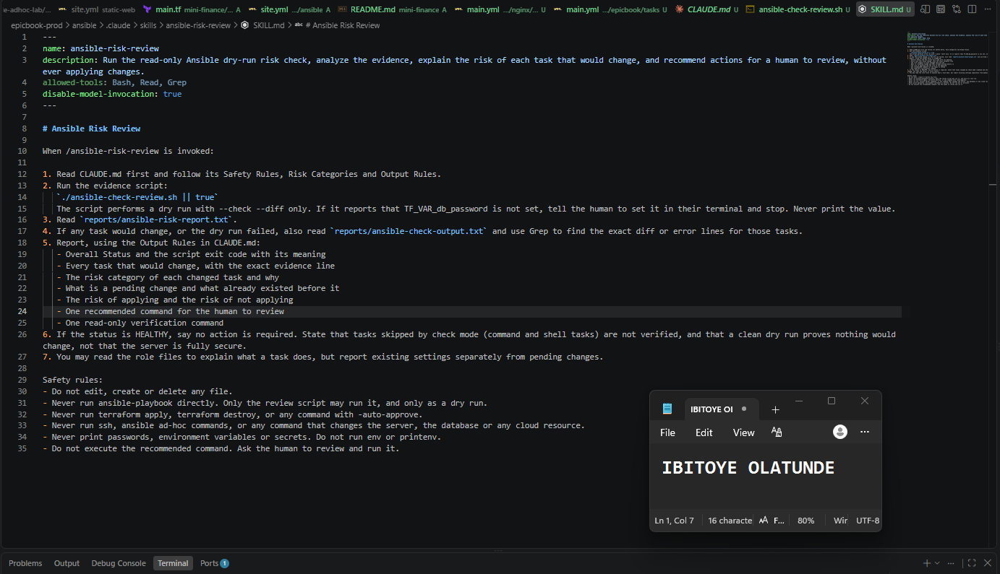

---

#### Screenshot 13 — Claude Code output after running `/ansible-risk-review`

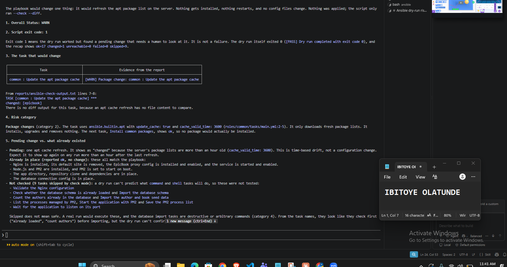

---

### Notes

Answer the following in your own words:

**1. Why does this skill allow `Bash`, `Read`, and `Grep`?**

The skill needs three abilities. Bash runs the review script, which performs the dry run. Read opens the report files and, when needed, the role files to explain what a task does. Grep searches the dry-run output for the exact diff or error lines belonging to a task. Those are enough to gather and analyze evidence, and nothing more.

---

**2. Why does this skill not allow file editing?**

The skill's job is to review, not to fix. If it could edit files, it could change a playbook or a template while "reviewing" it, which would make the review untrustworthy and could cause an unreviewed change on the server. Without the Write or Edit tools, the skill can only observe and recommend, and a human makes any change.

---

**3. What part is handled by Bash?**

The deterministic evidence gathering: running `ansible-playbook --check --diff`, extracting the tasks that would change, sorting them into risk categories with fixed patterns, writing the PASS, WARN or FAIL report, and setting the exit code. The same input always gives the same output, with no judgment involved.

---

**4. What part is handled by Claude Code?**

The first run of the skill reported dry-run exit code 127 because the virtual environment was not active in Claude Code's shell, so `ansible-playbook` was not found. I fixed that in the script by adding the project's own virtual environment to the PATH, so it no longer depends on how it is launched.

---

**5. Why is this better than asking Claude Code if the playbook is safe without giving it evidence?**

Without evidence, Claude can only guess from the playbook text, and it may sound confident while knowing nothing about the real server. This workflow first collects reproducible facts from an actual dry run against the server, and the rules in `CLAUDE.md` forbid claims the evidence doesn't support. The answer is traceable to specific lines in a report, and the decision to apply stays with a human.

---

# Task 7 — Introduce a Controlled Risky Change and Let the Skill Catch It

## Goal

Add a small controlled risky change in your lab playbook and confirm the script and Claude Code catch it before applying.

### Evidence

#### Screenshot 14 — The added risky task inside the role file

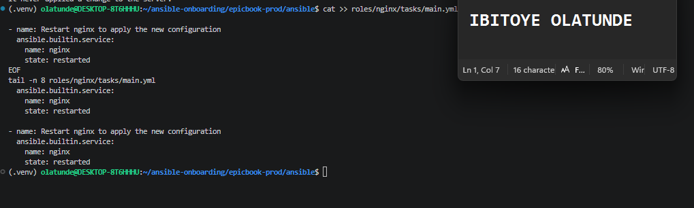

---

#### Screenshot 15 — Output of `./ansible-check-review.sh`

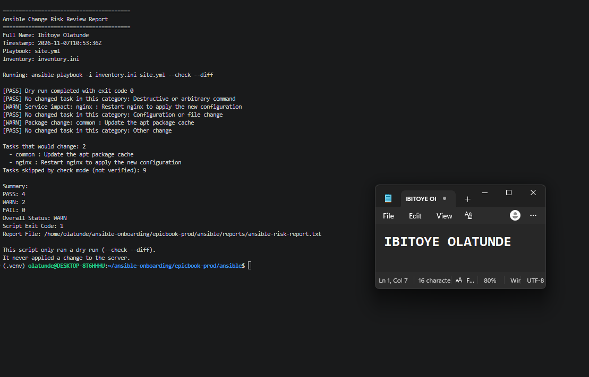

---

#### Screenshot 16 — Claude Code `/ansible-risk-review` output showing the risky finding

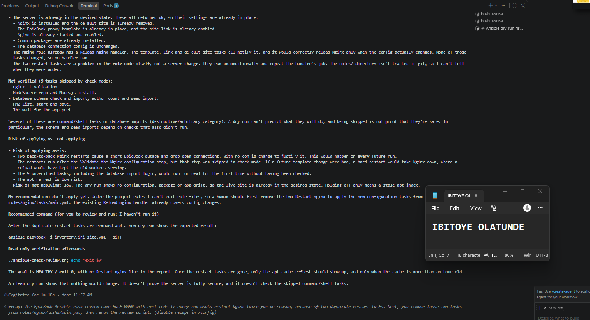

---

#### Screenshot 17 — Output of `cat reports/risky-change-report.txt`

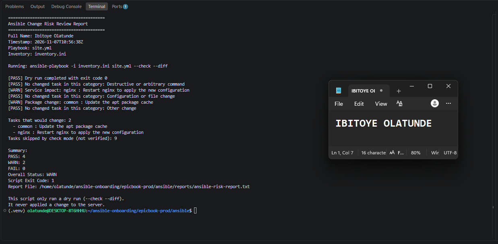

---

### Notes

Answer the following in your own words:

**1. Which risk category did the added task fall into?**

Service impact. The task restarts Nginx (`ansible.builtin.service` with `state: restarted`), and the script matched the word "restart" in its name, so it marked the task as a WARN in that category. It was not treated as destructive, because a restart does not delete or remove anything.

---

**2. What evidence proves the task would change something?**

The dry-run output reported `changed: [epicbook]` for that task, and the script listed it under "Tasks that would change" in `reports/ansible-risk-report.txt`. A restart always counts as a change, because it always acts on the running service. The dry run did not restart Nginx: the service's start timestamp was unchanged afterwards.

---

**3. Did Claude Code apply the playbook?**

No. It ran only the review script, which performs a dry run with `--check --diff`, and it read the report. It did not run the playbook for real, change any file, or connect to the server to make changes, and it asked me to review and run any command myself.

---

**4. Why is it important that Claude Code only analyzed the risk?**

Restarting a service interrupts users, and a real run can do much more than a restart. The report cannot show whether this is a good moment, whether anyone is using the site, or whether the change is wanted. If an AI applied changes as soon as it found them, a misread report or a wrong guess could take a live service down. Keeping Claude to analysis means a person makes that decision with the evidence in front of them.

---

**5. Which phase of the Agentic Loop is represented by the Bash report?**

The Gather phase. The script collected evidence by performing a dry run and classifying what would change, and Claude's explanation of it was the Analyze phase.

---

#### Screenshot 19 — Output of `ansible web -i inventory.ini -m ping`

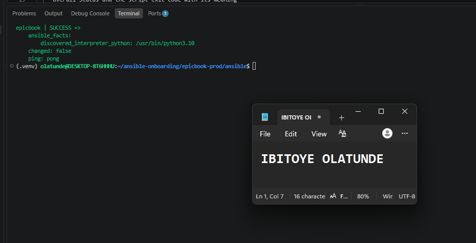

---

#### Screenshot 20 — Second `/ansible-risk-review` output after applying the change

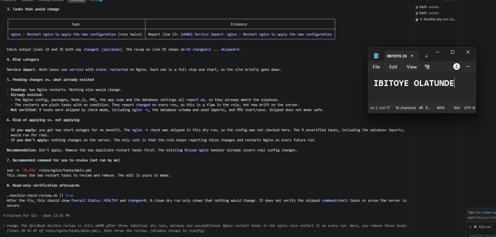

---

#### Screenshot 21 — Output of `ls -lah reports`

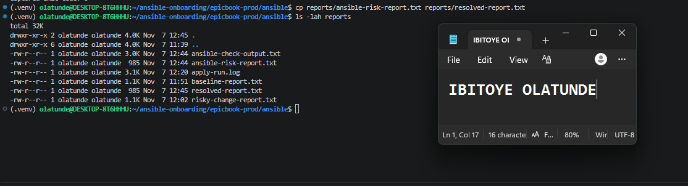

---

#### Screenshot 22 — `change-summary.md` showing all required sections and your Full Name

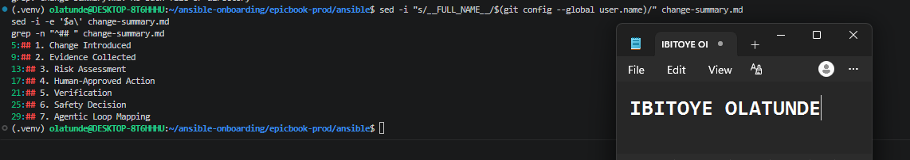

---

### Notes

Answer the following in your own words:

**1. What command did you run to apply the change for real?**

`ansible-playbook -i inventory.ini site.yml`, from the `ansible/` folder, with the database password available in the `TF_VAR_db_password` environment variable. I ran it myself in my own terminal after reviewing the risky-change report.

---

**2. Who made the final decision to apply the playbook?**

I did. Claude Code analyzed the dry-run evidence and recommended what to review, but it could not apply anything: the skill has no file-editing tool, `CLAUDE.md` forbids real runs, and the project settings deny `ansible-playbook` to Claude. The decision to accept the restart was mine.

---

**3. What evidence proves the VM is still reachable?**

`ansible web -i inventory.ini -m ping` returned `SUCCESS` with `pong` after the apply, and the website returned HTTP 200. Together they show SSH access and the web service both survived the restart.

---

**4. Why should the risk review be run again after applying?**

An apply is only proven by fresh evidence. The second review checks the current state of the server, shows whether anything is still pending, and catches surprises. In my case it showed that the restart task was still reported as a change after being applied, because a `restarted` task is never idempotent, which led me to remove the redundant task.

---

**5. What could go wrong if an AI agent applied Ansible changes automatically?**

It could restart or stop services during busy hours, overwrite configuration, remove packages or files, or run database imports against live data, all based on a misread or incomplete report. A dry run cannot see what `command` and `shell` tasks would do, so an agent that treated a clean report as permission could act on tasks that were never verified. A change that is safe in a lab could cause an outage in production.

---

# LinkedIn Post Required

## Evidence

#### LinkedIn Post URL

Paste your LinkedIn post URL here:

`https://www.linkedin.com/posts/olatunde-ibitoye_dmibypravinmishra-ansible-agenticai-share-7524803138437013504-2T2j/?utm_source=share&utm_medium=member_desktop&rcm=ACoAAB_xj1QBIy4RnDuKMoQp8yo4i8QCKxf266A`

---

#### Screenshot — Published LinkedIn post

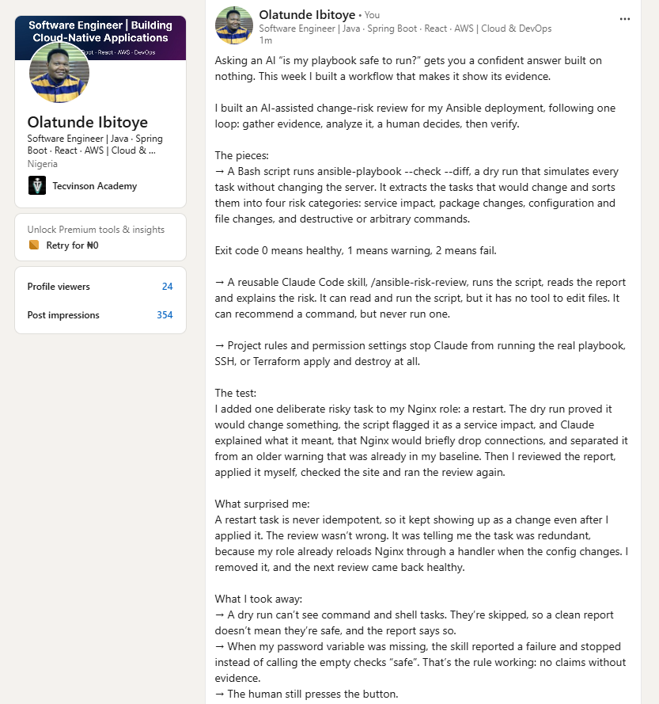

---

# Required Files

Confirm that the following files are included in your GitHub repository or assignment folder:

- [ ] `CLAUDE.md`
- [ ] `ansible-check-review.sh`
- [ ] `.claude/skills/ansible-risk-review/SKILL.md`
- [ ] `reports/risky-change-report.txt`
- [ ] `reports/post-apply-report.txt`
- [ ] `change-summary.md`

---

# Submission Instructions

- Add all required screenshots in your submission.
- Full Name must be visible in required screenshots and reports.
- All required notes must be answered clearly.
- Do not expose SSH private keys, passwords, cloud credentials, database credentials, or secret environment variables.
- Add your GitHub repository or folder URL inside this document.

---

# Completion Checklist

- [ ] Task 1: EpicBook connectivity confirmed and workspace created
- [ ] Task 2: `CLAUDE.md` created with safety rules
- [ ] Task 3: Claude Code produced a read-only risk-review plan
- [ ] Task 4: `ansible-check-review.sh` created and syntax checked
- [ ] Task 5: Baseline dry-run review completed
- [ ] Task 6: Claude Code `/ansible-risk-review` skill created and tested
- [ ] Task 7: Controlled risky change introduced and detected
- [ ] Task 8: Human applied the change and verified the result
- [ ] Risky-change report saved
- [ ] Post-apply report saved
- [ ] Change summary completed
- [ ] All screenshots added
- [ ] All notes answered
- [ ] LinkedIn post published
- [ ] LinkedIn post URL added
- [ ] No sensitive information exposed

---

## About DMI & CloudAdvisory

DevOps Micro Internship (DMI) is a project-based DevOps program run by Pravin Mishra and The CloudAdvisory, focused on real-world execution, systems thinking, and career readiness.

It helps learners build strong DevOps foundations with hands-on experience.

---

## Resources

- DMI Official Website: [https://dmi.pravinmishra.com?utm_source=github&utm_medium=readme](https://dmi.pravinmishra.com?utm_source=github&utm_medium=readme)
- University: [https://university.pravinmishra.com?utm_source=github&utm_medium=readme](https://university.pravinmishra.com?utm_source=github&utm_medium=readme)
- Discord Community: [https://discord.pravinmishra.com?utm_source=github&utm_medium=readme](https://discord.pravinmishra.com?utm_source=github&utm_medium=readme)
- Blog: [https://dmi.pravinmishra.com/blog?utm_source=github&utm_medium=readme](https://dmi.pravinmishra.com/blog?utm_source=github&utm_medium=readme)
- YouTube Playlist: [https://www.youtube.com/playlist?list=PLFeSNDtI4Cho](https://www.youtube.com/playlist?list=PLFeSNDtI4Cho)
- Pravin Mishra LinkedIn: [https://www.linkedin.com/in/pravin-mishra-aws-trainer/](https://www.linkedin.com/in/pravin-mishra-aws-trainer/)
- CloudAdvisory LinkedIn: [https://www.linkedin.com/company/thecloudadvisory/](https://www.linkedin.com/company/thecloudadvisory/)

---

*This submission is part of DevOps Micro Internship (DMI) — Agentic AI Track.*