# Assignment 5 — AI-Assisted Azure DevOps Dual-Pipeline Failure Triage

Part of the DevOps Micro Internship (DMI) — Agentic AI Track

---

## Student Information

**Full Name:** [Ibitoye Olatunde]

**GitHub Repository or Fork URL:** [https://github.com/horlartundhey/theepicbook]

**Public LinkedIn Post URL:** [[https://www.linkedin.com/posts/olatunde-ibitoye_dmibypravinmishra-claudecode-azuredevops-ugcPost-7531335286933499904-htEP/?utm_source=share&utm_medium=member_desktop&rcm=ACoAAB_xj1QBIy4RnDuKMoQp8yo4i8QCKxf266A](https://www.linkedin.com/posts/olatunde-ibitoye_dmibypravinmishra-claudecode-azuredevops-ugcPost-7531335286933499904-htEP/?utm_source=share&utm_medium=member_desktop&rcm=ACoAAB_xj1QBIy4RnDuKMoQp8yo4i8QCKxf266A)]

---

## Purpose

In this assignment, I configured an AI-assisted, read-only failure-triage workflow for the EpicBook Infrastructure and Application Pipelines. The workflow uses Bash to gather Azure DevOps pipeline evidence and Claude Code to analyze the evidence and recommend a recovery action while keeping all changes under human control.

---

# Task 0 — Verify Tools, Authentication, and Pipeline Details

## Goal

Verify the required tools, Azure DevOps authentication, organization and project details, and numeric pipeline IDs.

No screenshot is required for this task.

---

# Task 1 — Capture the Healthy Baseline and Prepare the Supplied Files

## Goal

Confirm that both EpicBook pipelines are healthy and place the supplied assignment files in the correct repository locations.

## Evidence

### Screenshot 1 — Healthy Baseline for Both Pipelines

Terminal output showing the latest completed Infrastructure and Application Pipeline runs with successful results.

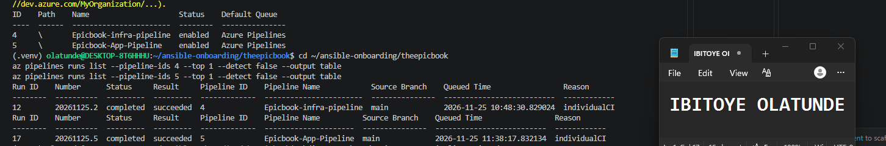

## Notes

### 1. What proves that both pipelines were healthy before the drill?

[The Azure DevOps CLI returned the latest run of each pipeline directly from the API. The Infrastructure Pipeline's run 12 (20261125.2) and the Application Pipeline's run 17 (20261125.5) both show Status completed and Result succeeded on the main branch. The deployed EpicBook site was also running and reachable at the same time. Later, the triage script confirmed it too, with both pipelines marked PASS, Overall Status: HEALTHY and exit code 0.]

### 2. Why is a healthy baseline necessary before introducing a controlled failure?

[Without a known-good starting point, I couldn't tell whether a failure found later was caused by my deliberate change or already existed. With the baseline proven, any failure the triage finds afterwards can be attributed to the drill. It also shows that the triage tooling reports HEALTHY correctly when nothing is wrong, so a failure report later can be trusted as a real detection rather than a false alarm.]

---

# Task 2 — Configure and Review the Supplied CLAUDE.md

## Goal

Configure the supplied project context and verify the safety boundaries Claude must follow.

## Evidence

### Screenshot 2 — CLAUDE.md Context and Safety Rules

`CLAUDE.md` open in the editor with the Project Overview, Incident Workflow, Safety Rules, and Output Rules visible.

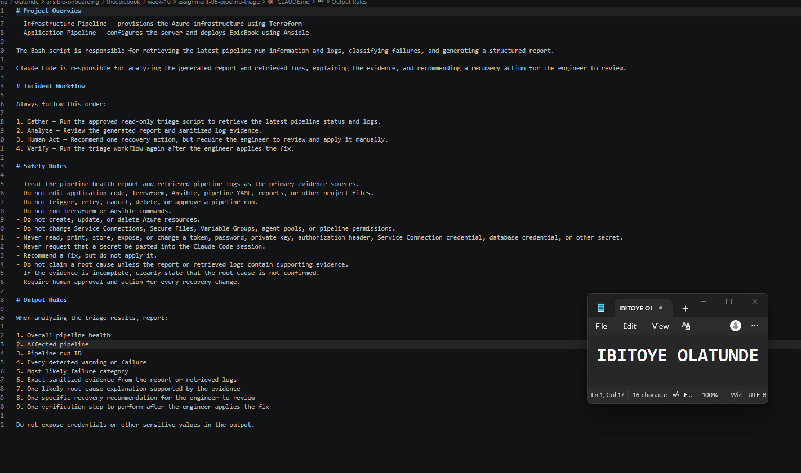

## Notes

### 1. Why does Claude need project-specific operational context?

[Claude doesn't know my environment by default. CLAUDE.md tells it there are two pipelines, that Terraform builds the infrastructure and Ansible deploys the app, and what order to work in. With that, it can tell an infrastructure failure from an application one and give relevant advice instead of generic guesses, and it follows the same reporting format every time.]

### 2. Which rules keep the human responsible for the recovery action?

[Recommend a fix, but do not apply it", "Require human approval and action for every recovery change", and the Incident Workflow itself, where step 3 is "Human Act". Also the rules against editing any project file and against triggering, retrying, cancelling, deleting or approving a pipeline run.]

### 3. Which rules protect pipeline credentials and application secrets?

["Never read, print, store, expose, or change a token, password, private key, authorization header, Service Connection credential, database credential, or other secret"; "Never request that a secret be pasted into the Claude Code session"; and the rule against changing Service Connections, Secure Files, Variable Groups, agent pools or pipeline permissions. The output rule "Do not expose credentials or other sensitive values in the output" backs this up.]

---

# Task 3 — Configure and Validate the Supplied Pipeline Triage Script

## Goal

Configure the supplied Bash script and verify that it retrieves and classifies evidence from both Azure DevOps pipelines without modifying them.

## Evidence

### Screenshot 3 — Pipeline Triage Script Configuration

Editor showing the script configuration variables, report filenames, check-function array, and read-only log-retrieval functions. Ensure that no token is visible.

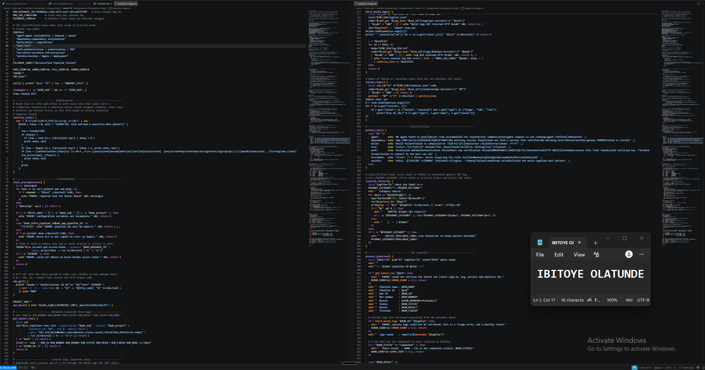

---

### Screenshot 4 — Script Validation

Terminal showing successful Bash syntax validation and executable file permission.

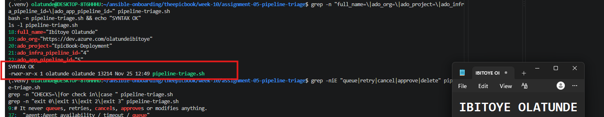

## Notes

### 1. Why are pipeline metadata and step console logs handled separately?

[Metadata (run ID, branch, status, result) says what happened, and it comes from one Azure DevOps list call. The console logs say why, and they come from a different API that returns one log per step. Keeping them apart means the script can still report a pipeline's state if the log download fails, and it can mark that log failure as a triage error instead of a healthy result.]

### 2. How does the script obtain the actual console logs?

[It gets an Azure DevOps access token from the signed-in Azure CLI, held in memory only and never printed. It then calls the Build Logs API with GET requests to list the logs of the run and downloads each one, sanitizes it and saves it under reports/.]

### 3. How does the check-function array control the classification loop?

[The CHECKS array lists the categories in priority order (agent, dependency, build, test, authentication, Terraform, Ansible). The loop takes each entry, looks up its pattern and counts matching log lines. The first category that matches becomes the most likely category, and the full table shows every category that matched.]

### 4. What prevents a failed but unmatched run from being reported as healthy?

[A failed result always counts as a FAIL. If no known pattern matches, the script falls back to "Unclassified Pipeline Failure", so it never shows a failed run as passing. A run that isn't completed is a WARN, and API or sign-in problems are errors (exit 3), never healthy.]

### 5. Why are different exit codes useful to another automation tool?

[A scheduler or CI job can branch on the code without parsing text: 0 means do nothing, 1 means wait and re-check, 2 means alert someone about a failure, and 3 means the monitoring itself is broken and needs fixing.]

---

# Task 4 — Run and Understand the Healthy-State Report

## Goal

Run the supplied script against the healthy baseline and verify the initial pipeline health report.

## Evidence

### Screenshot 5 — Healthy Pipeline Report

Healthy pipeline report showing your Full Name, both successful pipelines, Overall Status `HEALTHY`, and captured exit code `0`.

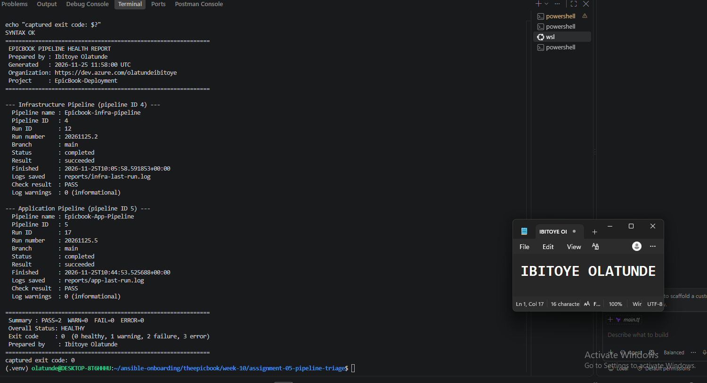

## Notes

### 1. What evidence proves that both pipelines are healthy?

[The report shows both latest runs as completed and succeeded on main, both checks as PASS, a summary of PASS=2 WARN=0 FAIL=0 ERROR=0, Overall Status: HEALTHY and exit code 0.]

### 2. Why must the baseline exit code be verified before the incident drill?

[It proves the script works and reports healthy correctly when nothing is wrong. After the drill, a changed exit code (2) can then be attributed to the failure I introduced, not to a script or configuration problem.]

---

# Task 5 — Configure and Test the Supplied /pipeline-triage Skill

## Goal

Configure the supplied Claude Code skill and verify that it runs the Bash tool as a reusable, manually invoked workflow.

## Evidence

### Screenshot 6 — Pipeline-Triage Skill Definition

`SKILL.md` showing the frontmatter, manual-invocation setting, narrowly scoped tools, safety rules, and required output structure.

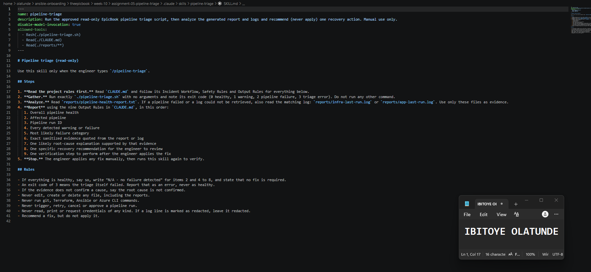

---

### Screenshot 7 — Healthy Skill Result

Healthy `/pipeline-triage` result showing that both pipelines are healthy and no fix is required.

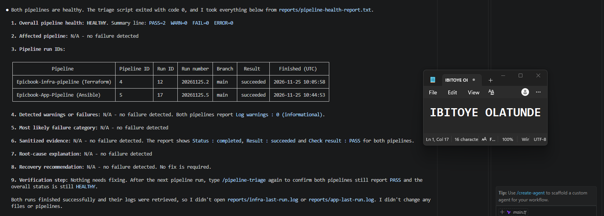

## Notes

### 1. Why is `disable-model-invocation: true` appropriate for this skill?

[The skill runs a command against live Azure DevOps. With this flag, Claude can't start it on its own in the middle of another conversation. Only I can, by typing /pipeline-triage, so every run is a deliberate human decision.]

### 2. Why should the skill avoid broad Bash approval?

[A broad grant like Bash(*) would let Claude run any command, including ones that change pipelines or files. The skill only pre-approves the single command ./pipeline-triage.sh and read access to CLAUDE.md and reports/, so a mistake or a prompt injection in a log has very little it can do.]

### 3. What work is performed by Bash, and what work is performed by Claude?

[Bash (the script) does the mechanical work: it queries Azure DevOps, downloads and sanitizes the logs, classifies failures and writes the report. Claude reads that evidence, explains it, picks the most likely cause and recommends one fix for me to review.]

### 4. Why are permission rules required in addition to written safety instructions?

[Written instructions are guidance that a model can misread or be talked out of. The permission rules (.claude/settings.json deny rules and the skill's allowed-tools) are enforced by Claude Code itself, so Edit, Write, git, az, Terraform and Ansible are blocked regardless of what Claude decides.]

---

# Task 6 — Introduce a Safe Failure in the Application Pipeline

## Goal

Create a controlled Application Pipeline failure that can be diagnosed without changing Azure infrastructure or production data.

## Evidence

### Screenshot 8 — Controlled Application Pipeline Failure

Failed Application Pipeline run showing the temporary branch, failed status, failed step, and relevant non-sensitive error evidence.

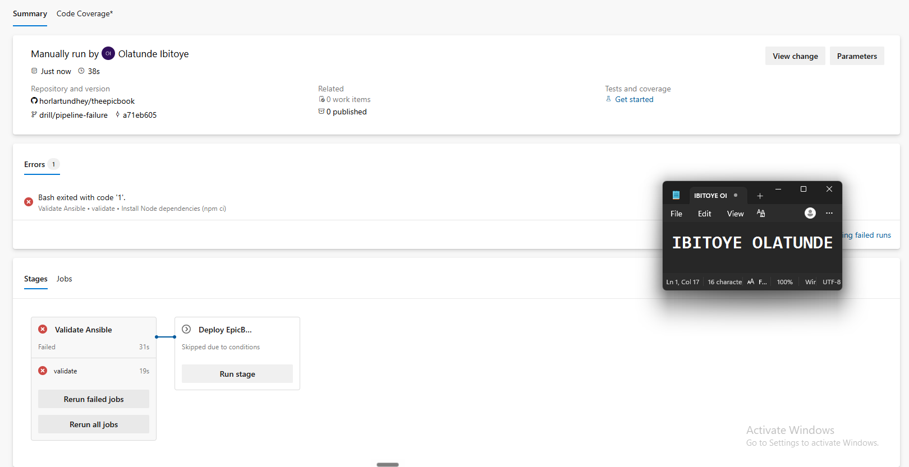

## Notes

### 1. What exact failure did you introduce?

[I added a dependency that doesn't exist, "not-a-real-package-xyz": "1.0.0", to package.json on the temporary branch drill/pipeline-failure. npm ci fails because it isn't in package-lock.json and can't be resolved.]

### 2. Which category should detect it?

[Dependency installation.]

### 3. Why is the failure safe and easily reversible?

[It occurs in the Validate stage, before any deployment step, and only on a temporary branch, so Azure resources, the VMs, the database and the running app aren't touched. Reverting is one git revert of a single commit.]

### 4. How did you prevent the deliberate failure from reaching `main` or changing the deployed application?

[I used a separate branch, never merged it, queued the pipeline manually against that branch, and made the Deploy stage conditional on main, so a drill branch can never deploy. The failed Validate stage also skips Deploy.]

---

# Task 7 — Diagnose and Save the Incident Evidence

## Goal

Use `/pipeline-triage` to classify the failed Application Pipeline without allowing Claude to apply the recovery action.

## Evidence

### Screenshot 9 — Failed-State Diagnosis and Incident Report

`/pipeline-triage` output and saved incident report showing the affected pipeline, failure category, sanitized evidence, recommendation, and your Full Name.

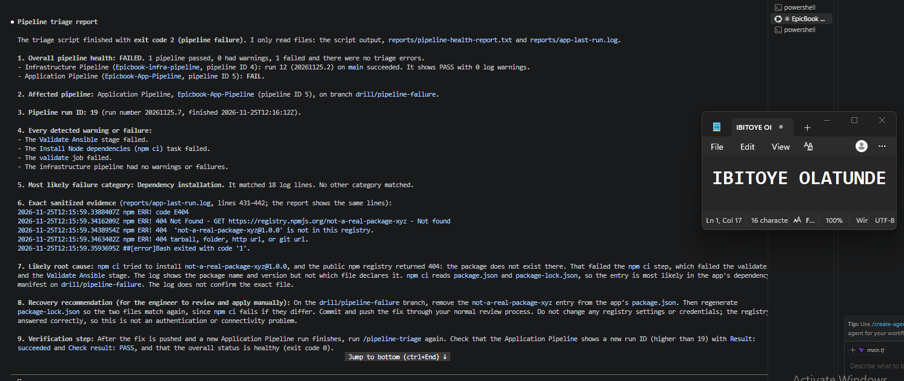
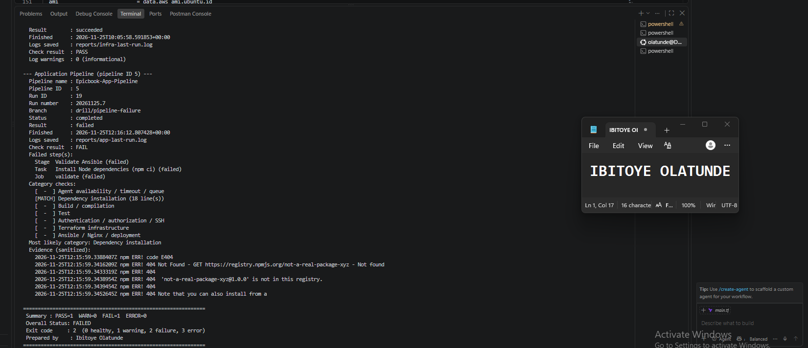

## Notes

### 1. Which failure category was identified?

[Dependency installation.]

### 2. What exact evidence supported the diagnosis?

[The Validate stage failed at the Install Node dependencies (npm ci) step, and the sanitized log shows `npm ERR! code E404`, `npm ERR! 404 Not Found - GET https://registry.npmjs.org/not-a-real-package-xyz - Not found` and `npm ERR! 404 'not-a-real-package-xyz@1.0.0' is not in this registry.` The report matched 18 log lines to the Dependency installation category and no other category.]

### 3. Did Claude apply the fix or rerun the pipeline? Why is that important?

[No. Claude only diagnosed and recommended. That matters because an automatic fix could be wrong or could change production, and the human stays accountable. Claude's wrong guess about a pipeline never turns into an unreviewed change.]

### 4. Which part represents Gather, and which part represents Analyze?

[Gather is pipeline-triage.sh, which queried Azure DevOps, downloaded and sanitized the logs and wrote the report. Analyze is Claude reading that report and logs, classifying the failure and recommending a fix.]

---

# Task 8 — Apply the Human-Reviewed Fix and Verify Recovery

## Goal

Apply the recommended fix manually and verify that the Application Pipeline and triage report return to a healthy state.

## Evidence

### Screenshot 10 — Corrected Application Pipeline Run

Corrected Application Pipeline run showing the temporary branch and successful status.

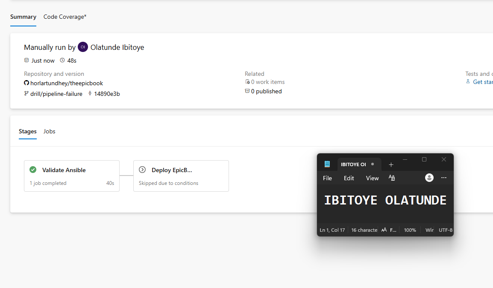

---

### Screenshot 11 — Recovery Triage Result

Recovery `/pipeline-triage` output showing Overall Status `HEALTHY`, exit code `0`, your Full Name, and both saved report filenames.

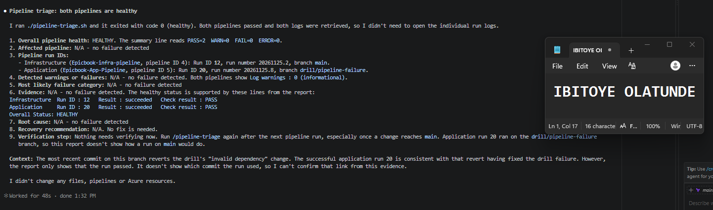

## Notes

### 1. What exact fix did you apply?

[I reverted the drill commit with git revert on drill/pipeline-failure, which removed the invalid not-a-real-package-xyz dependency from package.json, then pushed and re-queued the pipeline.]

### 2. Did the fix match Claude’s recommendation? Explain briefly.

[Yes. Claude identified the non-existent dependency as the cause and recommended removing or correcting it. Reverting the commit does exactly that.]

### 3. What evidence proves that the pipeline recovered?

[The new run on the drill branch is completed and succeeded (Validate passes, Deploy is skipped by design), and the recovery triage reports HEALTHY with exit code 0.]

### 4. Why is a second triage run required after the pipeline becomes green?

[A green pipeline is only one signal. The second triage confirms with the same independent tooling that the latest run is healthy and that the failure category is gone, so recovery is measured the same way the failure was detected.]

### 5. What risk would be created if Claude could automatically edit, push, approve, and rerun the pipeline?

[A wrong or manipulated diagnosis could be pushed and deployed without a human seeing it. Claude could also reinforce its own mistake by approving and rerunning, and with deploy rights it could change production or expose credentials with no review or audit trail.]

---

# LinkedIn Post — Mandatory

## LinkedIn Post URL

[[https://www.linkedin.com/posts/olatunde-ibitoye_dmibypravinmishra-claudecode-azuredevops-ugcPost-7531335286933499904-htEP/?utm_source=share&utm_medium=member_desktop&rcm=ACoAAB_xj1QBIy4RnDuKMoQp8yo4i8QCKxf266A](https://www.linkedin.com/posts/olatunde-ibitoye_dmibypravinmishra-claudecode-azuredevops-ugcPost-7531335286933499904-htEP/?utm_source=share&utm_medium=member_desktop&rcm=ACoAAB_xj1QBIy4RnDuKMoQp8yo4i8QCKxf266A)]

**Blog Post URL:** https://dev.to/horlartundhey/i-let-claude-code-triage-my-failing-cicd-pipeline-but-never-fix-it-ije

## Evidence

### Screenshot 12 — Published LinkedIn Post

Published LinkedIn post showing its text and at least one image or link.

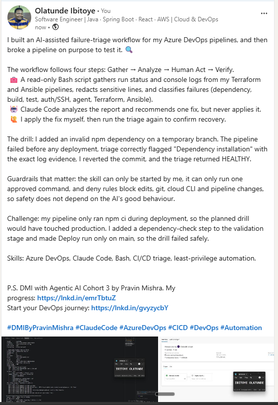

---

# Required Repository Files

Confirm that the following files are available in your repository:

* [ ] `CLAUDE.md`
* [ ] `pipeline-triage.sh`
* [ ] `.claude/skills/pipeline-triage/SKILL.md`
* [ ] `reports/incident-failure-report.txt`
* [ ] `reports/recovery-report.txt`

---

# Submission Instructions

* Complete all tasks in sequence.
* Include all 12 required screenshots.
* Answer every Notes question in your own words.
* Include your GitHub repository or fork URL.
* Include your public LinkedIn post URL.
* Ensure your Full Name appears in the required reports.
* Do not include raw logs containing sensitive information.
* Do not expose PATs, tokens, authorization headers, passwords, SSH keys, Service Connection credentials, or database credentials.

---

# Completion Checklist

* [ ] Both Azure DevOps pipelines were healthy before the drill.
* [ ] The supplied files were copied to the correct repository locations.
* [ ] Only the required student-specific placeholders were updated.
* [ ] `CLAUDE.md` contains the required context and safety rules.
* [ ] `pipeline-triage.sh` passed Bash syntax validation.
* [ ] The script has executable permission.
* [ ] The script uses read-only Azure DevOps operations.
* [ ] The script retrieves pipeline metadata and console logs.
* [ ] No token or password is stored in the script.
* [ ] The healthy baseline reported `HEALTHY` with exit code `0`.
* [ ] `/pipeline-triage` was invoked manually.
* [ ] The skill does not have broad Bash approval.
* [ ] The controlled failure affected only the Application Pipeline.
* [ ] The failure occurred before deployment changes were applied.
* [ ] The deliberate failure was not merged into `main`.
* [ ] The failed-state report was saved before applying the fix.
* [ ] Claude diagnosed the failure but did not apply the fix.
* [ ] The fix was reviewed and applied manually.
* [ ] The corrected Application Pipeline completed successfully.
* [ ] The recovery triage reported `HEALTHY` with exit code `0`.
* [ ] `incident-failure-report.txt` exists.
* [ ] `recovery-report.txt` exists.
* [ ] All Notes questions have been answered.
* [ ] All 12 screenshots have been added.
* [ ] The GitHub repository or fork URL has been included.
* [ ] The LinkedIn post is public.
* [ ] The LinkedIn post URL has been included.
* [ ] No sensitive information is exposed.

---

# Final Submission

**Full Name:** Ibitoye Olatunde

**GitHub Repository or Fork URL:** https://github.com/horlartundhey/theepicbook

**LinkedIn Post URL:** https://www.linkedin.com/posts/olatunde-ibitoye_dmibypravinmishra-claudecode-azuredevops-ugcPost-7531335286933499904-htEP/

**Blog Post:** [I Let Claude Code Triage My Failing CI/CD Pipeline (But Never Fix It)](https://dev.to/horlartundhey/i-let-claude-code-triage-my-failing-cicd-pipeline-but-never-fix-it-ije)

---

*This submission is part of the DevOps Micro Internship (DMI) — Agentic AI Track.*
